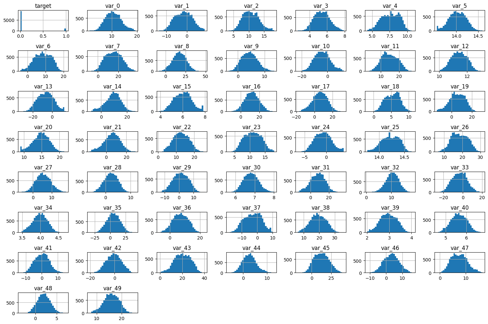
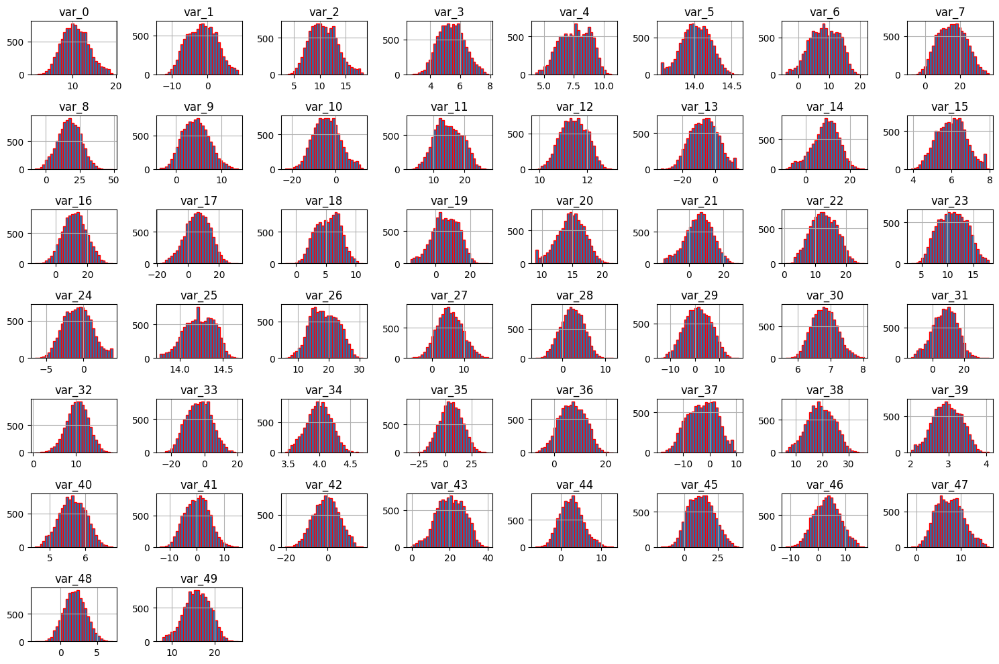
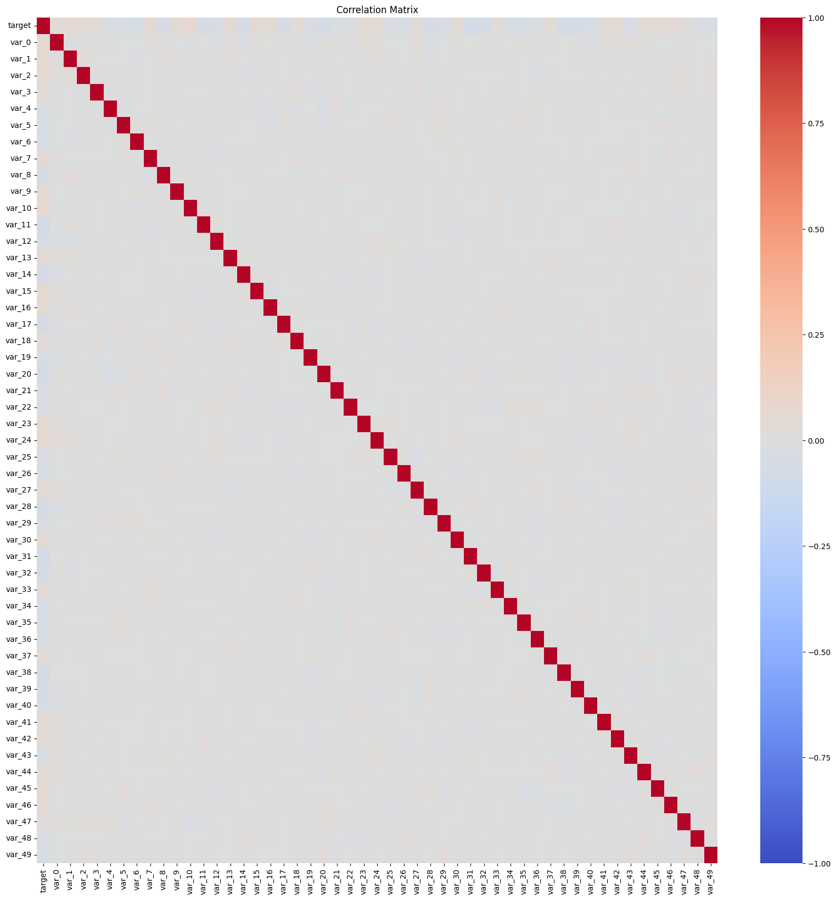
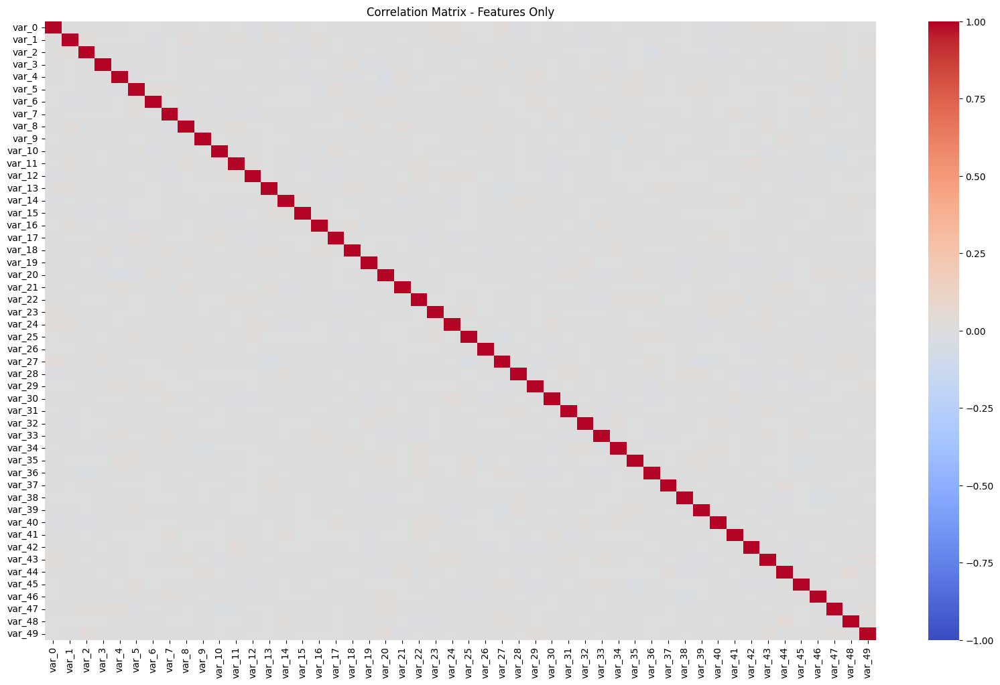
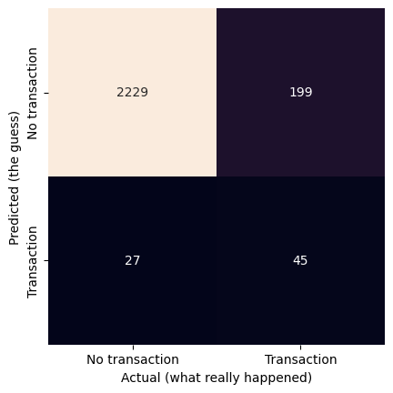

# Project 1 – Pass-03


## Problem Definition


Business problem: Predict whether a customer will make a transaction,

Data Science problem: This is a supervised learning and classification problem. I will use the Gaussian Naive Bayes model


## Data Collection

### Imports


```python
import pandas as pd
import matplotlib.pyplot as plt
import numpy as np
import seaborn as sns

from sklearn.naive_bayes import GaussianNB
from sklearn.model_selection import train_test_split
from sklearn import datasets, metrics, model_selection
```

### File Paths


```python
url = 'https://ddc-datascience.s3.amazonaws.com/Projects/Project.1-Transactions/Data/Transaction.train.csv'
```

### Load data


```python
#load data
transaction_df= pd.read_csv(url)
```

### Head


```python
# first few rows
transaction_df.head()
```


  <div id="df-0fbf3497-1b26-4c8c-8977-7252991feb3f" class="colab-df-container">
    <div>
<style scoped>
    .dataframe tbody tr th:only-of-type {
        vertical-align: middle;
    }

    .dataframe tbody tr th {
        vertical-align: top;
    }

    .dataframe thead th {
        text-align: right;
    }
</style>
<table border="1" class="dataframe">
  <thead>
    <tr style="text-align: right;">
      <th></th>
      <th>Unnamed: 0</th>
      <th>ID_code</th>
      <th>target</th>
      <th>var_0</th>
      <th>var_1</th>
      <th>var_2</th>
      <th>var_3</th>
      <th>var_4</th>
      <th>var_5</th>
      <th>var_6</th>
      <th>...</th>
      <th>var_40</th>
      <th>var_41</th>
      <th>var_42</th>
      <th>var_43</th>
      <th>var_44</th>
      <th>var_45</th>
      <th>var_46</th>
      <th>var_47</th>
      <th>var_48</th>
      <th>var_49</th>
    </tr>
  </thead>
  <tbody>
    <tr>
      <th>0</th>
      <td>0</td>
      <td>train_0</td>
      <td>0</td>
      <td>8.9255</td>
      <td>-6.7863</td>
      <td>11.9081</td>
      <td>5.1187</td>
      <td>5.7470</td>
      <td>14.0137</td>
      <td>0.5745</td>
      <td>...</td>
      <td>5.4879</td>
      <td>-4.7645</td>
      <td>3.1531</td>
      <td>18.5618</td>
      <td>1.7202</td>
      <td>25.8398</td>
      <td>4.4354</td>
      <td>3.9642</td>
      <td>3.1364</td>
      <td>12.7803</td>
    </tr>
    <tr>
      <th>1</th>
      <td>1</td>
      <td>train_1</td>
      <td>0</td>
      <td>11.5006</td>
      <td>-4.1473</td>
      <td>13.8588</td>
      <td>5.6208</td>
      <td>8.0851</td>
      <td>14.0239</td>
      <td>8.4135</td>
      <td>...</td>
      <td>5.7999</td>
      <td>5.5378</td>
      <td>5.5134</td>
      <td>30.2645</td>
      <td>11.0752</td>
      <td>22.5441</td>
      <td>7.6421</td>
      <td>7.7214</td>
      <td>2.5837</td>
      <td>18.3560</td>
    </tr>
    <tr>
      <th>2</th>
      <td>2</td>
      <td>train_2</td>
      <td>0</td>
      <td>8.6093</td>
      <td>-2.7457</td>
      <td>12.0805</td>
      <td>6.9427</td>
      <td>5.9525</td>
      <td>14.1929</td>
      <td>7.3124</td>
      <td>...</td>
      <td>5.7690</td>
      <td>-7.0927</td>
      <td>-5.8234</td>
      <td>25.6820</td>
      <td>2.4013</td>
      <td>23.0866</td>
      <td>2.9057</td>
      <td>9.7905</td>
      <td>1.6704</td>
      <td>14.7222</td>
    </tr>
    <tr>
      <th>3</th>
      <td>3</td>
      <td>train_3</td>
      <td>0</td>
      <td>11.0604</td>
      <td>-2.1518</td>
      <td>8.9522</td>
      <td>5.8428</td>
      <td>8.2450</td>
      <td>13.8463</td>
      <td>11.9704</td>
      <td>...</td>
      <td>5.3430</td>
      <td>-7.1541</td>
      <td>11.7134</td>
      <td>14.7483</td>
      <td>5.6961</td>
      <td>-0.4639</td>
      <td>4.4666</td>
      <td>4.7433</td>
      <td>0.7178</td>
      <td>17.9697</td>
    </tr>
    <tr>
      <th>4</th>
      <td>4</td>
      <td>train_4</td>
      <td>0</td>
      <td>9.8369</td>
      <td>-1.4834</td>
      <td>12.8746</td>
      <td>5.9405</td>
      <td>7.6784</td>
      <td>13.8481</td>
      <td>7.8895</td>
      <td>...</td>
      <td>5.5518</td>
      <td>1.4493</td>
      <td>2.3705</td>
      <td>18.4685</td>
      <td>5.1743</td>
      <td>11.8503</td>
      <td>-1.4905</td>
      <td>9.5214</td>
      <td>-0.1508</td>
      <td>17.9974</td>
    </tr>
  </tbody>
</table>
<p>5 rows × 53 columns</p>
</div>
    <div class="colab-df-buttons">

  <div class="colab-df-container">
    <button class="colab-df-convert" onclick="convertToInteractive('df-0fbf3497-1b26-4c8c-8977-7252991feb3f')"
            title="Convert this dataframe to an interactive table."
            style="display:none;">

  <svg xmlns="http://www.w3.org/2000/svg" height="24px" viewBox="0 -960 960 960">
    <path d="M120-120v-720h720v720H120Zm60-500h600v-160H180v160Zm220 220h160v-160H400v160Zm0 220h160v-160H400v160ZM180-400h160v-160H180v160Zm440 0h160v-160H620v160ZM180-180h160v-160H180v160Zm440 0h160v-160H620v160Z"/>
  </svg>
    </button>

  <style>
    .colab-df-container {
      display:flex;
      gap: 12px;
    }

    .colab-df-convert {
      background-color: #E8F0FE;
      border: none;
      border-radius: 50%;
      cursor: pointer;
      display: none;
      fill: #1967D2;
      height: 32px;
      padding: 0 0 0 0;
      width: 32px;
    }

    .colab-df-convert:hover {
      background-color: #E2EBFA;
      box-shadow: 0px 1px 2px rgba(60, 64, 67, 0.3), 0px 1px 3px 1px rgba(60, 64, 67, 0.15);
      fill: #174EA6;
    }

    .colab-df-buttons div {
      margin-bottom: 4px;
    }

    [theme=dark] .colab-df-convert {
      background-color: #3B4455;
      fill: #D2E3FC;
    }

    [theme=dark] .colab-df-convert:hover {
      background-color: #434B5C;
      box-shadow: 0px 1px 3px 1px rgba(0, 0, 0, 0.15);
      filter: drop-shadow(0px 1px 2px rgba(0, 0, 0, 0.3));
      fill: #FFFFFF;
    }
  </style>

    <script>
      const buttonEl =
        document.querySelector('#df-0fbf3497-1b26-4c8c-8977-7252991feb3f button.colab-df-convert');
      buttonEl.style.display =
        google.colab.kernel.accessAllowed ? 'block' : 'none';

      async function convertToInteractive(key) {
        const element = document.querySelector('#df-0fbf3497-1b26-4c8c-8977-7252991feb3f');
        const dataTable =
          await google.colab.kernel.invokeFunction('convertToInteractive',
                                                    [key], {});
        if (!dataTable) return;

        const docLinkHtml = 'Like what you see? Visit the ' +
          '<a target="_blank" href=https://colab.research.google.com/notebooks/data_table.ipynb>data table notebook</a>'
          + ' to learn more about interactive tables.';
        element.innerHTML = '';
        dataTable['output_type'] = 'display_data';
        await google.colab.output.renderOutput(dataTable, element);
        const docLink = document.createElement('div');
        docLink.innerHTML = docLinkHtml;
        element.appendChild(docLink);
      }
    </script>
  </div>


    </div>
  </div>


### Tail


```python
# last few rows
transaction_df.tail()
```


  <div id="df-bc3d8e14-2eb4-44b0-923d-67570f76780c" class="colab-df-container">
    <div>
<style scoped>
    .dataframe tbody tr th:only-of-type {
        vertical-align: middle;
    }

    .dataframe tbody tr th {
        vertical-align: top;
    }

    .dataframe thead th {
        text-align: right;
    }
</style>
<table border="1" class="dataframe">
  <thead>
    <tr style="text-align: right;">
      <th></th>
      <th>Unnamed: 0</th>
      <th>ID_code</th>
      <th>target</th>
      <th>var_0</th>
      <th>var_1</th>
      <th>var_2</th>
      <th>var_3</th>
      <th>var_4</th>
      <th>var_5</th>
      <th>var_6</th>
      <th>...</th>
      <th>var_40</th>
      <th>var_41</th>
      <th>var_42</th>
      <th>var_43</th>
      <th>var_44</th>
      <th>var_45</th>
      <th>var_46</th>
      <th>var_47</th>
      <th>var_48</th>
      <th>var_49</th>
    </tr>
  </thead>
  <tbody>
    <tr>
      <th>179995</th>
      <td>179995</td>
      <td>train_179995</td>
      <td>0</td>
      <td>8.9112</td>
      <td>-4.4900</td>
      <td>11.3795</td>
      <td>5.4164</td>
      <td>8.3309</td>
      <td>14.1869</td>
      <td>12.8219</td>
      <td>...</td>
      <td>5.9355</td>
      <td>5.1764</td>
      <td>-5.4817</td>
      <td>20.7390</td>
      <td>-0.8043</td>
      <td>31.3663</td>
      <td>8.7194</td>
      <td>4.7839</td>
      <td>0.9673</td>
      <td>14.9529</td>
    </tr>
    <tr>
      <th>179996</th>
      <td>179996</td>
      <td>train_179996</td>
      <td>0</td>
      <td>8.2722</td>
      <td>7.1923</td>
      <td>16.7300</td>
      <td>4.9698</td>
      <td>5.4907</td>
      <td>14.0238</td>
      <td>11.9933</td>
      <td>...</td>
      <td>5.3550</td>
      <td>-1.5556</td>
      <td>7.3839</td>
      <td>9.9193</td>
      <td>5.0860</td>
      <td>28.0185</td>
      <td>7.4145</td>
      <td>4.2814</td>
      <td>2.5575</td>
      <td>15.3969</td>
    </tr>
    <tr>
      <th>179997</th>
      <td>179997</td>
      <td>train_179997</td>
      <td>0</td>
      <td>12.4902</td>
      <td>-2.9379</td>
      <td>6.5901</td>
      <td>4.7242</td>
      <td>9.1423</td>
      <td>13.9133</td>
      <td>12.2314</td>
      <td>...</td>
      <td>6.0708</td>
      <td>-0.3463</td>
      <td>-5.0098</td>
      <td>20.4807</td>
      <td>5.9814</td>
      <td>20.2668</td>
      <td>3.1006</td>
      <td>3.7701</td>
      <td>0.1299</td>
      <td>16.1256</td>
    </tr>
    <tr>
      <th>179998</th>
      <td>179998</td>
      <td>train_179998</td>
      <td>0</td>
      <td>8.4894</td>
      <td>0.7048</td>
      <td>11.1518</td>
      <td>4.6370</td>
      <td>8.1321</td>
      <td>14.2921</td>
      <td>6.9582</td>
      <td>...</td>
      <td>5.5161</td>
      <td>3.1774</td>
      <td>-4.9374</td>
      <td>23.6365</td>
      <td>1.0432</td>
      <td>29.9365</td>
      <td>9.6381</td>
      <td>6.9649</td>
      <td>2.5546</td>
      <td>15.6760</td>
    </tr>
    <tr>
      <th>179999</th>
      <td>179999</td>
      <td>train_179999</td>
      <td>0</td>
      <td>11.6252</td>
      <td>3.3959</td>
      <td>11.5558</td>
      <td>4.2003</td>
      <td>7.4666</td>
      <td>13.7381</td>
      <td>12.9590</td>
      <td>...</td>
      <td>5.0415</td>
      <td>-2.4210</td>
      <td>-3.6829</td>
      <td>14.2422</td>
      <td>1.0741</td>
      <td>26.3943</td>
      <td>4.1482</td>
      <td>11.9539</td>
      <td>2.9846</td>
      <td>15.6002</td>
    </tr>
  </tbody>
</table>
<p>5 rows × 53 columns</p>
</div>
    <div class="colab-df-buttons">

  <div class="colab-df-container">
    <button class="colab-df-convert" onclick="convertToInteractive('df-bc3d8e14-2eb4-44b0-923d-67570f76780c')"
            title="Convert this dataframe to an interactive table."
            style="display:none;">

  <svg xmlns="http://www.w3.org/2000/svg" height="24px" viewBox="0 -960 960 960">
    <path d="M120-120v-720h720v720H120Zm60-500h600v-160H180v160Zm220 220h160v-160H400v160Zm0 220h160v-160H400v160ZM180-400h160v-160H180v160Zm440 0h160v-160H620v160ZM180-180h160v-160H180v160Zm440 0h160v-160H620v160Z"/>
  </svg>
    </button>

  <style>
    .colab-df-container {
      display:flex;
      gap: 12px;
    }

    .colab-df-convert {
      background-color: #E8F0FE;
      border: none;
      border-radius: 50%;
      cursor: pointer;
      display: none;
      fill: #1967D2;
      height: 32px;
      padding: 0 0 0 0;
      width: 32px;
    }

    .colab-df-convert:hover {
      background-color: #E2EBFA;
      box-shadow: 0px 1px 2px rgba(60, 64, 67, 0.3), 0px 1px 3px 1px rgba(60, 64, 67, 0.15);
      fill: #174EA6;
    }

    .colab-df-buttons div {
      margin-bottom: 4px;
    }

    [theme=dark] .colab-df-convert {
      background-color: #3B4455;
      fill: #D2E3FC;
    }

    [theme=dark] .colab-df-convert:hover {
      background-color: #434B5C;
      box-shadow: 0px 1px 3px 1px rgba(0, 0, 0, 0.15);
      filter: drop-shadow(0px 1px 2px rgba(0, 0, 0, 0.3));
      fill: #FFFFFF;
    }
  </style>

    <script>
      const buttonEl =
        document.querySelector('#df-bc3d8e14-2eb4-44b0-923d-67570f76780c button.colab-df-convert');
      buttonEl.style.display =
        google.colab.kernel.accessAllowed ? 'block' : 'none';

      async function convertToInteractive(key) {
        const element = document.querySelector('#df-bc3d8e14-2eb4-44b0-923d-67570f76780c');
        const dataTable =
          await google.colab.kernel.invokeFunction('convertToInteractive',
                                                    [key], {});
        if (!dataTable) return;

        const docLinkHtml = 'Like what you see? Visit the ' +
          '<a target="_blank" href=https://colab.research.google.com/notebooks/data_table.ipynb>data table notebook</a>'
          + ' to learn more about interactive tables.';
        element.innerHTML = '';
        dataTable['output_type'] = 'display_data';
        await google.colab.output.renderOutput(dataTable, element);
        const docLink = document.createElement('div');
        docLink.innerHTML = docLinkHtml;
        element.appendChild(docLink);
      }
    </script>
  </div>


    </div>
  </div>


### Shape


```python
# shape of data frame
transaction_df.shape

#output (# of rows, # of columns)
```


    (180000, 53)


### Size


```python
# size of data frame
transaction_df.size
```


    9540000


### Info


```python
# display meta-data
transaction_df.info()

```

    <class 'pandas.core.frame.DataFrame'>
    RangeIndex: 180000 entries, 0 to 179999
    Data columns (total 53 columns):
     #   Column      Non-Null Count   Dtype  
    ---  ------      --------------   -----  
     0   Unnamed: 0  180000 non-null  int64  
     1   ID_code     180000 non-null  object 
     2   target      180000 non-null  int64  
     3   var_0       180000 non-null  float64
     4   var_1       180000 non-null  float64
     5   var_2       180000 non-null  float64
     6   var_3       180000 non-null  float64
     7   var_4       180000 non-null  float64
     8   var_5       180000 non-null  float64
     9   var_6       180000 non-null  float64
     10  var_7       180000 non-null  float64
     11  var_8       180000 non-null  float64
     12  var_9       180000 non-null  float64
     13  var_10      180000 non-null  float64
     14  var_11      180000 non-null  float64
     15  var_12      180000 non-null  float64
     16  var_13      180000 non-null  float64
     17  var_14      180000 non-null  float64
     18  var_15      180000 non-null  float64
     19  var_16      180000 non-null  float64
     20  var_17      180000 non-null  float64
     21  var_18      180000 non-null  float64
     22  var_19      180000 non-null  float64
     23  var_20      180000 non-null  float64
     24  var_21      180000 non-null  float64
     25  var_22      180000 non-null  float64
     26  var_23      180000 non-null  float64
     27  var_24      180000 non-null  float64
     28  var_25      180000 non-null  float64
     29  var_26      180000 non-null  float64
     30  var_27      180000 non-null  float64
     31  var_28      180000 non-null  float64
     32  var_29      180000 non-null  float64
     33  var_30      180000 non-null  float64
     34  var_31      180000 non-null  float64
     35  var_32      180000 non-null  float64
     36  var_33      180000 non-null  float64
     37  var_34      180000 non-null  float64
     38  var_35      180000 non-null  float64
     39  var_36      180000 non-null  float64
     40  var_37      180000 non-null  float64
     41  var_38      180000 non-null  float64
     42  var_39      180000 non-null  float64
     43  var_40      180000 non-null  float64
     44  var_41      180000 non-null  float64
     45  var_42      180000 non-null  float64
     46  var_43      180000 non-null  float64
     47  var_44      180000 non-null  float64
     48  var_45      180000 non-null  float64
     49  var_46      180000 non-null  float64
     50  var_47      180000 non-null  float64
     51  var_48      180000 non-null  float64
     52  var_49      180000 non-null  float64
    dtypes: float64(50), int64(2), object(1)
    memory usage: 72.8+ MB


## Summary statistics

### Describe


```python
# display summary statistics
transaction_df.describe()

```


  <div id="df-350f1d7e-55f6-472f-b83d-0c6c8cf2f3b3" class="colab-df-container">
    <div>
<style scoped>
    .dataframe tbody tr th:only-of-type {
        vertical-align: middle;
    }

    .dataframe tbody tr th {
        vertical-align: top;
    }

    .dataframe thead th {
        text-align: right;
    }
</style>
<table border="1" class="dataframe">
  <thead>
    <tr style="text-align: right;">
      <th></th>
      <th>Unnamed: 0</th>
      <th>target</th>
      <th>var_0</th>
      <th>var_1</th>
      <th>var_2</th>
      <th>var_3</th>
      <th>var_4</th>
      <th>var_5</th>
      <th>var_6</th>
      <th>var_7</th>
      <th>...</th>
      <th>var_40</th>
      <th>var_41</th>
      <th>var_42</th>
      <th>var_43</th>
      <th>var_44</th>
      <th>var_45</th>
      <th>var_46</th>
      <th>var_47</th>
      <th>var_48</th>
      <th>var_49</th>
    </tr>
  </thead>
  <tbody>
    <tr>
      <th>count</th>
      <td>180000.000000</td>
      <td>180000.000000</td>
      <td>180000.000000</td>
      <td>180000.000000</td>
      <td>180000.000000</td>
      <td>180000.000000</td>
      <td>180000.000000</td>
      <td>180000.000000</td>
      <td>180000.00000</td>
      <td>180000.000000</td>
      <td>...</td>
      <td>180000.000000</td>
      <td>180000.000000</td>
      <td>180000.000000</td>
      <td>180000.000000</td>
      <td>180000.000000</td>
      <td>180000.000000</td>
      <td>180000.000000</td>
      <td>180000.000000</td>
      <td>180000.000000</td>
      <td>180000.000000</td>
    </tr>
    <tr>
      <th>mean</th>
      <td>89999.500000</td>
      <td>0.100222</td>
      <td>10.678650</td>
      <td>-1.630045</td>
      <td>10.712922</td>
      <td>5.408688</td>
      <td>7.566953</td>
      <td>14.024017</td>
      <td>8.52808</td>
      <td>15.243424</td>
      <td>...</td>
      <td>5.635897</td>
      <td>-0.000418</td>
      <td>-0.668334</td>
      <td>20.208845</td>
      <td>2.595090</td>
      <td>12.756574</td>
      <td>3.236201</td>
      <td>7.440715</td>
      <td>1.927078</td>
      <td>15.870166</td>
    </tr>
    <tr>
      <th>std</th>
      <td>51961.668564</td>
      <td>0.300297</td>
      <td>3.041036</td>
      <td>4.050519</td>
      <td>2.639146</td>
      <td>0.866265</td>
      <td>1.235043</td>
      <td>0.190038</td>
      <td>4.64170</td>
      <td>7.851050</td>
      <td>...</td>
      <td>0.369629</td>
      <td>4.422915</td>
      <td>5.968300</td>
      <td>7.132446</td>
      <td>2.801692</td>
      <td>9.320939</td>
      <td>4.561317</td>
      <td>3.021636</td>
      <td>1.476777</td>
      <td>3.010492</td>
    </tr>
    <tr>
      <th>min</th>
      <td>0.000000</td>
      <td>0.000000</td>
      <td>0.408400</td>
      <td>-15.043400</td>
      <td>2.117100</td>
      <td>2.347300</td>
      <td>3.970500</td>
      <td>13.434600</td>
      <td>-6.01110</td>
      <td>-10.664200</td>
      <td>...</td>
      <td>4.258800</td>
      <td>-14.506000</td>
      <td>-22.748700</td>
      <td>-2.995300</td>
      <td>-7.856100</td>
      <td>-18.489700</td>
      <td>-14.093300</td>
      <td>-2.691700</td>
      <td>-3.814500</td>
      <td>6.299300</td>
    </tr>
    <tr>
      <th>25%</th>
      <td>44999.750000</td>
      <td>0.000000</td>
      <td>8.451675</td>
      <td>-4.745600</td>
      <td>8.720000</td>
      <td>4.768500</td>
      <td>6.618800</td>
      <td>13.893900</td>
      <td>5.06575</td>
      <td>9.170200</td>
      <td>...</td>
      <td>5.374200</td>
      <td>-3.253575</td>
      <td>-4.997500</td>
      <td>15.062900</td>
      <td>0.628600</td>
      <td>5.661300</td>
      <td>-0.062000</td>
      <td>5.160325</td>
      <td>0.890000</td>
      <td>13.830400</td>
    </tr>
    <tr>
      <th>50%</th>
      <td>89999.500000</td>
      <td>0.000000</td>
      <td>10.526750</td>
      <td>-1.611250</td>
      <td>10.579600</td>
      <td>5.385600</td>
      <td>7.628500</td>
      <td>14.025500</td>
      <td>8.59920</td>
      <td>15.198900</td>
      <td>...</td>
      <td>5.634500</td>
      <td>0.008500</td>
      <td>-0.560300</td>
      <td>20.203300</td>
      <td>2.513800</td>
      <td>12.520300</td>
      <td>3.204650</td>
      <td>7.350950</td>
      <td>1.899700</td>
      <td>15.934600</td>
    </tr>
    <tr>
      <th>75%</th>
      <td>134999.250000</td>
      <td>0.000000</td>
      <td>12.756200</td>
      <td>1.360225</td>
      <td>12.514100</td>
      <td>6.003200</td>
      <td>8.583800</td>
      <td>14.164400</td>
      <td>12.27330</td>
      <td>21.010500</td>
      <td>...</td>
      <td>5.905600</td>
      <td>3.098325</td>
      <td>3.632525</td>
      <td>25.639125</td>
      <td>4.396725</td>
      <td>19.461725</td>
      <td>6.409900</td>
      <td>9.511125</td>
      <td>2.947225</td>
      <td>18.061425</td>
    </tr>
    <tr>
      <th>max</th>
      <td>179999.000000</td>
      <td>1.000000</td>
      <td>20.315000</td>
      <td>10.376800</td>
      <td>19.353000</td>
      <td>8.447700</td>
      <td>11.150600</td>
      <td>14.654500</td>
      <td>22.33150</td>
      <td>41.748000</td>
      <td>...</td>
      <td>7.089000</td>
      <td>16.731900</td>
      <td>18.855400</td>
      <td>43.546800</td>
      <td>13.448700</td>
      <td>44.363400</td>
      <td>18.440900</td>
      <td>16.716500</td>
      <td>8.402400</td>
      <td>26.079100</td>
    </tr>
  </tbody>
</table>
<p>8 rows × 52 columns</p>
</div>
    <div class="colab-df-buttons">

  <div class="colab-df-container">
    <button class="colab-df-convert" onclick="convertToInteractive('df-350f1d7e-55f6-472f-b83d-0c6c8cf2f3b3')"
            title="Convert this dataframe to an interactive table."
            style="display:none;">

  <svg xmlns="http://www.w3.org/2000/svg" height="24px" viewBox="0 -960 960 960">
    <path d="M120-120v-720h720v720H120Zm60-500h600v-160H180v160Zm220 220h160v-160H400v160Zm0 220h160v-160H400v160ZM180-400h160v-160H180v160Zm440 0h160v-160H620v160ZM180-180h160v-160H180v160Zm440 0h160v-160H620v160Z"/>
  </svg>
    </button>

  <style>
    .colab-df-container {
      display:flex;
      gap: 12px;
    }

    .colab-df-convert {
      background-color: #E8F0FE;
      border: none;
      border-radius: 50%;
      cursor: pointer;
      display: none;
      fill: #1967D2;
      height: 32px;
      padding: 0 0 0 0;
      width: 32px;
    }

    .colab-df-convert:hover {
      background-color: #E2EBFA;
      box-shadow: 0px 1px 2px rgba(60, 64, 67, 0.3), 0px 1px 3px 1px rgba(60, 64, 67, 0.15);
      fill: #174EA6;
    }

    .colab-df-buttons div {
      margin-bottom: 4px;
    }

    [theme=dark] .colab-df-convert {
      background-color: #3B4455;
      fill: #D2E3FC;
    }

    [theme=dark] .colab-df-convert:hover {
      background-color: #434B5C;
      box-shadow: 0px 1px 3px 1px rgba(0, 0, 0, 0.15);
      filter: drop-shadow(0px 1px 2px rgba(0, 0, 0, 0.3));
      fill: #FFFFFF;
    }
  </style>

    <script>
      const buttonEl =
        document.querySelector('#df-350f1d7e-55f6-472f-b83d-0c6c8cf2f3b3 button.colab-df-convert');
      buttonEl.style.display =
        google.colab.kernel.accessAllowed ? 'block' : 'none';

      async function convertToInteractive(key) {
        const element = document.querySelector('#df-350f1d7e-55f6-472f-b83d-0c6c8cf2f3b3');
        const dataTable =
          await google.colab.kernel.invokeFunction('convertToInteractive',
                                                    [key], {});
        if (!dataTable) return;

        const docLinkHtml = 'Like what you see? Visit the ' +
          '<a target="_blank" href=https://colab.research.google.com/notebooks/data_table.ipynb>data table notebook</a>'
          + ' to learn more about interactive tables.';
        element.innerHTML = '';
        dataTable['output_type'] = 'display_data';
        await google.colab.output.renderOutput(dataTable, element);
        const docLink = document.createElement('div');
        docLink.innerHTML = docLinkHtml;
        element.appendChild(docLink);
      }
    </script>
  </div>


    </div>
  </div>


### Target value counts

NOTE: the ‘target’ column indicates a successful transaction (‘1’) or a no-transaction (‘0’). Verify these are the only values in that column, and that there are no nulls.


```python
# value_counts on target ; include nulls
transaction_df['target'].value_counts(dropna=False)
```


<div>
<style scoped>
    .dataframe tbody tr th:only-of-type {
        vertical-align: middle;
    }

    .dataframe tbody tr th {
        vertical-align: top;
    }

    .dataframe thead th {
        text-align: right;
    }
</style>
<table border="1" class="dataframe">
  <thead>
    <tr style="text-align: right;">
      <th></th>
      <th>count</th>
    </tr>
    <tr>
      <th>target</th>
      <th></th>
    </tr>
  </thead>
  <tbody>
    <tr>
      <th>0</th>
      <td>161960</td>
    </tr>
    <tr>
      <th>1</th>
      <td>18040</td>
    </tr>
  </tbody>
</table>
</div><br><label><b>dtype:</b> int64</label>


```python
#normalize value counts on target ; include nulls
transaction_df['target'].value_counts(normalize=True, dropna=False)
```


<div>
<style scoped>
    .dataframe tbody tr th:only-of-type {
        vertical-align: middle;
    }

    .dataframe tbody tr th {
        vertical-align: top;
    }

    .dataframe thead th {
        text-align: right;
    }
</style>
<table border="1" class="dataframe">
  <thead>
    <tr style="text-align: right;">
      <th></th>
      <th>proportion</th>
    </tr>
    <tr>
      <th>target</th>
      <th></th>
    </tr>
  </thead>
  <tbody>
    <tr>
      <th>0</th>
      <td>0.899778</td>
    </tr>
    <tr>
      <th>1</th>
      <td>0.100222</td>
    </tr>
  </tbody>
</table>
</div><br><label><b>dtype:</b> float64</label>


### Nulls


```python
# look for nulls
transaction_df.isnull().sum().sort_values(ascending=False)

#output null rows:none (every column has 0 nulls, so no row can contain one)
```


<div>
<style scoped>
    .dataframe tbody tr th:only-of-type {
        vertical-align: middle;
    }

    .dataframe tbody tr th {
        vertical-align: top;
    }

    .dataframe thead th {
        text-align: right;
    }
</style>
<table border="1" class="dataframe">
  <thead>
    <tr style="text-align: right;">
      <th></th>
      <th>0</th>
    </tr>
  </thead>
  <tbody>
    <tr>
      <th>Unnamed: 0</th>
      <td>0</td>
    </tr>
    <tr>
      <th>ID_code</th>
      <td>0</td>
    </tr>
    <tr>
      <th>target</th>
      <td>0</td>
    </tr>
    <tr>
      <th>var_0</th>
      <td>0</td>
    </tr>
    <tr>
      <th>var_1</th>
      <td>0</td>
    </tr>
    <tr>
      <th>var_2</th>
      <td>0</td>
    </tr>
    <tr>
      <th>var_3</th>
      <td>0</td>
    </tr>
    <tr>
      <th>var_4</th>
      <td>0</td>
    </tr>
    <tr>
      <th>var_5</th>
      <td>0</td>
    </tr>
    <tr>
      <th>var_6</th>
      <td>0</td>
    </tr>
    <tr>
      <th>var_7</th>
      <td>0</td>
    </tr>
    <tr>
      <th>var_8</th>
      <td>0</td>
    </tr>
    <tr>
      <th>var_9</th>
      <td>0</td>
    </tr>
    <tr>
      <th>var_10</th>
      <td>0</td>
    </tr>
    <tr>
      <th>var_11</th>
      <td>0</td>
    </tr>
    <tr>
      <th>var_12</th>
      <td>0</td>
    </tr>
    <tr>
      <th>var_13</th>
      <td>0</td>
    </tr>
    <tr>
      <th>var_14</th>
      <td>0</td>
    </tr>
    <tr>
      <th>var_15</th>
      <td>0</td>
    </tr>
    <tr>
      <th>var_16</th>
      <td>0</td>
    </tr>
    <tr>
      <th>var_17</th>
      <td>0</td>
    </tr>
    <tr>
      <th>var_18</th>
      <td>0</td>
    </tr>
    <tr>
      <th>var_19</th>
      <td>0</td>
    </tr>
    <tr>
      <th>var_20</th>
      <td>0</td>
    </tr>
    <tr>
      <th>var_21</th>
      <td>0</td>
    </tr>
    <tr>
      <th>var_22</th>
      <td>0</td>
    </tr>
    <tr>
      <th>var_23</th>
      <td>0</td>
    </tr>
    <tr>
      <th>var_24</th>
      <td>0</td>
    </tr>
    <tr>
      <th>var_25</th>
      <td>0</td>
    </tr>
    <tr>
      <th>var_26</th>
      <td>0</td>
    </tr>
    <tr>
      <th>var_27</th>
      <td>0</td>
    </tr>
    <tr>
      <th>var_28</th>
      <td>0</td>
    </tr>
    <tr>
      <th>var_29</th>
      <td>0</td>
    </tr>
    <tr>
      <th>var_30</th>
      <td>0</td>
    </tr>
    <tr>
      <th>var_31</th>
      <td>0</td>
    </tr>
    <tr>
      <th>var_32</th>
      <td>0</td>
    </tr>
    <tr>
      <th>var_33</th>
      <td>0</td>
    </tr>
    <tr>
      <th>var_34</th>
      <td>0</td>
    </tr>
    <tr>
      <th>var_35</th>
      <td>0</td>
    </tr>
    <tr>
      <th>var_36</th>
      <td>0</td>
    </tr>
    <tr>
      <th>var_37</th>
      <td>0</td>
    </tr>
    <tr>
      <th>var_38</th>
      <td>0</td>
    </tr>
    <tr>
      <th>var_39</th>
      <td>0</td>
    </tr>
    <tr>
      <th>var_40</th>
      <td>0</td>
    </tr>
    <tr>
      <th>var_41</th>
      <td>0</td>
    </tr>
    <tr>
      <th>var_42</th>
      <td>0</td>
    </tr>
    <tr>
      <th>var_43</th>
      <td>0</td>
    </tr>
    <tr>
      <th>var_44</th>
      <td>0</td>
    </tr>
    <tr>
      <th>var_45</th>
      <td>0</td>
    </tr>
    <tr>
      <th>var_46</th>
      <td>0</td>
    </tr>
    <tr>
      <th>var_47</th>
      <td>0</td>
    </tr>
    <tr>
      <th>var_48</th>
      <td>0</td>
    </tr>
    <tr>
      <th>var_49</th>
      <td>0</td>
    </tr>
  </tbody>
</table>
</div><br><label><b>dtype:</b> int64</label>


### Column data types


```python
# display data types
transaction_df.dtypes.sort_values()
```


<div>
<style scoped>
    .dataframe tbody tr th:only-of-type {
        vertical-align: middle;
    }

    .dataframe tbody tr th {
        vertical-align: top;
    }

    .dataframe thead th {
        text-align: right;
    }
</style>
<table border="1" class="dataframe">
  <thead>
    <tr style="text-align: right;">
      <th></th>
      <th>0</th>
    </tr>
  </thead>
  <tbody>
    <tr>
      <th>Unnamed: 0</th>
      <td>int64</td>
    </tr>
    <tr>
      <th>target</th>
      <td>int64</td>
    </tr>
    <tr>
      <th>var_26</th>
      <td>float64</td>
    </tr>
    <tr>
      <th>var_27</th>
      <td>float64</td>
    </tr>
    <tr>
      <th>var_28</th>
      <td>float64</td>
    </tr>
    <tr>
      <th>var_29</th>
      <td>float64</td>
    </tr>
    <tr>
      <th>var_30</th>
      <td>float64</td>
    </tr>
    <tr>
      <th>var_31</th>
      <td>float64</td>
    </tr>
    <tr>
      <th>var_32</th>
      <td>float64</td>
    </tr>
    <tr>
      <th>var_33</th>
      <td>float64</td>
    </tr>
    <tr>
      <th>var_34</th>
      <td>float64</td>
    </tr>
    <tr>
      <th>var_35</th>
      <td>float64</td>
    </tr>
    <tr>
      <th>var_36</th>
      <td>float64</td>
    </tr>
    <tr>
      <th>var_37</th>
      <td>float64</td>
    </tr>
    <tr>
      <th>var_38</th>
      <td>float64</td>
    </tr>
    <tr>
      <th>var_39</th>
      <td>float64</td>
    </tr>
    <tr>
      <th>var_40</th>
      <td>float64</td>
    </tr>
    <tr>
      <th>var_41</th>
      <td>float64</td>
    </tr>
    <tr>
      <th>var_42</th>
      <td>float64</td>
    </tr>
    <tr>
      <th>var_43</th>
      <td>float64</td>
    </tr>
    <tr>
      <th>var_44</th>
      <td>float64</td>
    </tr>
    <tr>
      <th>var_45</th>
      <td>float64</td>
    </tr>
    <tr>
      <th>var_46</th>
      <td>float64</td>
    </tr>
    <tr>
      <th>var_47</th>
      <td>float64</td>
    </tr>
    <tr>
      <th>var_25</th>
      <td>float64</td>
    </tr>
    <tr>
      <th>var_24</th>
      <td>float64</td>
    </tr>
    <tr>
      <th>var_23</th>
      <td>float64</td>
    </tr>
    <tr>
      <th>var_22</th>
      <td>float64</td>
    </tr>
    <tr>
      <th>var_0</th>
      <td>float64</td>
    </tr>
    <tr>
      <th>var_1</th>
      <td>float64</td>
    </tr>
    <tr>
      <th>var_2</th>
      <td>float64</td>
    </tr>
    <tr>
      <th>var_3</th>
      <td>float64</td>
    </tr>
    <tr>
      <th>var_4</th>
      <td>float64</td>
    </tr>
    <tr>
      <th>var_5</th>
      <td>float64</td>
    </tr>
    <tr>
      <th>var_6</th>
      <td>float64</td>
    </tr>
    <tr>
      <th>var_7</th>
      <td>float64</td>
    </tr>
    <tr>
      <th>var_8</th>
      <td>float64</td>
    </tr>
    <tr>
      <th>var_9</th>
      <td>float64</td>
    </tr>
    <tr>
      <th>var_48</th>
      <td>float64</td>
    </tr>
    <tr>
      <th>var_10</th>
      <td>float64</td>
    </tr>
    <tr>
      <th>var_12</th>
      <td>float64</td>
    </tr>
    <tr>
      <th>var_13</th>
      <td>float64</td>
    </tr>
    <tr>
      <th>var_14</th>
      <td>float64</td>
    </tr>
    <tr>
      <th>var_15</th>
      <td>float64</td>
    </tr>
    <tr>
      <th>var_16</th>
      <td>float64</td>
    </tr>
    <tr>
      <th>var_17</th>
      <td>float64</td>
    </tr>
    <tr>
      <th>var_18</th>
      <td>float64</td>
    </tr>
    <tr>
      <th>var_19</th>
      <td>float64</td>
    </tr>
    <tr>
      <th>var_20</th>
      <td>float64</td>
    </tr>
    <tr>
      <th>var_21</th>
      <td>float64</td>
    </tr>
    <tr>
      <th>var_11</th>
      <td>float64</td>
    </tr>
    <tr>
      <th>var_49</th>
      <td>float64</td>
    </tr>
    <tr>
      <th>ID_code</th>
      <td>object</td>
    </tr>
  </tbody>
</table>
</div><br><label><b>dtype:</b> object</label>


###Unique elements


```python
# number of unique elements in every column (works on the whole dataframe)
transaction_df.nunique().sort_values(ascending=False)
```


<div>
<style scoped>
    .dataframe tbody tr th:only-of-type {
        vertical-align: middle;
    }

    .dataframe tbody tr th {
        vertical-align: top;
    }

    .dataframe thead th {
        text-align: right;
    }
</style>
<table border="1" class="dataframe">
  <thead>
    <tr style="text-align: right;">
      <th></th>
      <th>0</th>
    </tr>
  </thead>
  <tbody>
    <tr>
      <th>Unnamed: 0</th>
      <td>180000</td>
    </tr>
    <tr>
      <th>ID_code</th>
      <td>180000</td>
    </tr>
    <tr>
      <th>var_35</th>
      <td>137280</td>
    </tr>
    <tr>
      <th>var_45</th>
      <td>134537</td>
    </tr>
    <tr>
      <th>var_13</th>
      <td>131746</td>
    </tr>
    <tr>
      <th>var_21</th>
      <td>130573</td>
    </tr>
    <tr>
      <th>var_8</th>
      <td>130208</td>
    </tr>
    <tr>
      <th>var_7</th>
      <td>129702</td>
    </tr>
    <tr>
      <th>var_17</th>
      <td>129453</td>
    </tr>
    <tr>
      <th>var_33</th>
      <td>128142</td>
    </tr>
    <tr>
      <th>var_16</th>
      <td>127809</td>
    </tr>
    <tr>
      <th>var_31</th>
      <td>127689</td>
    </tr>
    <tr>
      <th>var_19</th>
      <td>127006</td>
    </tr>
    <tr>
      <th>var_43</th>
      <td>125668</td>
    </tr>
    <tr>
      <th>var_42</th>
      <td>119849</td>
    </tr>
    <tr>
      <th>var_14</th>
      <td>119476</td>
    </tr>
    <tr>
      <th>var_10</th>
      <td>118977</td>
    </tr>
    <tr>
      <th>var_37</th>
      <td>115230</td>
    </tr>
    <tr>
      <th>var_29</th>
      <td>114505</td>
    </tr>
    <tr>
      <th>var_36</th>
      <td>112328</td>
    </tr>
    <tr>
      <th>var_38</th>
      <td>112124</td>
    </tr>
    <tr>
      <th>var_6</th>
      <td>108599</td>
    </tr>
    <tr>
      <th>var_46</th>
      <td>108401</td>
    </tr>
    <tr>
      <th>var_41</th>
      <td>107417</td>
    </tr>
    <tr>
      <th>var_11</th>
      <td>106142</td>
    </tr>
    <tr>
      <th>var_26</th>
      <td>106000</td>
    </tr>
    <tr>
      <th>var_22</th>
      <td>104710</td>
    </tr>
    <tr>
      <th>var_1</th>
      <td>103081</td>
    </tr>
    <tr>
      <th>var_27</th>
      <td>100528</td>
    </tr>
    <tr>
      <th>var_0</th>
      <td>90443</td>
    </tr>
    <tr>
      <th>var_47</th>
      <td>89982</td>
    </tr>
    <tr>
      <th>var_49</th>
      <td>89845</td>
    </tr>
    <tr>
      <th>var_9</th>
      <td>86773</td>
    </tr>
    <tr>
      <th>var_44</th>
      <td>86228</td>
    </tr>
    <tr>
      <th>var_23</th>
      <td>85501</td>
    </tr>
    <tr>
      <th>var_28</th>
      <td>83117</td>
    </tr>
    <tr>
      <th>var_2</th>
      <td>83041</td>
    </tr>
    <tr>
      <th>var_32</th>
      <td>80967</td>
    </tr>
    <tr>
      <th>var_20</th>
      <td>76198</td>
    </tr>
    <tr>
      <th>var_18</th>
      <td>69951</td>
    </tr>
    <tr>
      <th>var_24</th>
      <td>67117</td>
    </tr>
    <tr>
      <th>var_48</th>
      <td>57444</td>
    </tr>
    <tr>
      <th>var_4</th>
      <td>48476</td>
    </tr>
    <tr>
      <th>var_3</th>
      <td>37907</td>
    </tr>
    <tr>
      <th>var_15</th>
      <td>32995</td>
    </tr>
    <tr>
      <th>var_12</th>
      <td>24845</td>
    </tr>
    <tr>
      <th>var_30</th>
      <td>19006</td>
    </tr>
    <tr>
      <th>var_40</th>
      <td>18053</td>
    </tr>
    <tr>
      <th>var_39</th>
      <td>17760</td>
    </tr>
    <tr>
      <th>var_34</th>
      <td>10512</td>
    </tr>
    <tr>
      <th>var_5</th>
      <td>9500</td>
    </tr>
    <tr>
      <th>var_25</th>
      <td>8479</td>
    </tr>
    <tr>
      <th>target</th>
      <td>2</td>
    </tr>
  </tbody>
</table>
</div><br><label><b>dtype:</b> int64</label>


```python
# actual unique values in one column
transaction_df['target'].unique()
```


    array([0, 1])


## Data Cleaning


Backup #1


```python
# backup copy of the original data
transaction_df_backup= transaction_df.copy()

```


```python
# restore from backup
transaction_df=transaction_df_backup.copy()
```

### Keep only the target and features

Selected `target` for the target and `var_0 through var_49` for the features


```python
# select the target (first 10000 rows)
transaction_df_target=transaction_df[['target']].head(10000).copy()
transaction_df_target.shape
```


    (10000, 1)


```python
# select the features
feature_cols =[] #start with an empty list to hold the features
for col in transaction_df.columns: #look at each column name
  if col.startswith ('var_'): #if the name start with 'var_, it's a feature
    feature_cols.append(col)
# check the list (show 50 names)
print(feature_cols)
print(len(feature_cols))
```

    ['var_0', 'var_1', 'var_2', 'var_3', 'var_4', 'var_5', 'var_6', 'var_7', 'var_8', 'var_9', 'var_10', 'var_11', 'var_12', 'var_13', 'var_14', 'var_15', 'var_16', 'var_17', 'var_18', 'var_19', 'var_20', 'var_21', 'var_22', 'var_23', 'var_24', 'var_25', 'var_26', 'var_27', 'var_28', 'var_29', 'var_30', 'var_31', 'var_32', 'var_33', 'var_34', 'var_35', 'var_36', 'var_37', 'var_38', 'var_39', 'var_40', 'var_41', 'var_42', 'var_43', 'var_44', 'var_45', 'var_46', 'var_47', 'var_48', 'var_49']
    50


```python
# select the target and the features
#feature_cols= feature_cols #using all the column dont need this code line

#keep only the first 10,000 rows,(.head(# of rows))
transaction_df_target_feature = transaction_df[['target'] + feature_cols].head(10000).copy()

transaction_df_target_feature.shape #verify

```


    (10000, 51)


## Recommendations for Data Cleaning

**1. Identifier Columns**
- **Two columns:** `Unnamed: 0` is row numbers and `ID_code` is customer ID. cannot help predict anything
- **Recommendation:** Drop both columns. (I kept only `target` and `var_0` to `var_49`.)

**2. Null values:** No feature column have nulls. no action needed

**3. Target nulls:** none, no rows dropped

**4. Feature columns with high null counts:** None

**5. Medium null counts:** none

**6. Low null counts:** none

**7. Null rows:** none


## Exploratory Data Analysis ##

### Normal distribution of features:histogram


```python
# Display a histogram - overview of target and the all features

transaction_df_target_feature.hist(figsize=(15, 10), bins=30)
plt.tight_layout()
plt.show()

```


    

    


```python
# Check the distributions of the all features (var_0 to var_49)

transaction_df_target_feature[feature_cols].hist(
  figsize=(15,10), # size of the whole picture in inches(width,height)
  layout=(7,8),
  bins=30,         # more bars, so the shape is clear
  edgecolor= "red"
)
plt.tight_layout()
plt.show()
#output- each graph look like a bell-shaped (first GNB assumption)
```


    

    


### Independence of features: Correlation matrix


```python
# Calculate a correlation matrix (target & features)
transaction_df_target_feature.corr()
```


  <div id="df-4986c15b-2eb6-43cf-a1e2-f295d25df59c" class="colab-df-container">
    <div>
<style scoped>
    .dataframe tbody tr th:only-of-type {
        vertical-align: middle;
    }

    .dataframe tbody tr th {
        vertical-align: top;
    }

    .dataframe thead th {
        text-align: right;
    }
</style>
<table border="1" class="dataframe">
  <thead>
    <tr style="text-align: right;">
      <th></th>
      <th>target</th>
      <th>var_0</th>
      <th>var_1</th>
      <th>var_2</th>
      <th>var_3</th>
      <th>var_4</th>
      <th>var_5</th>
      <th>var_6</th>
      <th>var_7</th>
      <th>var_8</th>
      <th>...</th>
      <th>var_40</th>
      <th>var_41</th>
      <th>var_42</th>
      <th>var_43</th>
      <th>var_44</th>
      <th>var_45</th>
      <th>var_46</th>
      <th>var_47</th>
      <th>var_48</th>
      <th>var_49</th>
    </tr>
  </thead>
  <tbody>
    <tr>
      <th>target</th>
      <td>1.000000</td>
      <td>0.043574</td>
      <td>0.066114</td>
      <td>0.059939</td>
      <td>0.038732</td>
      <td>-0.028126</td>
      <td>-0.052735</td>
      <td>-0.049049</td>
      <td>0.052472</td>
      <td>-0.060138</td>
      <td>...</td>
      <td>-0.048415</td>
      <td>0.046831</td>
      <td>0.046523</td>
      <td>-0.052515</td>
      <td>0.045255</td>
      <td>0.050636</td>
      <td>0.055105</td>
      <td>0.029874</td>
      <td>-0.038527</td>
      <td>-0.039557</td>
    </tr>
    <tr>
      <th>var_0</th>
      <td>0.043574</td>
      <td>1.000000</td>
      <td>-0.009854</td>
      <td>0.011217</td>
      <td>-0.008830</td>
      <td>-0.011991</td>
      <td>-0.004008</td>
      <td>-0.005610</td>
      <td>0.010324</td>
      <td>0.002143</td>
      <td>...</td>
      <td>-0.017735</td>
      <td>0.008473</td>
      <td>0.013734</td>
      <td>0.021657</td>
      <td>0.011481</td>
      <td>-0.007350</td>
      <td>-0.001388</td>
      <td>0.010983</td>
      <td>-0.003014</td>
      <td>-0.006168</td>
    </tr>
    <tr>
      <th>var_1</th>
      <td>0.066114</td>
      <td>-0.009854</td>
      <td>1.000000</td>
      <td>0.025620</td>
      <td>-0.001012</td>
      <td>-0.007787</td>
      <td>-0.002027</td>
      <td>-0.018065</td>
      <td>-0.004419</td>
      <td>0.024228</td>
      <td>...</td>
      <td>-0.012141</td>
      <td>0.000944</td>
      <td>0.010871</td>
      <td>0.001363</td>
      <td>-0.010561</td>
      <td>-0.014996</td>
      <td>0.011586</td>
      <td>0.015015</td>
      <td>-0.007402</td>
      <td>-0.010730</td>
    </tr>
    <tr>
      <th>var_2</th>
      <td>0.059939</td>
      <td>0.011217</td>
      <td>0.025620</td>
      <td>1.000000</td>
      <td>0.004626</td>
      <td>0.003042</td>
      <td>0.009377</td>
      <td>-0.014958</td>
      <td>-0.002831</td>
      <td>-0.010006</td>
      <td>...</td>
      <td>-0.015676</td>
      <td>-0.001984</td>
      <td>0.008702</td>
      <td>-0.002698</td>
      <td>-0.014033</td>
      <td>0.006582</td>
      <td>0.000033</td>
      <td>0.019182</td>
      <td>-0.006128</td>
      <td>0.023475</td>
    </tr>
    <tr>
      <th>var_3</th>
      <td>0.038732</td>
      <td>-0.008830</td>
      <td>-0.001012</td>
      <td>0.004626</td>
      <td>1.000000</td>
      <td>-0.011308</td>
      <td>0.004225</td>
      <td>-0.014157</td>
      <td>-0.007376</td>
      <td>0.001228</td>
      <td>...</td>
      <td>-0.012295</td>
      <td>0.013620</td>
      <td>-0.001306</td>
      <td>0.002114</td>
      <td>-0.006729</td>
      <td>0.002133</td>
      <td>0.007527</td>
      <td>0.018795</td>
      <td>-0.005085</td>
      <td>0.013717</td>
    </tr>
    <tr>
      <th>var_4</th>
      <td>-0.028126</td>
      <td>-0.011991</td>
      <td>-0.007787</td>
      <td>0.003042</td>
      <td>-0.011308</td>
      <td>1.000000</td>
      <td>-0.020643</td>
      <td>-0.004096</td>
      <td>-0.001834</td>
      <td>0.003835</td>
      <td>...</td>
      <td>0.006545</td>
      <td>-0.000525</td>
      <td>-0.011105</td>
      <td>0.002464</td>
      <td>0.001220</td>
      <td>-0.004567</td>
      <td>-0.013192</td>
      <td>0.022225</td>
      <td>-0.008804</td>
      <td>0.014925</td>
    </tr>
    <tr>
      <th>var_5</th>
      <td>-0.052735</td>
      <td>-0.004008</td>
      <td>-0.002027</td>
      <td>0.009377</td>
      <td>0.004225</td>
      <td>-0.020643</td>
      <td>1.000000</td>
      <td>0.015994</td>
      <td>0.016200</td>
      <td>0.002981</td>
      <td>...</td>
      <td>0.000999</td>
      <td>-0.003686</td>
      <td>-0.002560</td>
      <td>-0.002469</td>
      <td>-0.001667</td>
      <td>0.023947</td>
      <td>0.009096</td>
      <td>-0.016727</td>
      <td>0.014813</td>
      <td>-0.008814</td>
    </tr>
    <tr>
      <th>var_6</th>
      <td>-0.049049</td>
      <td>-0.005610</td>
      <td>-0.018065</td>
      <td>-0.014958</td>
      <td>-0.014157</td>
      <td>-0.004096</td>
      <td>0.015994</td>
      <td>1.000000</td>
      <td>-0.002434</td>
      <td>0.006529</td>
      <td>...</td>
      <td>-0.000391</td>
      <td>-0.003957</td>
      <td>-0.000081</td>
      <td>0.013318</td>
      <td>-0.002290</td>
      <td>-0.004444</td>
      <td>0.010051</td>
      <td>-0.005251</td>
      <td>0.014332</td>
      <td>0.008234</td>
    </tr>
    <tr>
      <th>var_7</th>
      <td>0.052472</td>
      <td>0.010324</td>
      <td>-0.004419</td>
      <td>-0.002831</td>
      <td>-0.007376</td>
      <td>-0.001834</td>
      <td>0.016200</td>
      <td>-0.002434</td>
      <td>1.000000</td>
      <td>-0.019602</td>
      <td>...</td>
      <td>-0.000739</td>
      <td>0.016092</td>
      <td>-0.009378</td>
      <td>0.009921</td>
      <td>-0.005740</td>
      <td>-0.011136</td>
      <td>0.016135</td>
      <td>0.006741</td>
      <td>-0.002834</td>
      <td>0.002422</td>
    </tr>
    <tr>
      <th>var_8</th>
      <td>-0.060138</td>
      <td>0.002143</td>
      <td>0.024228</td>
      <td>-0.010006</td>
      <td>0.001228</td>
      <td>0.003835</td>
      <td>0.002981</td>
      <td>0.006529</td>
      <td>-0.019602</td>
      <td>1.000000</td>
      <td>...</td>
      <td>0.013479</td>
      <td>-0.006359</td>
      <td>-0.007322</td>
      <td>0.020018</td>
      <td>-0.004483</td>
      <td>0.003823</td>
      <td>0.003681</td>
      <td>-0.001141</td>
      <td>-0.001220</td>
      <td>0.007712</td>
    </tr>
    <tr>
      <th>var_9</th>
      <td>0.052482</td>
      <td>-0.006890</td>
      <td>0.004811</td>
      <td>-0.010873</td>
      <td>-0.008344</td>
      <td>0.004965</td>
      <td>-0.002489</td>
      <td>0.013899</td>
      <td>0.010614</td>
      <td>0.003837</td>
      <td>...</td>
      <td>-0.010790</td>
      <td>-0.000306</td>
      <td>-0.008425</td>
      <td>-0.003149</td>
      <td>0.020996</td>
      <td>-0.015085</td>
      <td>-0.006736</td>
      <td>0.001209</td>
      <td>-0.011799</td>
      <td>-0.010723</td>
    </tr>
    <tr>
      <th>var_10</th>
      <td>0.072818</td>
      <td>0.007635</td>
      <td>0.000810</td>
      <td>0.014336</td>
      <td>-0.002561</td>
      <td>0.001558</td>
      <td>0.008302</td>
      <td>-0.018892</td>
      <td>0.005182</td>
      <td>0.011207</td>
      <td>...</td>
      <td>-0.006518</td>
      <td>-0.002745</td>
      <td>-0.007739</td>
      <td>-0.015877</td>
      <td>-0.002011</td>
      <td>-0.009826</td>
      <td>0.011132</td>
      <td>-0.024430</td>
      <td>-0.000433</td>
      <td>-0.005253</td>
    </tr>
    <tr>
      <th>var_11</th>
      <td>-0.057739</td>
      <td>-0.001042</td>
      <td>0.019208</td>
      <td>0.007383</td>
      <td>-0.001027</td>
      <td>0.000009</td>
      <td>0.012545</td>
      <td>0.003077</td>
      <td>-0.015522</td>
      <td>0.016068</td>
      <td>...</td>
      <td>-0.013496</td>
      <td>0.001965</td>
      <td>0.028365</td>
      <td>0.009908</td>
      <td>-0.011504</td>
      <td>0.000717</td>
      <td>0.000610</td>
      <td>-0.011514</td>
      <td>-0.002679</td>
      <td>0.005111</td>
    </tr>
    <tr>
      <th>var_12</th>
      <td>-0.041051</td>
      <td>-0.019303</td>
      <td>-0.009939</td>
      <td>-0.013939</td>
      <td>-0.008409</td>
      <td>-0.010377</td>
      <td>-0.001584</td>
      <td>0.000333</td>
      <td>-0.019419</td>
      <td>-0.003473</td>
      <td>...</td>
      <td>0.005124</td>
      <td>0.005371</td>
      <td>0.004890</td>
      <td>-0.015537</td>
      <td>0.003190</td>
      <td>-0.016154</td>
      <td>0.000709</td>
      <td>-0.006365</td>
      <td>-0.009560</td>
      <td>-0.001136</td>
    </tr>
    <tr>
      <th>var_13</th>
      <td>0.048825</td>
      <td>0.011239</td>
      <td>0.019822</td>
      <td>0.000867</td>
      <td>0.000490</td>
      <td>-0.010110</td>
      <td>0.007865</td>
      <td>-0.002027</td>
      <td>0.008338</td>
      <td>-0.006528</td>
      <td>...</td>
      <td>-0.000629</td>
      <td>-0.007216</td>
      <td>0.003582</td>
      <td>-0.001484</td>
      <td>0.007851</td>
      <td>0.004147</td>
      <td>-0.013712</td>
      <td>-0.000904</td>
      <td>-0.003957</td>
      <td>-0.007131</td>
    </tr>
    <tr>
      <th>var_14</th>
      <td>-0.064304</td>
      <td>-0.019103</td>
      <td>-0.001457</td>
      <td>-0.015014</td>
      <td>-0.003805</td>
      <td>0.003685</td>
      <td>-0.005346</td>
      <td>-0.004539</td>
      <td>0.000207</td>
      <td>0.009717</td>
      <td>...</td>
      <td>-0.008753</td>
      <td>0.015946</td>
      <td>-0.006675</td>
      <td>0.002626</td>
      <td>0.000453</td>
      <td>-0.005017</td>
      <td>-0.000829</td>
      <td>0.006827</td>
      <td>0.016055</td>
      <td>-0.011238</td>
    </tr>
    <tr>
      <th>var_15</th>
      <td>0.060374</td>
      <td>0.008630</td>
      <td>-0.010212</td>
      <td>-0.017016</td>
      <td>0.002171</td>
      <td>-0.018101</td>
      <td>-0.006207</td>
      <td>-0.000970</td>
      <td>0.009932</td>
      <td>-0.008967</td>
      <td>...</td>
      <td>-0.001215</td>
      <td>-0.003550</td>
      <td>-0.006144</td>
      <td>-0.015077</td>
      <td>0.007560</td>
      <td>0.002911</td>
      <td>-0.000600</td>
      <td>0.001711</td>
      <td>0.000244</td>
      <td>-0.003592</td>
    </tr>
    <tr>
      <th>var_16</th>
      <td>0.052662</td>
      <td>-0.001965</td>
      <td>0.018160</td>
      <td>0.003904</td>
      <td>-0.005275</td>
      <td>-0.013510</td>
      <td>-0.015768</td>
      <td>0.001106</td>
      <td>0.015374</td>
      <td>-0.006285</td>
      <td>...</td>
      <td>-0.003938</td>
      <td>-0.002080</td>
      <td>0.007154</td>
      <td>0.013839</td>
      <td>-0.009064</td>
      <td>-0.007555</td>
      <td>-0.010460</td>
      <td>0.006672</td>
      <td>0.001470</td>
      <td>-0.003476</td>
    </tr>
    <tr>
      <th>var_17</th>
      <td>-0.058330</td>
      <td>-0.015048</td>
      <td>-0.000933</td>
      <td>-0.000721</td>
      <td>0.001172</td>
      <td>0.007196</td>
      <td>0.025536</td>
      <td>0.014418</td>
      <td>-0.001887</td>
      <td>-0.006994</td>
      <td>...</td>
      <td>0.019374</td>
      <td>-0.004528</td>
      <td>0.008571</td>
      <td>0.004325</td>
      <td>-0.000592</td>
      <td>0.000603</td>
      <td>0.006576</td>
      <td>-0.006752</td>
      <td>-0.002013</td>
      <td>-0.002533</td>
    </tr>
    <tr>
      <th>var_18</th>
      <td>0.038726</td>
      <td>0.007967</td>
      <td>-0.008669</td>
      <td>-0.010551</td>
      <td>0.019514</td>
      <td>-0.020450</td>
      <td>0.001221</td>
      <td>-0.014567</td>
      <td>0.016855</td>
      <td>-0.010960</td>
      <td>...</td>
      <td>-0.015011</td>
      <td>-0.003140</td>
      <td>-0.005606</td>
      <td>0.010385</td>
      <td>-0.006284</td>
      <td>0.003115</td>
      <td>0.014475</td>
      <td>0.004250</td>
      <td>0.005332</td>
      <td>0.008630</td>
    </tr>
    <tr>
      <th>var_19</th>
      <td>-0.040273</td>
      <td>-0.011575</td>
      <td>-0.012844</td>
      <td>-0.003632</td>
      <td>-0.020365</td>
      <td>-0.001033</td>
      <td>0.002137</td>
      <td>0.004440</td>
      <td>0.001084</td>
      <td>0.022485</td>
      <td>...</td>
      <td>0.007100</td>
      <td>-0.017837</td>
      <td>-0.017958</td>
      <td>-0.015071</td>
      <td>-0.013821</td>
      <td>-0.004901</td>
      <td>0.012293</td>
      <td>0.006980</td>
      <td>0.003869</td>
      <td>0.000749</td>
    </tr>
    <tr>
      <th>var_20</th>
      <td>-0.074006</td>
      <td>0.010872</td>
      <td>0.002557</td>
      <td>-0.013328</td>
      <td>-0.008385</td>
      <td>-0.034944</td>
      <td>-0.016680</td>
      <td>0.021015</td>
      <td>0.004831</td>
      <td>-0.001458</td>
      <td>...</td>
      <td>0.006572</td>
      <td>-0.004037</td>
      <td>0.004247</td>
      <td>0.014581</td>
      <td>-0.017509</td>
      <td>-0.006561</td>
      <td>0.017626</td>
      <td>0.016578</td>
      <td>0.001395</td>
      <td>0.023752</td>
    </tr>
    <tr>
      <th>var_21</th>
      <td>-0.026867</td>
      <td>0.007410</td>
      <td>-0.001175</td>
      <td>-0.007993</td>
      <td>0.001347</td>
      <td>0.016075</td>
      <td>0.007972</td>
      <td>0.000145</td>
      <td>-0.009074</td>
      <td>0.024382</td>
      <td>...</td>
      <td>-0.007082</td>
      <td>-0.002410</td>
      <td>0.008641</td>
      <td>0.008806</td>
      <td>0.015725</td>
      <td>-0.001290</td>
      <td>-0.004759</td>
      <td>0.002293</td>
      <td>-0.004268</td>
      <td>-0.023343</td>
    </tr>
    <tr>
      <th>var_22</th>
      <td>-0.032480</td>
      <td>0.000480</td>
      <td>-0.013053</td>
      <td>-0.002634</td>
      <td>-0.005118</td>
      <td>-0.013305</td>
      <td>-0.004942</td>
      <td>0.004922</td>
      <td>0.007869</td>
      <td>0.005449</td>
      <td>...</td>
      <td>0.017852</td>
      <td>0.015706</td>
      <td>-0.013121</td>
      <td>0.004476</td>
      <td>-0.012643</td>
      <td>-0.009382</td>
      <td>-0.007090</td>
      <td>0.003310</td>
      <td>-0.017213</td>
      <td>-0.006870</td>
    </tr>
    <tr>
      <th>var_23</th>
      <td>0.046930</td>
      <td>0.015726</td>
      <td>0.015320</td>
      <td>0.003995</td>
      <td>0.010834</td>
      <td>-0.001171</td>
      <td>-0.003716</td>
      <td>0.006813</td>
      <td>0.014501</td>
      <td>0.000648</td>
      <td>...</td>
      <td>0.016195</td>
      <td>0.006977</td>
      <td>-0.001652</td>
      <td>0.018029</td>
      <td>0.004036</td>
      <td>-0.001114</td>
      <td>0.000213</td>
      <td>0.007466</td>
      <td>-0.016198</td>
      <td>0.003279</td>
    </tr>
    <tr>
      <th>var_24</th>
      <td>0.047117</td>
      <td>0.027466</td>
      <td>0.017973</td>
      <td>-0.011378</td>
      <td>0.013057</td>
      <td>-0.004368</td>
      <td>-0.010270</td>
      <td>0.004484</td>
      <td>0.001088</td>
      <td>0.002545</td>
      <td>...</td>
      <td>-0.011464</td>
      <td>0.005378</td>
      <td>0.015266</td>
      <td>0.023126</td>
      <td>-0.005047</td>
      <td>-0.010128</td>
      <td>0.007629</td>
      <td>0.008518</td>
      <td>0.006674</td>
      <td>-0.007634</td>
    </tr>
    <tr>
      <th>var_25</th>
      <td>-0.036665</td>
      <td>-0.001354</td>
      <td>0.004492</td>
      <td>0.015023</td>
      <td>-0.004970</td>
      <td>0.000777</td>
      <td>0.020883</td>
      <td>0.005505</td>
      <td>-0.013254</td>
      <td>0.005719</td>
      <td>...</td>
      <td>-0.004555</td>
      <td>-0.008631</td>
      <td>0.000526</td>
      <td>0.000536</td>
      <td>-0.008113</td>
      <td>0.000225</td>
      <td>-0.020881</td>
      <td>0.006674</td>
      <td>0.002887</td>
      <td>0.008606</td>
    </tr>
    <tr>
      <th>var_26</th>
      <td>-0.050313</td>
      <td>-0.000321</td>
      <td>-0.000175</td>
      <td>-0.008746</td>
      <td>0.004400</td>
      <td>-0.009763</td>
      <td>0.013429</td>
      <td>0.013268</td>
      <td>0.006424</td>
      <td>0.018993</td>
      <td>...</td>
      <td>-0.001054</td>
      <td>-0.003686</td>
      <td>-0.018710</td>
      <td>0.003779</td>
      <td>-0.012719</td>
      <td>0.007396</td>
      <td>-0.013959</td>
      <td>0.008851</td>
      <td>0.012429</td>
      <td>0.008945</td>
    </tr>
    <tr>
      <th>var_27</th>
      <td>0.043650</td>
      <td>0.027445</td>
      <td>0.010565</td>
      <td>0.002710</td>
      <td>0.018343</td>
      <td>0.000485</td>
      <td>-0.004897</td>
      <td>-0.000435</td>
      <td>0.009088</td>
      <td>0.001975</td>
      <td>...</td>
      <td>-0.011901</td>
      <td>-0.003741</td>
      <td>-0.002528</td>
      <td>0.006788</td>
      <td>-0.000862</td>
      <td>0.018011</td>
      <td>0.006250</td>
      <td>0.012516</td>
      <td>0.021075</td>
      <td>0.006672</td>
    </tr>
    <tr>
      <th>var_28</th>
      <td>-0.063661</td>
      <td>-0.015636</td>
      <td>-0.015612</td>
      <td>-0.009481</td>
      <td>-0.007902</td>
      <td>0.005374</td>
      <td>0.008804</td>
      <td>-0.003159</td>
      <td>-0.002258</td>
      <td>0.003499</td>
      <td>...</td>
      <td>-0.002838</td>
      <td>-0.014283</td>
      <td>-0.019672</td>
      <td>0.001102</td>
      <td>-0.022309</td>
      <td>0.012033</td>
      <td>-0.007233</td>
      <td>0.010641</td>
      <td>0.006563</td>
      <td>-0.001816</td>
    </tr>
    <tr>
      <th>var_29</th>
      <td>-0.032631</td>
      <td>-0.001067</td>
      <td>-0.003787</td>
      <td>-0.009093</td>
      <td>0.014144</td>
      <td>0.024529</td>
      <td>0.007876</td>
      <td>0.016113</td>
      <td>-0.000280</td>
      <td>-0.002200</td>
      <td>...</td>
      <td>0.004028</td>
      <td>-0.003185</td>
      <td>-0.017806</td>
      <td>0.013684</td>
      <td>-0.001115</td>
      <td>-0.016074</td>
      <td>-0.013487</td>
      <td>-0.001754</td>
      <td>-0.007767</td>
      <td>0.027282</td>
    </tr>
    <tr>
      <th>var_30</th>
      <td>0.052187</td>
      <td>0.008524</td>
      <td>0.004384</td>
      <td>0.006350</td>
      <td>-0.005517</td>
      <td>-0.006227</td>
      <td>-0.009271</td>
      <td>-0.001900</td>
      <td>0.017339</td>
      <td>-0.011871</td>
      <td>...</td>
      <td>0.001488</td>
      <td>0.016930</td>
      <td>0.000459</td>
      <td>-0.008348</td>
      <td>-0.009207</td>
      <td>0.007309</td>
      <td>-0.003072</td>
      <td>-0.007214</td>
      <td>0.012234</td>
      <td>0.005795</td>
    </tr>
    <tr>
      <th>var_31</th>
      <td>-0.070217</td>
      <td>-0.003975</td>
      <td>0.006617</td>
      <td>-0.000544</td>
      <td>0.004745</td>
      <td>0.011660</td>
      <td>0.015306</td>
      <td>0.004037</td>
      <td>-0.006747</td>
      <td>-0.004075</td>
      <td>...</td>
      <td>0.002167</td>
      <td>-0.015897</td>
      <td>0.000962</td>
      <td>0.022497</td>
      <td>-0.012788</td>
      <td>-0.005637</td>
      <td>0.004314</td>
      <td>0.002506</td>
      <td>0.014711</td>
      <td>0.002045</td>
    </tr>
    <tr>
      <th>var_32</th>
      <td>-0.067126</td>
      <td>0.010426</td>
      <td>-0.022645</td>
      <td>-0.006660</td>
      <td>-0.001532</td>
      <td>0.002197</td>
      <td>0.002023</td>
      <td>0.012291</td>
      <td>0.012696</td>
      <td>0.008822</td>
      <td>...</td>
      <td>0.016007</td>
      <td>0.005828</td>
      <td>0.001246</td>
      <td>-0.000841</td>
      <td>-0.003443</td>
      <td>0.001504</td>
      <td>-0.009596</td>
      <td>0.011367</td>
      <td>-0.000187</td>
      <td>-0.011570</td>
    </tr>
    <tr>
      <th>var_33</th>
      <td>0.038809</td>
      <td>0.007130</td>
      <td>0.007394</td>
      <td>-0.000094</td>
      <td>0.006394</td>
      <td>0.017764</td>
      <td>-0.002342</td>
      <td>-0.008718</td>
      <td>0.019513</td>
      <td>-0.008492</td>
      <td>...</td>
      <td>0.003203</td>
      <td>-0.001804</td>
      <td>0.000902</td>
      <td>0.019691</td>
      <td>-0.005531</td>
      <td>0.021666</td>
      <td>-0.003242</td>
      <td>-0.001737</td>
      <td>0.000788</td>
      <td>-0.000070</td>
    </tr>
    <tr>
      <th>var_34</th>
      <td>-0.052779</td>
      <td>-0.005965</td>
      <td>0.000612</td>
      <td>0.002646</td>
      <td>-0.020363</td>
      <td>0.002129</td>
      <td>0.011557</td>
      <td>0.010258</td>
      <td>0.008908</td>
      <td>0.008982</td>
      <td>...</td>
      <td>0.016905</td>
      <td>-0.002845</td>
      <td>0.000688</td>
      <td>0.006076</td>
      <td>-0.003663</td>
      <td>0.003607</td>
      <td>0.004630</td>
      <td>0.001611</td>
      <td>-0.011220</td>
      <td>0.000737</td>
    </tr>
    <tr>
      <th>var_35</th>
      <td>-0.054475</td>
      <td>0.008021</td>
      <td>-0.006697</td>
      <td>-0.006858</td>
      <td>-0.003434</td>
      <td>0.017498</td>
      <td>0.020020</td>
      <td>0.001424</td>
      <td>0.001425</td>
      <td>0.003829</td>
      <td>...</td>
      <td>0.000107</td>
      <td>-0.000255</td>
      <td>-0.011823</td>
      <td>-0.002832</td>
      <td>-0.003526</td>
      <td>-0.023612</td>
      <td>-0.010973</td>
      <td>-0.012745</td>
      <td>0.014640</td>
      <td>-0.009576</td>
    </tr>
    <tr>
      <th>var_36</th>
      <td>-0.030009</td>
      <td>0.002352</td>
      <td>0.007778</td>
      <td>-0.023849</td>
      <td>0.008951</td>
      <td>0.014461</td>
      <td>0.001565</td>
      <td>-0.002657</td>
      <td>0.004606</td>
      <td>-0.001028</td>
      <td>...</td>
      <td>0.007577</td>
      <td>-0.012315</td>
      <td>-0.000654</td>
      <td>0.006462</td>
      <td>-0.005153</td>
      <td>-0.009871</td>
      <td>0.007367</td>
      <td>0.008551</td>
      <td>-0.001437</td>
      <td>-0.005778</td>
    </tr>
    <tr>
      <th>var_37</th>
      <td>0.042777</td>
      <td>0.005984</td>
      <td>-0.001745</td>
      <td>0.011058</td>
      <td>0.003491</td>
      <td>-0.003375</td>
      <td>-0.004457</td>
      <td>-0.001063</td>
      <td>-0.009177</td>
      <td>0.000538</td>
      <td>...</td>
      <td>-0.009095</td>
      <td>0.004628</td>
      <td>0.002373</td>
      <td>-0.006247</td>
      <td>0.026133</td>
      <td>-0.005502</td>
      <td>-0.008128</td>
      <td>-0.002556</td>
      <td>-0.002573</td>
      <td>-0.009768</td>
    </tr>
    <tr>
      <th>var_38</th>
      <td>-0.061217</td>
      <td>-0.003962</td>
      <td>-0.001417</td>
      <td>-0.003476</td>
      <td>0.001454</td>
      <td>0.001648</td>
      <td>0.009885</td>
      <td>-0.006507</td>
      <td>-0.007234</td>
      <td>0.013575</td>
      <td>...</td>
      <td>-0.000223</td>
      <td>0.003893</td>
      <td>-0.008641</td>
      <td>-0.009571</td>
      <td>-0.021029</td>
      <td>-0.006443</td>
      <td>-0.024716</td>
      <td>-0.010822</td>
      <td>0.010712</td>
      <td>-0.002650</td>
    </tr>
    <tr>
      <th>var_39</th>
      <td>-0.067634</td>
      <td>0.006038</td>
      <td>-0.012043</td>
      <td>-0.006472</td>
      <td>0.002269</td>
      <td>0.013773</td>
      <td>0.018095</td>
      <td>0.006826</td>
      <td>0.005117</td>
      <td>0.009424</td>
      <td>...</td>
      <td>0.006926</td>
      <td>-0.009140</td>
      <td>-0.002249</td>
      <td>-0.019732</td>
      <td>0.007178</td>
      <td>-0.000430</td>
      <td>-0.001078</td>
      <td>0.008891</td>
      <td>0.006817</td>
      <td>0.003535</td>
    </tr>
    <tr>
      <th>var_40</th>
      <td>-0.048415</td>
      <td>-0.017735</td>
      <td>-0.012141</td>
      <td>-0.015676</td>
      <td>-0.012295</td>
      <td>0.006545</td>
      <td>0.000999</td>
      <td>-0.000391</td>
      <td>-0.000739</td>
      <td>0.013479</td>
      <td>...</td>
      <td>1.000000</td>
      <td>-0.003082</td>
      <td>0.007259</td>
      <td>-0.006695</td>
      <td>0.001198</td>
      <td>-0.013506</td>
      <td>0.003206</td>
      <td>0.003515</td>
      <td>-0.004605</td>
      <td>0.005172</td>
    </tr>
    <tr>
      <th>var_41</th>
      <td>0.046831</td>
      <td>0.008473</td>
      <td>0.000944</td>
      <td>-0.001984</td>
      <td>0.013620</td>
      <td>-0.000525</td>
      <td>-0.003686</td>
      <td>-0.003957</td>
      <td>0.016092</td>
      <td>-0.006359</td>
      <td>...</td>
      <td>-0.003082</td>
      <td>1.000000</td>
      <td>0.011133</td>
      <td>0.001623</td>
      <td>-0.002710</td>
      <td>-0.008556</td>
      <td>-0.008406</td>
      <td>0.011523</td>
      <td>0.004102</td>
      <td>0.008180</td>
    </tr>
    <tr>
      <th>var_42</th>
      <td>0.046523</td>
      <td>0.013734</td>
      <td>0.010871</td>
      <td>0.008702</td>
      <td>-0.001306</td>
      <td>-0.011105</td>
      <td>-0.002560</td>
      <td>-0.000081</td>
      <td>-0.009378</td>
      <td>-0.007322</td>
      <td>...</td>
      <td>0.007259</td>
      <td>0.011133</td>
      <td>1.000000</td>
      <td>0.007338</td>
      <td>0.015566</td>
      <td>-0.019005</td>
      <td>-0.005352</td>
      <td>-0.010800</td>
      <td>0.002892</td>
      <td>-0.009896</td>
    </tr>
    <tr>
      <th>var_43</th>
      <td>-0.052515</td>
      <td>0.021657</td>
      <td>0.001363</td>
      <td>-0.002698</td>
      <td>0.002114</td>
      <td>0.002464</td>
      <td>-0.002469</td>
      <td>0.013318</td>
      <td>0.009921</td>
      <td>0.020018</td>
      <td>...</td>
      <td>-0.006695</td>
      <td>0.001623</td>
      <td>0.007338</td>
      <td>1.000000</td>
      <td>0.002508</td>
      <td>-0.018774</td>
      <td>0.003730</td>
      <td>-0.006266</td>
      <td>-0.015576</td>
      <td>0.029090</td>
    </tr>
    <tr>
      <th>var_44</th>
      <td>0.045255</td>
      <td>0.011481</td>
      <td>-0.010561</td>
      <td>-0.014033</td>
      <td>-0.006729</td>
      <td>0.001220</td>
      <td>-0.001667</td>
      <td>-0.002290</td>
      <td>-0.005740</td>
      <td>-0.004483</td>
      <td>...</td>
      <td>0.001198</td>
      <td>-0.002710</td>
      <td>0.015566</td>
      <td>0.002508</td>
      <td>1.000000</td>
      <td>0.010899</td>
      <td>0.013947</td>
      <td>0.006545</td>
      <td>0.032336</td>
      <td>-0.010412</td>
    </tr>
    <tr>
      <th>var_45</th>
      <td>0.050636</td>
      <td>-0.007350</td>
      <td>-0.014996</td>
      <td>0.006582</td>
      <td>0.002133</td>
      <td>-0.004567</td>
      <td>0.023947</td>
      <td>-0.004444</td>
      <td>-0.011136</td>
      <td>0.003823</td>
      <td>...</td>
      <td>-0.013506</td>
      <td>-0.008556</td>
      <td>-0.019005</td>
      <td>-0.018774</td>
      <td>0.010899</td>
      <td>1.000000</td>
      <td>0.015332</td>
      <td>-0.003618</td>
      <td>-0.002526</td>
      <td>-0.013228</td>
    </tr>
    <tr>
      <th>var_46</th>
      <td>0.055105</td>
      <td>-0.001388</td>
      <td>0.011586</td>
      <td>0.000033</td>
      <td>0.007527</td>
      <td>-0.013192</td>
      <td>0.009096</td>
      <td>0.010051</td>
      <td>0.016135</td>
      <td>0.003681</td>
      <td>...</td>
      <td>0.003206</td>
      <td>-0.008406</td>
      <td>-0.005352</td>
      <td>0.003730</td>
      <td>0.013947</td>
      <td>0.015332</td>
      <td>1.000000</td>
      <td>0.001863</td>
      <td>0.006782</td>
      <td>-0.013118</td>
    </tr>
    <tr>
      <th>var_47</th>
      <td>0.029874</td>
      <td>0.010983</td>
      <td>0.015015</td>
      <td>0.019182</td>
      <td>0.018795</td>
      <td>0.022225</td>
      <td>-0.016727</td>
      <td>-0.005251</td>
      <td>0.006741</td>
      <td>-0.001141</td>
      <td>...</td>
      <td>0.003515</td>
      <td>0.011523</td>
      <td>-0.010800</td>
      <td>-0.006266</td>
      <td>0.006545</td>
      <td>-0.003618</td>
      <td>0.001863</td>
      <td>1.000000</td>
      <td>-0.015693</td>
      <td>0.019301</td>
    </tr>
    <tr>
      <th>var_48</th>
      <td>-0.038527</td>
      <td>-0.003014</td>
      <td>-0.007402</td>
      <td>-0.006128</td>
      <td>-0.005085</td>
      <td>-0.008804</td>
      <td>0.014813</td>
      <td>0.014332</td>
      <td>-0.002834</td>
      <td>-0.001220</td>
      <td>...</td>
      <td>-0.004605</td>
      <td>0.004102</td>
      <td>0.002892</td>
      <td>-0.015576</td>
      <td>0.032336</td>
      <td>-0.002526</td>
      <td>0.006782</td>
      <td>-0.015693</td>
      <td>1.000000</td>
      <td>0.005990</td>
    </tr>
    <tr>
      <th>var_49</th>
      <td>-0.039557</td>
      <td>-0.006168</td>
      <td>-0.010730</td>
      <td>0.023475</td>
      <td>0.013717</td>
      <td>0.014925</td>
      <td>-0.008814</td>
      <td>0.008234</td>
      <td>0.002422</td>
      <td>0.007712</td>
      <td>...</td>
      <td>0.005172</td>
      <td>0.008180</td>
      <td>-0.009896</td>
      <td>0.029090</td>
      <td>-0.010412</td>
      <td>-0.013228</td>
      <td>-0.013118</td>
      <td>0.019301</td>
      <td>0.005990</td>
      <td>1.000000</td>
    </tr>
  </tbody>
</table>
<p>51 rows × 51 columns</p>
</div>
    <div class="colab-df-buttons">

  <div class="colab-df-container">
    <button class="colab-df-convert" onclick="convertToInteractive('df-4986c15b-2eb6-43cf-a1e2-f295d25df59c')"
            title="Convert this dataframe to an interactive table."
            style="display:none;">

  <svg xmlns="http://www.w3.org/2000/svg" height="24px" viewBox="0 -960 960 960">
    <path d="M120-120v-720h720v720H120Zm60-500h600v-160H180v160Zm220 220h160v-160H400v160Zm0 220h160v-160H400v160ZM180-400h160v-160H180v160Zm440 0h160v-160H620v160ZM180-180h160v-160H180v160Zm440 0h160v-160H620v160Z"/>
  </svg>
    </button>

  <style>
    .colab-df-container {
      display:flex;
      gap: 12px;
    }

    .colab-df-convert {
      background-color: #E8F0FE;
      border: none;
      border-radius: 50%;
      cursor: pointer;
      display: none;
      fill: #1967D2;
      height: 32px;
      padding: 0 0 0 0;
      width: 32px;
    }

    .colab-df-convert:hover {
      background-color: #E2EBFA;
      box-shadow: 0px 1px 2px rgba(60, 64, 67, 0.3), 0px 1px 3px 1px rgba(60, 64, 67, 0.15);
      fill: #174EA6;
    }

    .colab-df-buttons div {
      margin-bottom: 4px;
    }

    [theme=dark] .colab-df-convert {
      background-color: #3B4455;
      fill: #D2E3FC;
    }

    [theme=dark] .colab-df-convert:hover {
      background-color: #434B5C;
      box-shadow: 0px 1px 3px 1px rgba(0, 0, 0, 0.15);
      filter: drop-shadow(0px 1px 2px rgba(0, 0, 0, 0.3));
      fill: #FFFFFF;
    }
  </style>

    <script>
      const buttonEl =
        document.querySelector('#df-4986c15b-2eb6-43cf-a1e2-f295d25df59c button.colab-df-convert');
      buttonEl.style.display =
        google.colab.kernel.accessAllowed ? 'block' : 'none';

      async function convertToInteractive(key) {
        const element = document.querySelector('#df-4986c15b-2eb6-43cf-a1e2-f295d25df59c');
        const dataTable =
          await google.colab.kernel.invokeFunction('convertToInteractive',
                                                    [key], {});
        if (!dataTable) return;

        const docLinkHtml = 'Like what you see? Visit the ' +
          '<a target="_blank" href=https://colab.research.google.com/notebooks/data_table.ipynb>data table notebook</a>'
          + ' to learn more about interactive tables.';
        element.innerHTML = '';
        dataTable['output_type'] = 'display_data';
        await google.colab.output.renderOutput(dataTable, element);
        const docLink = document.createElement('div');
        docLink.innerHTML = docLinkHtml;
        element.appendChild(docLink);
      }
    </script>
  </div>


    </div>
  </div>


```python
# Display the correlation matrix

plt.figure(figsize=(20, 20))
sns.heatmap(transaction_df_target_feature.corr(),
            annot=False,      # change to false, to many numbers
            cmap='coolwarm',  # blue = negative, red = positive
            center=0,         # white = no correlation
            vmin=-1, vmax=1)  # full correlation range
plt.title('Correlation Matrix')
plt.show()

```


    

    


```python
# Calculate a correlation matrix (features only)
transaction_df_features_only = transaction_df_target_feature[feature_cols]
feature_corr = transaction_df_features_only.corr()

plt.figure(figsize=(20, 12))
sns.heatmap(feature_corr,
            annot=False,
            cmap='coolwarm',  # blue = negative, red = positive
            center=0,         # white/gray = no correlation
            vmin=-1, vmax=1)  # full correlation range
plt.title('Correlation Matrix - Features Only')
plt.show()

#output- correlation between features are near 0
#look independent, 2nd GNB assumption

```


    

    


```python
# Create two data frames

# no transaction (target= 0)
transaction_df_no_success= transaction_df_target_feature[transaction_df_target_feature['target'] == 0].copy()

# successful transaction (target= 1)
transaction_df_successful= transaction_df_target_feature[transaction_df_target_feature['target'] == 1].copy()


print(type(transaction_df_successful))
print(type(transaction_df_no_success))

print(transaction_df_successful.shape)
print(transaction_df_no_success.shape)

```

    <class 'pandas.core.frame.DataFrame'>
    <class 'pandas.core.frame.DataFrame'>
    (994, 51)
    (9006, 51)


## Data Processing

### Single Cross-validation


```python
# Split data from into target and features
target =transaction_df_target['target'].copy()
features= transaction_df_target_feature [feature_cols].copy()


```


```python
# Train test split
x_train, x_test, y_train, y_test = train_test_split( features, target, test_size=0.25, random_state=42)
```


```python
# verify shape of each data set from Train test split
for i in (x_train, x_test,y_train,y_test):
  print(i.shape)
  print(type(i))
```

    (7500, 50)
    <class 'pandas.core.frame.DataFrame'>
    (2500, 50)
    <class 'pandas.core.frame.DataFrame'>
    (7500,)
    <class 'pandas.core.series.Series'>
    (2500,)
    <class 'pandas.core.series.Series'>


### Model


```python
# Create an empty GNB model
modelGNB= GaussianNB()
```

### Fit


```python
# Train ( fit ) the model
modelGNB.fit(x_train,y_train)
```


<style>#sk-container-id-2 {
  /* Definition of color scheme common for light and dark mode */
  --sklearn-color-text: #000;
  --sklearn-color-text-muted: #666;
  --sklearn-color-line: gray;
  /* Definition of color scheme for unfitted estimators */
  --sklearn-color-unfitted-level-0: #fff5e6;
  --sklearn-color-unfitted-level-1: #f6e4d2;
  --sklearn-color-unfitted-level-2: #ffe0b3;
  --sklearn-color-unfitted-level-3: chocolate;
  /* Definition of color scheme for fitted estimators */
  --sklearn-color-fitted-level-0: #f0f8ff;
  --sklearn-color-fitted-level-1: #d4ebff;
  --sklearn-color-fitted-level-2: #b3dbfd;
  --sklearn-color-fitted-level-3: cornflowerblue;

  /* Specific color for light theme */
  --sklearn-color-text-on-default-background: var(--sg-text-color, var(--theme-code-foreground, var(--jp-content-font-color1, black)));
  --sklearn-color-background: var(--sg-background-color, var(--theme-background, var(--jp-layout-color0, white)));
  --sklearn-color-border-box: var(--sg-text-color, var(--theme-code-foreground, var(--jp-content-font-color1, black)));
  --sklearn-color-icon: #696969;

  @media (prefers-color-scheme: dark) {
    /* Redefinition of color scheme for dark theme */
    --sklearn-color-text-on-default-background: var(--sg-text-color, var(--theme-code-foreground, var(--jp-content-font-color1, white)));
    --sklearn-color-background: var(--sg-background-color, var(--theme-background, var(--jp-layout-color0, #111)));
    --sklearn-color-border-box: var(--sg-text-color, var(--theme-code-foreground, var(--jp-content-font-color1, white)));
    --sklearn-color-icon: #878787;
  }
}

#sk-container-id-2 {
  color: var(--sklearn-color-text);
}

#sk-container-id-2 pre {
  padding: 0;
}

#sk-container-id-2 input.sk-hidden--visually {
  border: 0;
  clip: rect(1px 1px 1px 1px);
  clip: rect(1px, 1px, 1px, 1px);
  height: 1px;
  margin: -1px;
  overflow: hidden;
  padding: 0;
  position: absolute;
  width: 1px;
}

#sk-container-id-2 div.sk-dashed-wrapped {
  border: 1px dashed var(--sklearn-color-line);
  margin: 0 0.4em 0.5em 0.4em;
  box-sizing: border-box;
  padding-bottom: 0.4em;
  background-color: var(--sklearn-color-background);
}

#sk-container-id-2 div.sk-container {
  /* jupyter's `normalize.less` sets `[hidden] { display: none; }`
     but bootstrap.min.css set `[hidden] { display: none !important; }`
     so we also need the `!important` here to be able to override the
     default hidden behavior on the sphinx rendered scikit-learn.org.
     See: https://github.com/scikit-learn/scikit-learn/issues/21755 */
  display: inline-block !important;
  position: relative;
}

#sk-container-id-2 div.sk-text-repr-fallback {
  display: none;
}

div.sk-parallel-item,
div.sk-serial,
div.sk-item {
  /* draw centered vertical line to link estimators */
  background-image: linear-gradient(var(--sklearn-color-text-on-default-background), var(--sklearn-color-text-on-default-background));
  background-size: 2px 100%;
  background-repeat: no-repeat;
  background-position: center center;
}

/* Parallel-specific style estimator block */

#sk-container-id-2 div.sk-parallel-item::after {
  content: "";
  width: 100%;
  border-bottom: 2px solid var(--sklearn-color-text-on-default-background);
  flex-grow: 1;
}

#sk-container-id-2 div.sk-parallel {
  display: flex;
  align-items: stretch;
  justify-content: center;
  background-color: var(--sklearn-color-background);
  position: relative;
}

#sk-container-id-2 div.sk-parallel-item {
  display: flex;
  flex-direction: column;
}

#sk-container-id-2 div.sk-parallel-item:first-child::after {
  align-self: flex-end;
  width: 50%;
}

#sk-container-id-2 div.sk-parallel-item:last-child::after {
  align-self: flex-start;
  width: 50%;
}

#sk-container-id-2 div.sk-parallel-item:only-child::after {
  width: 0;
}

/* Serial-specific style estimator block */

#sk-container-id-2 div.sk-serial {
  display: flex;
  flex-direction: column;
  align-items: center;
  background-color: var(--sklearn-color-background);
  padding-right: 1em;
  padding-left: 1em;
}


/* Toggleable style: style used for estimator/Pipeline/ColumnTransformer box that is
clickable and can be expanded/collapsed.
- Pipeline and ColumnTransformer use this feature and define the default style
- Estimators will overwrite some part of the style using the `sk-estimator` class
*/

/* Pipeline and ColumnTransformer style (default) */

#sk-container-id-2 div.sk-toggleable {
  /* Default theme specific background. It is overwritten whether we have a
  specific estimator or a Pipeline/ColumnTransformer */
  background-color: var(--sklearn-color-background);
}

/* Toggleable label */
#sk-container-id-2 label.sk-toggleable__label {
  cursor: pointer;
  display: flex;
  width: 100%;
  margin-bottom: 0;
  padding: 0.5em;
  box-sizing: border-box;
  text-align: center;
  align-items: start;
  justify-content: space-between;
  gap: 0.5em;
}

#sk-container-id-2 label.sk-toggleable__label .caption {
  font-size: 0.6rem;
  font-weight: lighter;
  color: var(--sklearn-color-text-muted);
}

#sk-container-id-2 label.sk-toggleable__label-arrow:before {
  /* Arrow on the left of the label */
  content: "▸";
  float: left;
  margin-right: 0.25em;
  color: var(--sklearn-color-icon);
}

#sk-container-id-2 label.sk-toggleable__label-arrow:hover:before {
  color: var(--sklearn-color-text);
}

/* Toggleable content - dropdown */

#sk-container-id-2 div.sk-toggleable__content {
  max-height: 0;
  max-width: 0;
  overflow: hidden;
  text-align: left;
  /* unfitted */
  background-color: var(--sklearn-color-unfitted-level-0);
}

#sk-container-id-2 div.sk-toggleable__content.fitted {
  /* fitted */
  background-color: var(--sklearn-color-fitted-level-0);
}

#sk-container-id-2 div.sk-toggleable__content pre {
  margin: 0.2em;
  border-radius: 0.25em;
  color: var(--sklearn-color-text);
  /* unfitted */
  background-color: var(--sklearn-color-unfitted-level-0);
}

#sk-container-id-2 div.sk-toggleable__content.fitted pre {
  /* unfitted */
  background-color: var(--sklearn-color-fitted-level-0);
}

#sk-container-id-2 input.sk-toggleable__control:checked~div.sk-toggleable__content {
  /* Expand drop-down */
  max-height: 200px;
  max-width: 100%;
  overflow: auto;
}

#sk-container-id-2 input.sk-toggleable__control:checked~label.sk-toggleable__label-arrow:before {
  content: "▾";
}

/* Pipeline/ColumnTransformer-specific style */

#sk-container-id-2 div.sk-label input.sk-toggleable__control:checked~label.sk-toggleable__label {
  color: var(--sklearn-color-text);
  background-color: var(--sklearn-color-unfitted-level-2);
}

#sk-container-id-2 div.sk-label.fitted input.sk-toggleable__control:checked~label.sk-toggleable__label {
  background-color: var(--sklearn-color-fitted-level-2);
}

/* Estimator-specific style */

/* Colorize estimator box */
#sk-container-id-2 div.sk-estimator input.sk-toggleable__control:checked~label.sk-toggleable__label {
  /* unfitted */
  background-color: var(--sklearn-color-unfitted-level-2);
}

#sk-container-id-2 div.sk-estimator.fitted input.sk-toggleable__control:checked~label.sk-toggleable__label {
  /* fitted */
  background-color: var(--sklearn-color-fitted-level-2);
}

#sk-container-id-2 div.sk-label label.sk-toggleable__label,
#sk-container-id-2 div.sk-label label {
  /* The background is the default theme color */
  color: var(--sklearn-color-text-on-default-background);
}

/* On hover, darken the color of the background */
#sk-container-id-2 div.sk-label:hover label.sk-toggleable__label {
  color: var(--sklearn-color-text);
  background-color: var(--sklearn-color-unfitted-level-2);
}

/* Label box, darken color on hover, fitted */
#sk-container-id-2 div.sk-label.fitted:hover label.sk-toggleable__label.fitted {
  color: var(--sklearn-color-text);
  background-color: var(--sklearn-color-fitted-level-2);
}

/* Estimator label */

#sk-container-id-2 div.sk-label label {
  font-family: monospace;
  font-weight: bold;
  display: inline-block;
  line-height: 1.2em;
}

#sk-container-id-2 div.sk-label-container {
  text-align: center;
}

/* Estimator-specific */
#sk-container-id-2 div.sk-estimator {
  font-family: monospace;
  border: 1px dotted var(--sklearn-color-border-box);
  border-radius: 0.25em;
  box-sizing: border-box;
  margin-bottom: 0.5em;
  /* unfitted */
  background-color: var(--sklearn-color-unfitted-level-0);
}

#sk-container-id-2 div.sk-estimator.fitted {
  /* fitted */
  background-color: var(--sklearn-color-fitted-level-0);
}

/* on hover */
#sk-container-id-2 div.sk-estimator:hover {
  /* unfitted */
  background-color: var(--sklearn-color-unfitted-level-2);
}

#sk-container-id-2 div.sk-estimator.fitted:hover {
  /* fitted */
  background-color: var(--sklearn-color-fitted-level-2);
}

/* Specification for estimator info (e.g. "i" and "?") */

/* Common style for "i" and "?" */

.sk-estimator-doc-link,
a:link.sk-estimator-doc-link,
a:visited.sk-estimator-doc-link {
  float: right;
  font-size: smaller;
  line-height: 1em;
  font-family: monospace;
  background-color: var(--sklearn-color-background);
  border-radius: 1em;
  height: 1em;
  width: 1em;
  text-decoration: none !important;
  margin-left: 0.5em;
  text-align: center;
  /* unfitted */
  border: var(--sklearn-color-unfitted-level-1) 1pt solid;
  color: var(--sklearn-color-unfitted-level-1);
}

.sk-estimator-doc-link.fitted,
a:link.sk-estimator-doc-link.fitted,
a:visited.sk-estimator-doc-link.fitted {
  /* fitted */
  border: var(--sklearn-color-fitted-level-1) 1pt solid;
  color: var(--sklearn-color-fitted-level-1);
}

/* On hover */
div.sk-estimator:hover .sk-estimator-doc-link:hover,
.sk-estimator-doc-link:hover,
div.sk-label-container:hover .sk-estimator-doc-link:hover,
.sk-estimator-doc-link:hover {
  /* unfitted */
  background-color: var(--sklearn-color-unfitted-level-3);
  color: var(--sklearn-color-background);
  text-decoration: none;
}

div.sk-estimator.fitted:hover .sk-estimator-doc-link.fitted:hover,
.sk-estimator-doc-link.fitted:hover,
div.sk-label-container:hover .sk-estimator-doc-link.fitted:hover,
.sk-estimator-doc-link.fitted:hover {
  /* fitted */
  background-color: var(--sklearn-color-fitted-level-3);
  color: var(--sklearn-color-background);
  text-decoration: none;
}

/* Span, style for the box shown on hovering the info icon */
.sk-estimator-doc-link span {
  display: none;
  z-index: 9999;
  position: relative;
  font-weight: normal;
  right: .2ex;
  padding: .5ex;
  margin: .5ex;
  width: min-content;
  min-width: 20ex;
  max-width: 50ex;
  color: var(--sklearn-color-text);
  box-shadow: 2pt 2pt 4pt #999;
  /* unfitted */
  background: var(--sklearn-color-unfitted-level-0);
  border: .5pt solid var(--sklearn-color-unfitted-level-3);
}

.sk-estimator-doc-link.fitted span {
  /* fitted */
  background: var(--sklearn-color-fitted-level-0);
  border: var(--sklearn-color-fitted-level-3);
}

.sk-estimator-doc-link:hover span {
  display: block;
}

/* "?"-specific style due to the `<a>` HTML tag */

#sk-container-id-2 a.estimator_doc_link {
  float: right;
  font-size: 1rem;
  line-height: 1em;
  font-family: monospace;
  background-color: var(--sklearn-color-background);
  border-radius: 1rem;
  height: 1rem;
  width: 1rem;
  text-decoration: none;
  /* unfitted */
  color: var(--sklearn-color-unfitted-level-1);
  border: var(--sklearn-color-unfitted-level-1) 1pt solid;
}

#sk-container-id-2 a.estimator_doc_link.fitted {
  /* fitted */
  border: var(--sklearn-color-fitted-level-1) 1pt solid;
  color: var(--sklearn-color-fitted-level-1);
}

/* On hover */
#sk-container-id-2 a.estimator_doc_link:hover {
  /* unfitted */
  background-color: var(--sklearn-color-unfitted-level-3);
  color: var(--sklearn-color-background);
  text-decoration: none;
}

#sk-container-id-2 a.estimator_doc_link.fitted:hover {
  /* fitted */
  background-color: var(--sklearn-color-fitted-level-3);
}
</style><div id="sk-container-id-2" class="sk-top-container"><div class="sk-text-repr-fallback"><pre>GaussianNB()</pre><b>In a Jupyter environment, please rerun this cell to show the HTML representation or trust the notebook. <br />On GitHub, the HTML representation is unable to render, please try loading this page with nbviewer.org.</b></div><div class="sk-container" hidden><div class="sk-item"><div class="sk-estimator fitted sk-toggleable"><input class="sk-toggleable__control sk-hidden--visually" id="sk-estimator-id-2" type="checkbox" checked><label for="sk-estimator-id-2" class="sk-toggleable__label fitted sk-toggleable__label-arrow"><div><div>GaussianNB</div></div><div><a class="sk-estimator-doc-link fitted" rel="noreferrer" target="_blank" href="https://scikit-learn.org/1.6/modules/generated/sklearn.naive_bayes.GaussianNB.html">?<span>Documentation for GaussianNB</span></a><span class="sk-estimator-doc-link fitted">i<span>Fitted</span></span></div></label><div class="sk-toggleable__content fitted"><pre>GaussianNB()</pre></div> </div></div></div></div>


### Prediction


```python
# Make prediction using the model
pred_result= modelGNB.predict(x_test)
```

### Performance


```python
# Calculate the accuracy
accuracy=metrics.accuracy_score(y_test,pred_result)
accuracy*100
```


    90.96


```python
# Display a confusion matrix
mat = metrics.confusion_matrix(y_test,pred_result)
names = ['No transaction', 'Transaction']
sns.heatmap(mat.T,
    square=True,
    annot=True,
    fmt='d',
    cbar=False,
    xticklabels=names,  #names start left to right
    yticklabels=names,  #names start from top to bottom
)

plt.xlabel('Actual (what really happened)')
plt.ylabel('Predicted (the guess)') ;
```


    

    


```python
#Classification report
print(metrics.classification_report(y_test, pred_result,))


```

                  precision    recall  f1-score   support
    
               0       0.92      0.99      0.95      2256
               1       0.62      0.18      0.28       244
    
        accuracy                           0.91      2500
       macro avg       0.77      0.59      0.62      2500
    weighted avg       0.89      0.91      0.89      2500
    


### Communication of Results

The target show no transaction (‘0’) or  successful transaction (‘1’).

**Accuracy:** 91%


**Confusion matrix:**

 - 2229: guessed no transaction, actually no transaction → right
  
 - 199: guessed no transaction, actually successfull transaction → wrong

 - 27: guessed sucessful transaction, actually no transaction -> wrong

 - 45: guess sucessful transaction, actually transaction ->right
  
**Classification report:**
  
  - Recall for successfull transaction: 0.18
    - The model found 45 out 244 successfull transaction.

  - Precision for successfull transaction: 0.62
    - The model said successfull transaction 72 times, right 45 times   

  - 91% is just for the no transaction customer.

**Takeaway:** The model guessed "no transaction" for most customer transaction.


