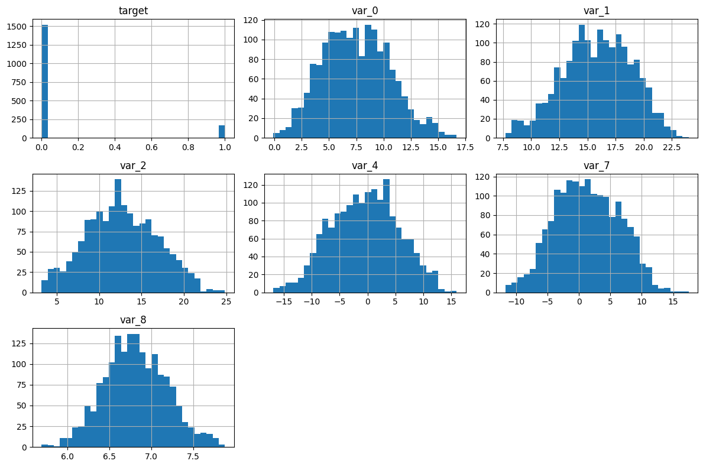
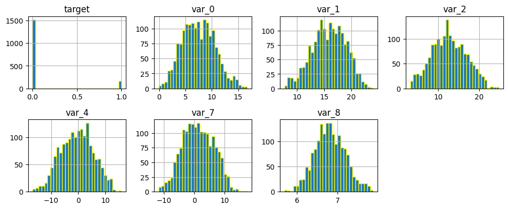
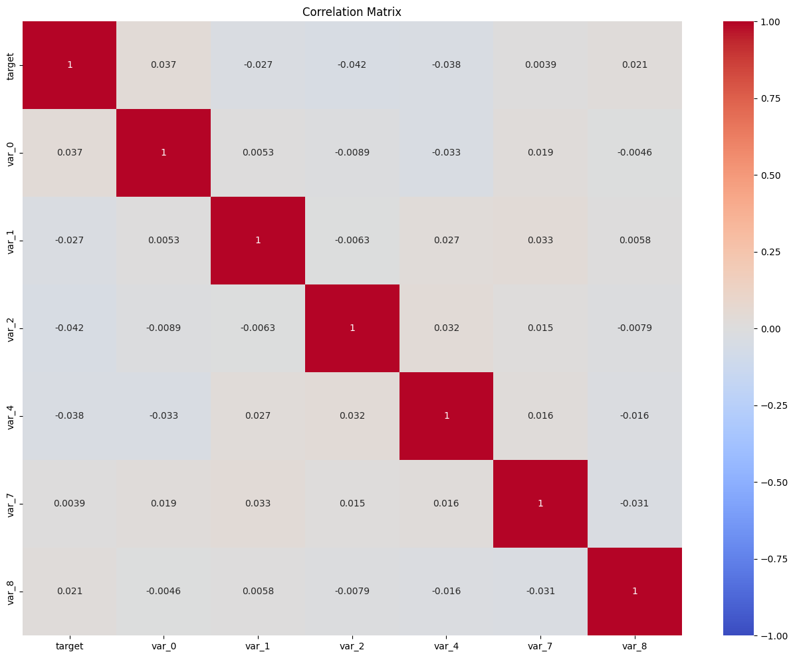
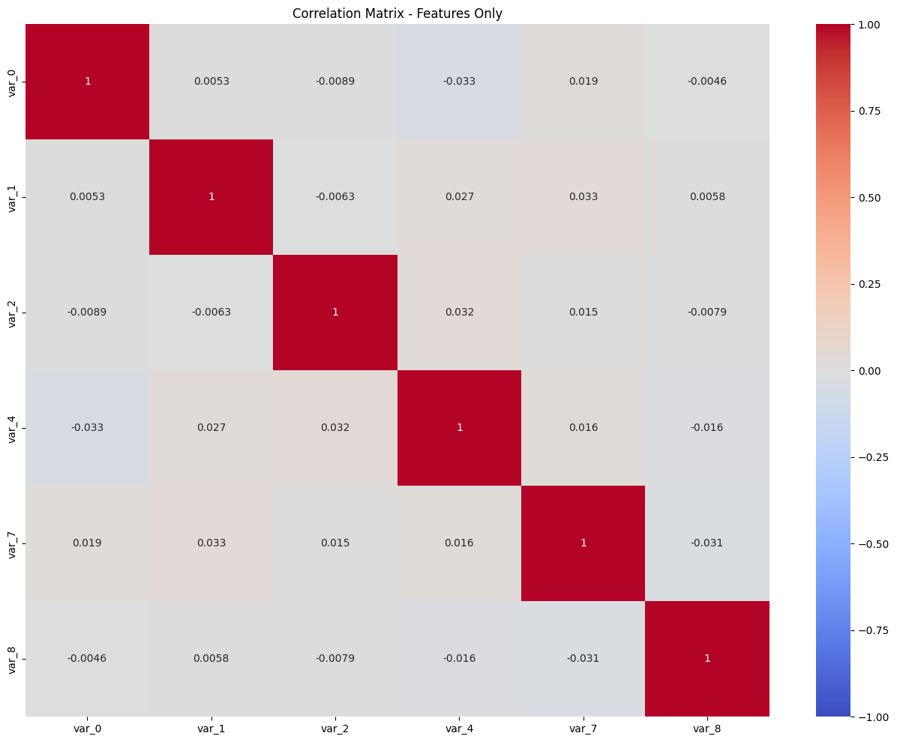
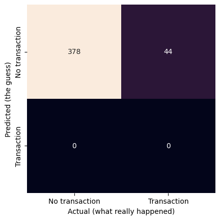

# Project 1 – Pass-07


## Problem Definition


Business problem: Predict whether a customer will make a successfull transaction,

Data Science problem: This is a supervised learning and classification problem. I will use the Gaussian Naive Bayes model


## Data Collection

### Imports


```python
import pandas as pd
import matplotlib.pyplot as plt
import numpy as np
import seaborn as sns

from sklearn.naive_bayes import GaussianNB
from sklearn.model_selection import train_test_split
from sklearn import datasets, metrics, model_selection
```

### File Paths


```python
url = 'https://ddc-datascience.s3.amazonaws.com/Projects/Project.1-Transactions/Data/Transaction.train.big.csv'
```

### Load data


```python
#load data
transaction_df= pd.read_csv(
    url,
    usecols=range(15),
    nrows=10_000,
)
```

### Head


```python
# first few rows
transaction_df.head()
```


  <div id="df-67c32b43-ec82-48fe-9b48-5f5de7e16e84" class="colab-df-container">
    <div>
<style scoped>
    .dataframe tbody tr th:only-of-type {
        vertical-align: middle;
    }

    .dataframe tbody tr th {
        vertical-align: top;
    }

    .dataframe thead th {
        text-align: right;
    }
</style>
<table border="1" class="dataframe">
  <thead>
    <tr style="text-align: right;">
      <th></th>
      <th>Unnamed: 0</th>
      <th>ID_code</th>
      <th>target</th>
      <th>var_0</th>
      <th>var_1</th>
      <th>var_2</th>
      <th>var_3</th>
      <th>var_4</th>
      <th>var_5</th>
      <th>var_6</th>
      <th>var_7</th>
      <th>var_8</th>
      <th>var_9</th>
      <th>var_10</th>
      <th>var_11</th>
    </tr>
  </thead>
  <tbody>
    <tr>
      <th>0</th>
      <td>0</td>
      <td>train_0</td>
      <td>NaN</td>
      <td>NaN</td>
      <td>NaN</td>
      <td>NaN</td>
      <td>NaN</td>
      <td>NaN</td>
      <td>NaN</td>
      <td>NaN</td>
      <td>NaN</td>
      <td>NaN</td>
      <td>NaN</td>
      <td>NaN</td>
      <td>NaN</td>
    </tr>
    <tr>
      <th>1</th>
      <td>1</td>
      <td>train_1</td>
      <td>NaN</td>
      <td>NaN</td>
      <td>NaN</td>
      <td>NaN</td>
      <td>NaN</td>
      <td>NaN</td>
      <td>NaN</td>
      <td>NaN</td>
      <td>NaN</td>
      <td>NaN</td>
      <td>NaN</td>
      <td>NaN</td>
      <td>NaN</td>
    </tr>
    <tr>
      <th>2</th>
      <td>2</td>
      <td>train_2</td>
      <td>NaN</td>
      <td>NaN</td>
      <td>NaN</td>
      <td>NaN</td>
      <td>NaN</td>
      <td>NaN</td>
      <td>NaN</td>
      <td>NaN</td>
      <td>NaN</td>
      <td>NaN</td>
      <td>NaN</td>
      <td>NaN</td>
      <td>NaN</td>
    </tr>
    <tr>
      <th>3</th>
      <td>3</td>
      <td>train_3</td>
      <td>0.0</td>
      <td>4.6739</td>
      <td>22.3915</td>
      <td>15.6015</td>
      <td>NaN</td>
      <td>0.0464</td>
      <td>NaN</td>
      <td>NaN</td>
      <td>-1.9254</td>
      <td>6.476</td>
      <td>NaN</td>
      <td>NaN</td>
      <td>NaN</td>
    </tr>
    <tr>
      <th>4</th>
      <td>4</td>
      <td>train_4</td>
      <td>NaN</td>
      <td>NaN</td>
      <td>NaN</td>
      <td>NaN</td>
      <td>NaN</td>
      <td>NaN</td>
      <td>NaN</td>
      <td>NaN</td>
      <td>NaN</td>
      <td>NaN</td>
      <td>NaN</td>
      <td>NaN</td>
      <td>NaN</td>
    </tr>
  </tbody>
</table>
</div>
    <div class="colab-df-buttons">

  <div class="colab-df-container">
    <button class="colab-df-convert" onclick="convertToInteractive('df-67c32b43-ec82-48fe-9b48-5f5de7e16e84')"
            title="Convert this dataframe to an interactive table."
            style="display:none;">

  <svg xmlns="http://www.w3.org/2000/svg" height="24px" viewBox="0 -960 960 960">
    <path d="M120-120v-720h720v720H120Zm60-500h600v-160H180v160Zm220 220h160v-160H400v160Zm0 220h160v-160H400v160ZM180-400h160v-160H180v160Zm440 0h160v-160H620v160ZM180-180h160v-160H180v160Zm440 0h160v-160H620v160Z"/>
  </svg>
    </button>

  <style>
    .colab-df-container {
      display:flex;
      gap: 12px;
    }

    .colab-df-convert {
      background-color: #E8F0FE;
      border: none;
      border-radius: 50%;
      cursor: pointer;
      display: none;
      fill: #1967D2;
      height: 32px;
      padding: 0 0 0 0;
      width: 32px;
    }

    .colab-df-convert:hover {
      background-color: #E2EBFA;
      box-shadow: 0px 1px 2px rgba(60, 64, 67, 0.3), 0px 1px 3px 1px rgba(60, 64, 67, 0.15);
      fill: #174EA6;
    }

    .colab-df-buttons div {
      margin-bottom: 4px;
    }

    [theme=dark] .colab-df-convert {
      background-color: #3B4455;
      fill: #D2E3FC;
    }

    [theme=dark] .colab-df-convert:hover {
      background-color: #434B5C;
      box-shadow: 0px 1px 3px 1px rgba(0, 0, 0, 0.15);
      filter: drop-shadow(0px 1px 2px rgba(0, 0, 0, 0.3));
      fill: #FFFFFF;
    }
  </style>

    <script>
      const buttonEl =
        document.querySelector('#df-67c32b43-ec82-48fe-9b48-5f5de7e16e84 button.colab-df-convert');
      buttonEl.style.display =
        google.colab.kernel.accessAllowed ? 'block' : 'none';

      async function convertToInteractive(key) {
        const element = document.querySelector('#df-67c32b43-ec82-48fe-9b48-5f5de7e16e84');
        const dataTable =
          await google.colab.kernel.invokeFunction('convertToInteractive',
                                                    [key], {});
        if (!dataTable) return;

        const docLinkHtml = 'Like what you see? Visit the ' +
          '<a target="_blank" href=https://colab.research.google.com/notebooks/data_table.ipynb>data table notebook</a>'
          + ' to learn more about interactive tables.';
        element.innerHTML = '';
        dataTable['output_type'] = 'display_data';
        await google.colab.output.renderOutput(dataTable, element);
        const docLink = document.createElement('div');
        docLink.innerHTML = docLinkHtml;
        element.appendChild(docLink);
      }
    </script>
  </div>


    </div>
  </div>


### Tail


```python
# last few rows
transaction_df.tail()
```


  <div id="df-ca212850-b29a-410f-bae9-f939dedf72ea" class="colab-df-container">
    <div>
<style scoped>
    .dataframe tbody tr th:only-of-type {
        vertical-align: middle;
    }

    .dataframe tbody tr th {
        vertical-align: top;
    }

    .dataframe thead th {
        text-align: right;
    }
</style>
<table border="1" class="dataframe">
  <thead>
    <tr style="text-align: right;">
      <th></th>
      <th>Unnamed: 0</th>
      <th>ID_code</th>
      <th>target</th>
      <th>var_0</th>
      <th>var_1</th>
      <th>var_2</th>
      <th>var_3</th>
      <th>var_4</th>
      <th>var_5</th>
      <th>var_6</th>
      <th>var_7</th>
      <th>var_8</th>
      <th>var_9</th>
      <th>var_10</th>
      <th>var_11</th>
    </tr>
  </thead>
  <tbody>
    <tr>
      <th>9995</th>
      <td>9995</td>
      <td>train_9995</td>
      <td>NaN</td>
      <td>NaN</td>
      <td>NaN</td>
      <td>NaN</td>
      <td>NaN</td>
      <td>NaN</td>
      <td>NaN</td>
      <td>NaN</td>
      <td>NaN</td>
      <td>NaN</td>
      <td>NaN</td>
      <td>NaN</td>
      <td>NaN</td>
    </tr>
    <tr>
      <th>9996</th>
      <td>9996</td>
      <td>train_9996</td>
      <td>NaN</td>
      <td>NaN</td>
      <td>NaN</td>
      <td>NaN</td>
      <td>NaN</td>
      <td>NaN</td>
      <td>NaN</td>
      <td>NaN</td>
      <td>NaN</td>
      <td>NaN</td>
      <td>NaN</td>
      <td>NaN</td>
      <td>NaN</td>
    </tr>
    <tr>
      <th>9997</th>
      <td>9997</td>
      <td>train_9997</td>
      <td>0.0</td>
      <td>4.1463</td>
      <td>20.3755</td>
      <td>14.8105</td>
      <td>NaN</td>
      <td>6.0432</td>
      <td>NaN</td>
      <td>NaN</td>
      <td>1.2462</td>
      <td>6.5467</td>
      <td>NaN</td>
      <td>NaN</td>
      <td>NaN</td>
    </tr>
    <tr>
      <th>9998</th>
      <td>9998</td>
      <td>train_9998</td>
      <td>NaN</td>
      <td>NaN</td>
      <td>NaN</td>
      <td>NaN</td>
      <td>NaN</td>
      <td>NaN</td>
      <td>NaN</td>
      <td>NaN</td>
      <td>NaN</td>
      <td>NaN</td>
      <td>NaN</td>
      <td>NaN</td>
      <td>NaN</td>
    </tr>
    <tr>
      <th>9999</th>
      <td>9999</td>
      <td>train_9999</td>
      <td>NaN</td>
      <td>NaN</td>
      <td>NaN</td>
      <td>NaN</td>
      <td>NaN</td>
      <td>NaN</td>
      <td>NaN</td>
      <td>NaN</td>
      <td>NaN</td>
      <td>NaN</td>
      <td>NaN</td>
      <td>NaN</td>
      <td>NaN</td>
    </tr>
  </tbody>
</table>
</div>
    <div class="colab-df-buttons">

  <div class="colab-df-container">
    <button class="colab-df-convert" onclick="convertToInteractive('df-ca212850-b29a-410f-bae9-f939dedf72ea')"
            title="Convert this dataframe to an interactive table."
            style="display:none;">

  <svg xmlns="http://www.w3.org/2000/svg" height="24px" viewBox="0 -960 960 960">
    <path d="M120-120v-720h720v720H120Zm60-500h600v-160H180v160Zm220 220h160v-160H400v160Zm0 220h160v-160H400v160ZM180-400h160v-160H180v160Zm440 0h160v-160H620v160ZM180-180h160v-160H180v160Zm440 0h160v-160H620v160Z"/>
  </svg>
    </button>

  <style>
    .colab-df-container {
      display:flex;
      gap: 12px;
    }

    .colab-df-convert {
      background-color: #E8F0FE;
      border: none;
      border-radius: 50%;
      cursor: pointer;
      display: none;
      fill: #1967D2;
      height: 32px;
      padding: 0 0 0 0;
      width: 32px;
    }

    .colab-df-convert:hover {
      background-color: #E2EBFA;
      box-shadow: 0px 1px 2px rgba(60, 64, 67, 0.3), 0px 1px 3px 1px rgba(60, 64, 67, 0.15);
      fill: #174EA6;
    }

    .colab-df-buttons div {
      margin-bottom: 4px;
    }

    [theme=dark] .colab-df-convert {
      background-color: #3B4455;
      fill: #D2E3FC;
    }

    [theme=dark] .colab-df-convert:hover {
      background-color: #434B5C;
      box-shadow: 0px 1px 3px 1px rgba(0, 0, 0, 0.15);
      filter: drop-shadow(0px 1px 2px rgba(0, 0, 0, 0.3));
      fill: #FFFFFF;
    }
  </style>

    <script>
      const buttonEl =
        document.querySelector('#df-ca212850-b29a-410f-bae9-f939dedf72ea button.colab-df-convert');
      buttonEl.style.display =
        google.colab.kernel.accessAllowed ? 'block' : 'none';

      async function convertToInteractive(key) {
        const element = document.querySelector('#df-ca212850-b29a-410f-bae9-f939dedf72ea');
        const dataTable =
          await google.colab.kernel.invokeFunction('convertToInteractive',
                                                    [key], {});
        if (!dataTable) return;

        const docLinkHtml = 'Like what you see? Visit the ' +
          '<a target="_blank" href=https://colab.research.google.com/notebooks/data_table.ipynb>data table notebook</a>'
          + ' to learn more about interactive tables.';
        element.innerHTML = '';
        dataTable['output_type'] = 'display_data';
        await google.colab.output.renderOutput(dataTable, element);
        const docLink = document.createElement('div');
        docLink.innerHTML = docLinkHtml;
        element.appendChild(docLink);
      }
    </script>
  </div>


    </div>
  </div>


### Shape


```python
# shape of data frame
transaction_df.shape

#output (# of rows, # of columns)
```


    (10000, 15)


### Size


```python
# size of data frame
transaction_df.size
```


    150000


### Info


```python
# display meta-data
transaction_df.info()

```

    <class 'pandas.core.frame.DataFrame'>
    RangeIndex: 10000 entries, 0 to 9999
    Data columns (total 15 columns):
     #   Column      Non-Null Count  Dtype  
    ---  ------      --------------  -----  
     0   Unnamed: 0  10000 non-null  int64  
     1   ID_code     10000 non-null  object 
     2   target      1686 non-null   float64
     3   var_0       1686 non-null   float64
     4   var_1       1686 non-null   float64
     5   var_2       1686 non-null   float64
     6   var_3       0 non-null      float64
     7   var_4       1686 non-null   float64
     8   var_5       0 non-null      float64
     9   var_6       0 non-null      float64
     10  var_7       1686 non-null   float64
     11  var_8       1686 non-null   float64
     12  var_9       0 non-null      float64
     13  var_10      0 non-null      float64
     14  var_11      0 non-null      float64
    dtypes: float64(13), int64(1), object(1)
    memory usage: 1.1+ MB


## Summary statistics

### Describe


```python
# display summary statistics
transaction_df.describe()

```


  <div id="df-bd0fea21-c0d8-4678-9889-ef278439d1af" class="colab-df-container">
    <div>
<style scoped>
    .dataframe tbody tr th:only-of-type {
        vertical-align: middle;
    }

    .dataframe tbody tr th {
        vertical-align: top;
    }

    .dataframe thead th {
        text-align: right;
    }
</style>
<table border="1" class="dataframe">
  <thead>
    <tr style="text-align: right;">
      <th></th>
      <th>Unnamed: 0</th>
      <th>target</th>
      <th>var_0</th>
      <th>var_1</th>
      <th>var_2</th>
      <th>var_3</th>
      <th>var_4</th>
      <th>var_5</th>
      <th>var_6</th>
      <th>var_7</th>
      <th>var_8</th>
      <th>var_9</th>
      <th>var_10</th>
      <th>var_11</th>
    </tr>
  </thead>
  <tbody>
    <tr>
      <th>count</th>
      <td>10000.00000</td>
      <td>1686.000000</td>
      <td>1686.000000</td>
      <td>1686.000000</td>
      <td>1686.000000</td>
      <td>0.0</td>
      <td>1686.000000</td>
      <td>0.0</td>
      <td>0.0</td>
      <td>1686.000000</td>
      <td>1686.000000</td>
      <td>0.0</td>
      <td>0.0</td>
      <td>0.0</td>
    </tr>
    <tr>
      <th>mean</th>
      <td>4999.50000</td>
      <td>0.098458</td>
      <td>7.493109</td>
      <td>15.840630</td>
      <td>12.667966</td>
      <td>NaN</td>
      <td>-0.461214</td>
      <td>NaN</td>
      <td>NaN</td>
      <td>1.276329</td>
      <td>6.812313</td>
      <td>NaN</td>
      <td>NaN</td>
      <td>NaN</td>
    </tr>
    <tr>
      <th>std</th>
      <td>2886.89568</td>
      <td>0.298021</td>
      <td>3.090435</td>
      <td>3.086651</td>
      <td>4.187706</td>
      <td>NaN</td>
      <td>6.014515</td>
      <td>NaN</td>
      <td>NaN</td>
      <td>5.103567</td>
      <td>0.374905</td>
      <td>NaN</td>
      <td>NaN</td>
      <td>NaN</td>
    </tr>
    <tr>
      <th>min</th>
      <td>0.00000</td>
      <td>0.000000</td>
      <td>-0.101600</td>
      <td>7.700200</td>
      <td>3.218700</td>
      <td>NaN</td>
      <td>-16.855000</td>
      <td>NaN</td>
      <td>NaN</td>
      <td>-11.731000</td>
      <td>5.688300</td>
      <td>NaN</td>
      <td>NaN</td>
      <td>NaN</td>
    </tr>
    <tr>
      <th>25%</th>
      <td>2499.75000</td>
      <td>0.000000</td>
      <td>5.174825</td>
      <td>13.739200</td>
      <td>9.601600</td>
      <td>NaN</td>
      <td>-4.893675</td>
      <td>NaN</td>
      <td>NaN</td>
      <td>-2.458950</td>
      <td>6.559500</td>
      <td>NaN</td>
      <td>NaN</td>
      <td>NaN</td>
    </tr>
    <tr>
      <th>50%</th>
      <td>4999.50000</td>
      <td>0.000000</td>
      <td>7.379350</td>
      <td>15.992700</td>
      <td>12.478250</td>
      <td>NaN</td>
      <td>-0.190200</td>
      <td>NaN</td>
      <td>NaN</td>
      <td>1.080350</td>
      <td>6.795350</td>
      <td>NaN</td>
      <td>NaN</td>
      <td>NaN</td>
    </tr>
    <tr>
      <th>75%</th>
      <td>7499.25000</td>
      <td>0.000000</td>
      <td>9.708875</td>
      <td>18.155675</td>
      <td>15.725050</td>
      <td>NaN</td>
      <td>3.730575</td>
      <td>NaN</td>
      <td>NaN</td>
      <td>5.107175</td>
      <td>7.071325</td>
      <td>NaN</td>
      <td>NaN</td>
      <td>NaN</td>
    </tr>
    <tr>
      <th>max</th>
      <td>9999.00000</td>
      <td>1.000000</td>
      <td>16.716500</td>
      <td>23.971700</td>
      <td>24.828500</td>
      <td>NaN</td>
      <td>15.973100</td>
      <td>NaN</td>
      <td>NaN</td>
      <td>17.441800</td>
      <td>7.877900</td>
      <td>NaN</td>
      <td>NaN</td>
      <td>NaN</td>
    </tr>
  </tbody>
</table>
</div>
    <div class="colab-df-buttons">

  <div class="colab-df-container">
    <button class="colab-df-convert" onclick="convertToInteractive('df-bd0fea21-c0d8-4678-9889-ef278439d1af')"
            title="Convert this dataframe to an interactive table."
            style="display:none;">

  <svg xmlns="http://www.w3.org/2000/svg" height="24px" viewBox="0 -960 960 960">
    <path d="M120-120v-720h720v720H120Zm60-500h600v-160H180v160Zm220 220h160v-160H400v160Zm0 220h160v-160H400v160ZM180-400h160v-160H180v160Zm440 0h160v-160H620v160ZM180-180h160v-160H180v160Zm440 0h160v-160H620v160Z"/>
  </svg>
    </button>

  <style>
    .colab-df-container {
      display:flex;
      gap: 12px;
    }

    .colab-df-convert {
      background-color: #E8F0FE;
      border: none;
      border-radius: 50%;
      cursor: pointer;
      display: none;
      fill: #1967D2;
      height: 32px;
      padding: 0 0 0 0;
      width: 32px;
    }

    .colab-df-convert:hover {
      background-color: #E2EBFA;
      box-shadow: 0px 1px 2px rgba(60, 64, 67, 0.3), 0px 1px 3px 1px rgba(60, 64, 67, 0.15);
      fill: #174EA6;
    }

    .colab-df-buttons div {
      margin-bottom: 4px;
    }

    [theme=dark] .colab-df-convert {
      background-color: #3B4455;
      fill: #D2E3FC;
    }

    [theme=dark] .colab-df-convert:hover {
      background-color: #434B5C;
      box-shadow: 0px 1px 3px 1px rgba(0, 0, 0, 0.15);
      filter: drop-shadow(0px 1px 2px rgba(0, 0, 0, 0.3));
      fill: #FFFFFF;
    }
  </style>

    <script>
      const buttonEl =
        document.querySelector('#df-bd0fea21-c0d8-4678-9889-ef278439d1af button.colab-df-convert');
      buttonEl.style.display =
        google.colab.kernel.accessAllowed ? 'block' : 'none';

      async function convertToInteractive(key) {
        const element = document.querySelector('#df-bd0fea21-c0d8-4678-9889-ef278439d1af');
        const dataTable =
          await google.colab.kernel.invokeFunction('convertToInteractive',
                                                    [key], {});
        if (!dataTable) return;

        const docLinkHtml = 'Like what you see? Visit the ' +
          '<a target="_blank" href=https://colab.research.google.com/notebooks/data_table.ipynb>data table notebook</a>'
          + ' to learn more about interactive tables.';
        element.innerHTML = '';
        dataTable['output_type'] = 'display_data';
        await google.colab.output.renderOutput(dataTable, element);
        const docLink = document.createElement('div');
        docLink.innerHTML = docLinkHtml;
        element.appendChild(docLink);
      }
    </script>
  </div>


    </div>
  </div>


### Target value counts

NOTE: the ‘target’ column indicates a successful transaction (‘1’) or a no-transaction (‘0’). Verify these are the only values in that column, and that there are no nulls.


```python
# value_counts on target ; include nulls
transaction_df['target'].value_counts(dropna=False)
```


<div>
<style scoped>
    .dataframe tbody tr th:only-of-type {
        vertical-align: middle;
    }

    .dataframe tbody tr th {
        vertical-align: top;
    }

    .dataframe thead th {
        text-align: right;
    }
</style>
<table border="1" class="dataframe">
  <thead>
    <tr style="text-align: right;">
      <th></th>
      <th>count</th>
    </tr>
    <tr>
      <th>target</th>
      <th></th>
    </tr>
  </thead>
  <tbody>
    <tr>
      <th>NaN</th>
      <td>8314</td>
    </tr>
    <tr>
      <th>0.0</th>
      <td>1520</td>
    </tr>
    <tr>
      <th>1.0</th>
      <td>166</td>
    </tr>
  </tbody>
</table>
</div><br><label><b>dtype:</b> int64</label>


```python
#normalize value counts on target ; include nulls
transaction_df['target'].value_counts(normalize=True, dropna=False)
```


<div>
<style scoped>
    .dataframe tbody tr th:only-of-type {
        vertical-align: middle;
    }

    .dataframe tbody tr th {
        vertical-align: top;
    }

    .dataframe thead th {
        text-align: right;
    }
</style>
<table border="1" class="dataframe">
  <thead>
    <tr style="text-align: right;">
      <th></th>
      <th>proportion</th>
    </tr>
    <tr>
      <th>target</th>
      <th></th>
    </tr>
  </thead>
  <tbody>
    <tr>
      <th>NaN</th>
      <td>0.8314</td>
    </tr>
    <tr>
      <th>0.0</th>
      <td>0.1520</td>
    </tr>
    <tr>
      <th>1.0</th>
      <td>0.0166</td>
    </tr>
  </tbody>
</table>
</div><br><label><b>dtype:</b> float64</label>


### Nulls


```python
# look for nulls
transaction_df.isnull().sum().sort_values(ascending=False)


```


<div>
<style scoped>
    .dataframe tbody tr th:only-of-type {
        vertical-align: middle;
    }

    .dataframe tbody tr th {
        vertical-align: top;
    }

    .dataframe thead th {
        text-align: right;
    }
</style>
<table border="1" class="dataframe">
  <thead>
    <tr style="text-align: right;">
      <th></th>
      <th>0</th>
    </tr>
  </thead>
  <tbody>
    <tr>
      <th>var_3</th>
      <td>10000</td>
    </tr>
    <tr>
      <th>var_6</th>
      <td>10000</td>
    </tr>
    <tr>
      <th>var_11</th>
      <td>10000</td>
    </tr>
    <tr>
      <th>var_9</th>
      <td>10000</td>
    </tr>
    <tr>
      <th>var_10</th>
      <td>10000</td>
    </tr>
    <tr>
      <th>var_5</th>
      <td>10000</td>
    </tr>
    <tr>
      <th>var_0</th>
      <td>8314</td>
    </tr>
    <tr>
      <th>target</th>
      <td>8314</td>
    </tr>
    <tr>
      <th>var_4</th>
      <td>8314</td>
    </tr>
    <tr>
      <th>var_2</th>
      <td>8314</td>
    </tr>
    <tr>
      <th>var_1</th>
      <td>8314</td>
    </tr>
    <tr>
      <th>var_7</th>
      <td>8314</td>
    </tr>
    <tr>
      <th>var_8</th>
      <td>8314</td>
    </tr>
    <tr>
      <th>Unnamed: 0</th>
      <td>0</td>
    </tr>
    <tr>
      <th>ID_code</th>
      <td>0</td>
    </tr>
  </tbody>
</table>
</div><br><label><b>dtype:</b> int64</label>


```python
# look for nulls, display relative frequency
null_sum = transaction_df.isnull().sum()
null_freq = null_sum / transaction_df.shape[0] * 100
null_freq.sort_values()

#Output- target has 82% percent null values
```


<div>
<style scoped>
    .dataframe tbody tr th:only-of-type {
        vertical-align: middle;
    }

    .dataframe tbody tr th {
        vertical-align: top;
    }

    .dataframe thead th {
        text-align: right;
    }
</style>
<table border="1" class="dataframe">
  <thead>
    <tr style="text-align: right;">
      <th></th>
      <th>0</th>
    </tr>
  </thead>
  <tbody>
    <tr>
      <th>Unnamed: 0</th>
      <td>0.00</td>
    </tr>
    <tr>
      <th>ID_code</th>
      <td>0.00</td>
    </tr>
    <tr>
      <th>target</th>
      <td>83.14</td>
    </tr>
    <tr>
      <th>var_0</th>
      <td>83.14</td>
    </tr>
    <tr>
      <th>var_1</th>
      <td>83.14</td>
    </tr>
    <tr>
      <th>var_2</th>
      <td>83.14</td>
    </tr>
    <tr>
      <th>var_4</th>
      <td>83.14</td>
    </tr>
    <tr>
      <th>var_8</th>
      <td>83.14</td>
    </tr>
    <tr>
      <th>var_7</th>
      <td>83.14</td>
    </tr>
    <tr>
      <th>var_3</th>
      <td>100.00</td>
    </tr>
    <tr>
      <th>var_6</th>
      <td>100.00</td>
    </tr>
    <tr>
      <th>var_5</th>
      <td>100.00</td>
    </tr>
    <tr>
      <th>var_9</th>
      <td>100.00</td>
    </tr>
    <tr>
      <th>var_10</th>
      <td>100.00</td>
    </tr>
    <tr>
      <th>var_11</th>
      <td>100.00</td>
    </tr>
  </tbody>
</table>
</div><br><label><b>dtype:</b> float64</label>


### Column data types


```python
# display data types
transaction_df.dtypes.sort_values()
```


<div>
<style scoped>
    .dataframe tbody tr th:only-of-type {
        vertical-align: middle;
    }

    .dataframe tbody tr th {
        vertical-align: top;
    }

    .dataframe thead th {
        text-align: right;
    }
</style>
<table border="1" class="dataframe">
  <thead>
    <tr style="text-align: right;">
      <th></th>
      <th>0</th>
    </tr>
  </thead>
  <tbody>
    <tr>
      <th>Unnamed: 0</th>
      <td>int64</td>
    </tr>
    <tr>
      <th>target</th>
      <td>float64</td>
    </tr>
    <tr>
      <th>var_0</th>
      <td>float64</td>
    </tr>
    <tr>
      <th>var_1</th>
      <td>float64</td>
    </tr>
    <tr>
      <th>var_2</th>
      <td>float64</td>
    </tr>
    <tr>
      <th>var_3</th>
      <td>float64</td>
    </tr>
    <tr>
      <th>var_4</th>
      <td>float64</td>
    </tr>
    <tr>
      <th>var_5</th>
      <td>float64</td>
    </tr>
    <tr>
      <th>var_6</th>
      <td>float64</td>
    </tr>
    <tr>
      <th>var_7</th>
      <td>float64</td>
    </tr>
    <tr>
      <th>var_8</th>
      <td>float64</td>
    </tr>
    <tr>
      <th>var_9</th>
      <td>float64</td>
    </tr>
    <tr>
      <th>var_10</th>
      <td>float64</td>
    </tr>
    <tr>
      <th>var_11</th>
      <td>float64</td>
    </tr>
    <tr>
      <th>ID_code</th>
      <td>object</td>
    </tr>
  </tbody>
</table>
</div><br><label><b>dtype:</b> object</label>


### Unique elements


```python
# number of unique elements in every column (works on the whole dataframe)
transaction_df.nunique().sort_values(ascending=False)
```


<div>
<style scoped>
    .dataframe tbody tr th:only-of-type {
        vertical-align: middle;
    }

    .dataframe tbody tr th {
        vertical-align: top;
    }

    .dataframe thead th {
        text-align: right;
    }
</style>
<table border="1" class="dataframe">
  <thead>
    <tr style="text-align: right;">
      <th></th>
      <th>0</th>
    </tr>
  </thead>
  <tbody>
    <tr>
      <th>Unnamed: 0</th>
      <td>10000</td>
    </tr>
    <tr>
      <th>ID_code</th>
      <td>10000</td>
    </tr>
    <tr>
      <th>var_4</th>
      <td>1678</td>
    </tr>
    <tr>
      <th>var_7</th>
      <td>1677</td>
    </tr>
    <tr>
      <th>var_0</th>
      <td>1677</td>
    </tr>
    <tr>
      <th>var_2</th>
      <td>1672</td>
    </tr>
    <tr>
      <th>var_1</th>
      <td>1663</td>
    </tr>
    <tr>
      <th>var_8</th>
      <td>1596</td>
    </tr>
    <tr>
      <th>target</th>
      <td>2</td>
    </tr>
    <tr>
      <th>var_3</th>
      <td>0</td>
    </tr>
    <tr>
      <th>var_5</th>
      <td>0</td>
    </tr>
    <tr>
      <th>var_6</th>
      <td>0</td>
    </tr>
    <tr>
      <th>var_9</th>
      <td>0</td>
    </tr>
    <tr>
      <th>var_10</th>
      <td>0</td>
    </tr>
    <tr>
      <th>var_11</th>
      <td>0</td>
    </tr>
  </tbody>
</table>
</div><br><label><b>dtype:</b> int64</label>


```python
# actual unique values in one column
transaction_df['target'].unique()
```


    array([nan,  0.,  1.])


```python

```

## Data Cleaning


Backup #1


```python
# backup copy of the original data
transaction_df_backup= transaction_df.copy()

```


```python
# restore from backup
transaction_df=transaction_df_backup.copy()
```

### Drop rows with no target
  - The target has 83% nulls. Model cant learn from rows with no answer, remove them first

Selected `target` for the target and drop the rows with null values


```python
#transaction_df.iloc[:5].dropna(subset=['target'])
```


```python
# Keep only the rows where target is not missing
transaction_df_target=transaction_df.dropna(subset=['target']).copy()
transaction_df_target.head()
```


  <div id="df-7a947bbc-b4c3-4e39-a641-d6f44adee510" class="colab-df-container">
    <div>
<style scoped>
    .dataframe tbody tr th:only-of-type {
        vertical-align: middle;
    }

    .dataframe tbody tr th {
        vertical-align: top;
    }

    .dataframe thead th {
        text-align: right;
    }
</style>
<table border="1" class="dataframe">
  <thead>
    <tr style="text-align: right;">
      <th></th>
      <th>Unnamed: 0</th>
      <th>ID_code</th>
      <th>target</th>
      <th>var_0</th>
      <th>var_1</th>
      <th>var_2</th>
      <th>var_3</th>
      <th>var_4</th>
      <th>var_5</th>
      <th>var_6</th>
      <th>var_7</th>
      <th>var_8</th>
      <th>var_9</th>
      <th>var_10</th>
      <th>var_11</th>
    </tr>
  </thead>
  <tbody>
    <tr>
      <th>3</th>
      <td>3</td>
      <td>train_3</td>
      <td>0.0</td>
      <td>4.6739</td>
      <td>22.3915</td>
      <td>15.6015</td>
      <td>NaN</td>
      <td>0.0464</td>
      <td>NaN</td>
      <td>NaN</td>
      <td>-1.9254</td>
      <td>6.4760</td>
      <td>NaN</td>
      <td>NaN</td>
      <td>NaN</td>
    </tr>
    <tr>
      <th>5</th>
      <td>5</td>
      <td>train_5</td>
      <td>0.0</td>
      <td>14.6962</td>
      <td>18.3383</td>
      <td>17.4788</td>
      <td>NaN</td>
      <td>-9.1355</td>
      <td>NaN</td>
      <td>NaN</td>
      <td>-6.4882</td>
      <td>6.0821</td>
      <td>NaN</td>
      <td>NaN</td>
      <td>NaN</td>
    </tr>
    <tr>
      <th>11</th>
      <td>11</td>
      <td>train_11</td>
      <td>0.0</td>
      <td>4.4949</td>
      <td>14.4142</td>
      <td>13.2219</td>
      <td>NaN</td>
      <td>4.9140</td>
      <td>NaN</td>
      <td>NaN</td>
      <td>4.0501</td>
      <td>5.8144</td>
      <td>NaN</td>
      <td>NaN</td>
      <td>NaN</td>
    </tr>
    <tr>
      <th>15</th>
      <td>15</td>
      <td>train_15</td>
      <td>0.0</td>
      <td>4.9657</td>
      <td>16.2867</td>
      <td>17.9579</td>
      <td>NaN</td>
      <td>0.6017</td>
      <td>NaN</td>
      <td>NaN</td>
      <td>-5.4904</td>
      <td>6.6670</td>
      <td>NaN</td>
      <td>NaN</td>
      <td>NaN</td>
    </tr>
    <tr>
      <th>19</th>
      <td>19</td>
      <td>train_19</td>
      <td>0.0</td>
      <td>9.4287</td>
      <td>18.7822</td>
      <td>10.7630</td>
      <td>NaN</td>
      <td>-0.7532</td>
      <td>NaN</td>
      <td>NaN</td>
      <td>8.8477</td>
      <td>6.8045</td>
      <td>NaN</td>
      <td>NaN</td>
      <td>NaN</td>
    </tr>
  </tbody>
</table>
</div>
    <div class="colab-df-buttons">

  <div class="colab-df-container">
    <button class="colab-df-convert" onclick="convertToInteractive('df-7a947bbc-b4c3-4e39-a641-d6f44adee510')"
            title="Convert this dataframe to an interactive table."
            style="display:none;">

  <svg xmlns="http://www.w3.org/2000/svg" height="24px" viewBox="0 -960 960 960">
    <path d="M120-120v-720h720v720H120Zm60-500h600v-160H180v160Zm220 220h160v-160H400v160Zm0 220h160v-160H400v160ZM180-400h160v-160H180v160Zm440 0h160v-160H620v160ZM180-180h160v-160H180v160Zm440 0h160v-160H620v160Z"/>
  </svg>
    </button>

  <style>
    .colab-df-container {
      display:flex;
      gap: 12px;
    }

    .colab-df-convert {
      background-color: #E8F0FE;
      border: none;
      border-radius: 50%;
      cursor: pointer;
      display: none;
      fill: #1967D2;
      height: 32px;
      padding: 0 0 0 0;
      width: 32px;
    }

    .colab-df-convert:hover {
      background-color: #E2EBFA;
      box-shadow: 0px 1px 2px rgba(60, 64, 67, 0.3), 0px 1px 3px 1px rgba(60, 64, 67, 0.15);
      fill: #174EA6;
    }

    .colab-df-buttons div {
      margin-bottom: 4px;
    }

    [theme=dark] .colab-df-convert {
      background-color: #3B4455;
      fill: #D2E3FC;
    }

    [theme=dark] .colab-df-convert:hover {
      background-color: #434B5C;
      box-shadow: 0px 1px 3px 1px rgba(0, 0, 0, 0.15);
      filter: drop-shadow(0px 1px 2px rgba(0, 0, 0, 0.3));
      fill: #FFFFFF;
    }
  </style>

    <script>
      const buttonEl =
        document.querySelector('#df-7a947bbc-b4c3-4e39-a641-d6f44adee510 button.colab-df-convert');
      buttonEl.style.display =
        google.colab.kernel.accessAllowed ? 'block' : 'none';

      async function convertToInteractive(key) {
        const element = document.querySelector('#df-7a947bbc-b4c3-4e39-a641-d6f44adee510');
        const dataTable =
          await google.colab.kernel.invokeFunction('convertToInteractive',
                                                    [key], {});
        if (!dataTable) return;

        const docLinkHtml = 'Like what you see? Visit the ' +
          '<a target="_blank" href=https://colab.research.google.com/notebooks/data_table.ipynb>data table notebook</a>'
          + ' to learn more about interactive tables.';
        element.innerHTML = '';
        dataTable['output_type'] = 'display_data';
        await google.colab.output.renderOutput(dataTable, element);
        const docLink = document.createElement('div');
        docLink.innerHTML = docLinkHtml;
        element.appendChild(docLink);
      }
    </script>
  </div>


    </div>
  </div>


```python
transaction_df_target.head(10) # this is to check
```


  <div id="df-b2df8afa-d6c8-4f2b-901a-387ecb627ab3" class="colab-df-container">
    <div>
<style scoped>
    .dataframe tbody tr th:only-of-type {
        vertical-align: middle;
    }

    .dataframe tbody tr th {
        vertical-align: top;
    }

    .dataframe thead th {
        text-align: right;
    }
</style>
<table border="1" class="dataframe">
  <thead>
    <tr style="text-align: right;">
      <th></th>
      <th>Unnamed: 0</th>
      <th>ID_code</th>
      <th>target</th>
      <th>var_0</th>
      <th>var_1</th>
      <th>var_2</th>
      <th>var_3</th>
      <th>var_4</th>
      <th>var_5</th>
      <th>var_6</th>
      <th>var_7</th>
      <th>var_8</th>
      <th>var_9</th>
      <th>var_10</th>
      <th>var_11</th>
    </tr>
  </thead>
  <tbody>
    <tr>
      <th>3</th>
      <td>3</td>
      <td>train_3</td>
      <td>0.0</td>
      <td>4.6739</td>
      <td>22.3915</td>
      <td>15.6015</td>
      <td>NaN</td>
      <td>0.0464</td>
      <td>NaN</td>
      <td>NaN</td>
      <td>-1.9254</td>
      <td>6.4760</td>
      <td>NaN</td>
      <td>NaN</td>
      <td>NaN</td>
    </tr>
    <tr>
      <th>5</th>
      <td>5</td>
      <td>train_5</td>
      <td>0.0</td>
      <td>14.6962</td>
      <td>18.3383</td>
      <td>17.4788</td>
      <td>NaN</td>
      <td>-9.1355</td>
      <td>NaN</td>
      <td>NaN</td>
      <td>-6.4882</td>
      <td>6.0821</td>
      <td>NaN</td>
      <td>NaN</td>
      <td>NaN</td>
    </tr>
    <tr>
      <th>11</th>
      <td>11</td>
      <td>train_11</td>
      <td>0.0</td>
      <td>4.4949</td>
      <td>14.4142</td>
      <td>13.2219</td>
      <td>NaN</td>
      <td>4.9140</td>
      <td>NaN</td>
      <td>NaN</td>
      <td>4.0501</td>
      <td>5.8144</td>
      <td>NaN</td>
      <td>NaN</td>
      <td>NaN</td>
    </tr>
    <tr>
      <th>15</th>
      <td>15</td>
      <td>train_15</td>
      <td>0.0</td>
      <td>4.9657</td>
      <td>16.2867</td>
      <td>17.9579</td>
      <td>NaN</td>
      <td>0.6017</td>
      <td>NaN</td>
      <td>NaN</td>
      <td>-5.4904</td>
      <td>6.6670</td>
      <td>NaN</td>
      <td>NaN</td>
      <td>NaN</td>
    </tr>
    <tr>
      <th>19</th>
      <td>19</td>
      <td>train_19</td>
      <td>0.0</td>
      <td>9.4287</td>
      <td>18.7822</td>
      <td>10.7630</td>
      <td>NaN</td>
      <td>-0.7532</td>
      <td>NaN</td>
      <td>NaN</td>
      <td>8.8477</td>
      <td>6.8045</td>
      <td>NaN</td>
      <td>NaN</td>
      <td>NaN</td>
    </tr>
    <tr>
      <th>22</th>
      <td>22</td>
      <td>train_22</td>
      <td>0.0</td>
      <td>6.7023</td>
      <td>18.0127</td>
      <td>18.4424</td>
      <td>NaN</td>
      <td>-5.1010</td>
      <td>NaN</td>
      <td>NaN</td>
      <td>-6.2877</td>
      <td>6.9091</td>
      <td>NaN</td>
      <td>NaN</td>
      <td>NaN</td>
    </tr>
    <tr>
      <th>29</th>
      <td>29</td>
      <td>train_29</td>
      <td>0.0</td>
      <td>11.2902</td>
      <td>7.7553</td>
      <td>6.6189</td>
      <td>NaN</td>
      <td>-7.0587</td>
      <td>NaN</td>
      <td>NaN</td>
      <td>-2.8962</td>
      <td>7.1432</td>
      <td>NaN</td>
      <td>NaN</td>
      <td>NaN</td>
    </tr>
    <tr>
      <th>33</th>
      <td>33</td>
      <td>train_33</td>
      <td>0.0</td>
      <td>4.6761</td>
      <td>14.6116</td>
      <td>12.4063</td>
      <td>NaN</td>
      <td>-9.6457</td>
      <td>NaN</td>
      <td>NaN</td>
      <td>-3.5926</td>
      <td>6.1751</td>
      <td>NaN</td>
      <td>NaN</td>
      <td>NaN</td>
    </tr>
    <tr>
      <th>35</th>
      <td>35</td>
      <td>train_35</td>
      <td>0.0</td>
      <td>10.5404</td>
      <td>10.9793</td>
      <td>11.0240</td>
      <td>NaN</td>
      <td>2.2579</td>
      <td>NaN</td>
      <td>NaN</td>
      <td>8.7554</td>
      <td>7.2437</td>
      <td>NaN</td>
      <td>NaN</td>
      <td>NaN</td>
    </tr>
    <tr>
      <th>46</th>
      <td>46</td>
      <td>train_46</td>
      <td>0.0</td>
      <td>5.6315</td>
      <td>13.2825</td>
      <td>20.9955</td>
      <td>NaN</td>
      <td>3.1402</td>
      <td>NaN</td>
      <td>NaN</td>
      <td>-0.9188</td>
      <td>6.6585</td>
      <td>NaN</td>
      <td>NaN</td>
      <td>NaN</td>
    </tr>
  </tbody>
</table>
</div>
    <div class="colab-df-buttons">

  <div class="colab-df-container">
    <button class="colab-df-convert" onclick="convertToInteractive('df-b2df8afa-d6c8-4f2b-901a-387ecb627ab3')"
            title="Convert this dataframe to an interactive table."
            style="display:none;">

  <svg xmlns="http://www.w3.org/2000/svg" height="24px" viewBox="0 -960 960 960">
    <path d="M120-120v-720h720v720H120Zm60-500h600v-160H180v160Zm220 220h160v-160H400v160Zm0 220h160v-160H400v160ZM180-400h160v-160H180v160Zm440 0h160v-160H620v160ZM180-180h160v-160H180v160Zm440 0h160v-160H620v160Z"/>
  </svg>
    </button>

  <style>
    .colab-df-container {
      display:flex;
      gap: 12px;
    }

    .colab-df-convert {
      background-color: #E8F0FE;
      border: none;
      border-radius: 50%;
      cursor: pointer;
      display: none;
      fill: #1967D2;
      height: 32px;
      padding: 0 0 0 0;
      width: 32px;
    }

    .colab-df-convert:hover {
      background-color: #E2EBFA;
      box-shadow: 0px 1px 2px rgba(60, 64, 67, 0.3), 0px 1px 3px 1px rgba(60, 64, 67, 0.15);
      fill: #174EA6;
    }

    .colab-df-buttons div {
      margin-bottom: 4px;
    }

    [theme=dark] .colab-df-convert {
      background-color: #3B4455;
      fill: #D2E3FC;
    }

    [theme=dark] .colab-df-convert:hover {
      background-color: #434B5C;
      box-shadow: 0px 1px 3px 1px rgba(0, 0, 0, 0.15);
      filter: drop-shadow(0px 1px 2px rgba(0, 0, 0, 0.3));
      fill: #FFFFFF;
    }
  </style>

    <script>
      const buttonEl =
        document.querySelector('#df-b2df8afa-d6c8-4f2b-901a-387ecb627ab3 button.colab-df-convert');
      buttonEl.style.display =
        google.colab.kernel.accessAllowed ? 'block' : 'none';

      async function convertToInteractive(key) {
        const element = document.querySelector('#df-b2df8afa-d6c8-4f2b-901a-387ecb627ab3');
        const dataTable =
          await google.colab.kernel.invokeFunction('convertToInteractive',
                                                    [key], {});
        if (!dataTable) return;

        const docLinkHtml = 'Like what you see? Visit the ' +
          '<a target="_blank" href=https://colab.research.google.com/notebooks/data_table.ipynb>data table notebook</a>'
          + ' to learn more about interactive tables.';
        element.innerHTML = '';
        dataTable['output_type'] = 'display_data';
        await google.colab.output.renderOutput(dataTable, element);
        const docLink = document.createElement('div');
        docLink.innerHTML = docLinkHtml;
        element.appendChild(docLink);
      }
    </script>
  </div>


    </div>
  </div>


```python

```

### Backup #2


```python
# make backup
transaction_df_target_backup = transaction_df_target.copy()
```


```python
# restore from back up
transaction_df_target = transaction_df_target_backup.copy()
```

### Address any rows with nulls

- If the number of nulls in a column is low, it would be easiest to drop the row.
- If the number of nulls in a column is high, it would be easiest to drop the column.
- If the number of nulls in a column is between the low and high, one should impute values for the nulls.


```python
transaction_df_target.isnull().sum().sort_values (ascending=False) # show me where the null value are
```


<div>
<style scoped>
    .dataframe tbody tr th:only-of-type {
        vertical-align: middle;
    }

    .dataframe tbody tr th {
        vertical-align: top;
    }

    .dataframe thead th {
        text-align: right;
    }
</style>
<table border="1" class="dataframe">
  <thead>
    <tr style="text-align: right;">
      <th></th>
      <th>0</th>
    </tr>
  </thead>
  <tbody>
    <tr>
      <th>var_3</th>
      <td>1686</td>
    </tr>
    <tr>
      <th>var_6</th>
      <td>1686</td>
    </tr>
    <tr>
      <th>var_11</th>
      <td>1686</td>
    </tr>
    <tr>
      <th>var_9</th>
      <td>1686</td>
    </tr>
    <tr>
      <th>var_10</th>
      <td>1686</td>
    </tr>
    <tr>
      <th>var_5</th>
      <td>1686</td>
    </tr>
    <tr>
      <th>ID_code</th>
      <td>0</td>
    </tr>
    <tr>
      <th>var_2</th>
      <td>0</td>
    </tr>
    <tr>
      <th>var_1</th>
      <td>0</td>
    </tr>
    <tr>
      <th>var_0</th>
      <td>0</td>
    </tr>
    <tr>
      <th>target</th>
      <td>0</td>
    </tr>
    <tr>
      <th>Unnamed: 0</th>
      <td>0</td>
    </tr>
    <tr>
      <th>var_4</th>
      <td>0</td>
    </tr>
    <tr>
      <th>var_7</th>
      <td>0</td>
    </tr>
    <tr>
      <th>var_8</th>
      <td>0</td>
    </tr>
  </tbody>
</table>
</div><br><label><b>dtype:</b> int64</label>


```python
# Remove all the null row under target
transaction_df_target_clean =transaction_df_target.dropna(axis ='columns')
transaction_df_target_clean.isnull().sum().sort_values(ascending=False)

transaction_df_target_clean.head()


```


  <div id="df-58194641-5508-44d6-afd9-c58753973ac0" class="colab-df-container">
    <div>
<style scoped>
    .dataframe tbody tr th:only-of-type {
        vertical-align: middle;
    }

    .dataframe tbody tr th {
        vertical-align: top;
    }

    .dataframe thead th {
        text-align: right;
    }
</style>
<table border="1" class="dataframe">
  <thead>
    <tr style="text-align: right;">
      <th></th>
      <th>Unnamed: 0</th>
      <th>ID_code</th>
      <th>target</th>
      <th>var_0</th>
      <th>var_1</th>
      <th>var_2</th>
      <th>var_4</th>
      <th>var_7</th>
      <th>var_8</th>
    </tr>
  </thead>
  <tbody>
    <tr>
      <th>3</th>
      <td>3</td>
      <td>train_3</td>
      <td>0.0</td>
      <td>4.6739</td>
      <td>22.3915</td>
      <td>15.6015</td>
      <td>0.0464</td>
      <td>-1.9254</td>
      <td>6.4760</td>
    </tr>
    <tr>
      <th>5</th>
      <td>5</td>
      <td>train_5</td>
      <td>0.0</td>
      <td>14.6962</td>
      <td>18.3383</td>
      <td>17.4788</td>
      <td>-9.1355</td>
      <td>-6.4882</td>
      <td>6.0821</td>
    </tr>
    <tr>
      <th>11</th>
      <td>11</td>
      <td>train_11</td>
      <td>0.0</td>
      <td>4.4949</td>
      <td>14.4142</td>
      <td>13.2219</td>
      <td>4.9140</td>
      <td>4.0501</td>
      <td>5.8144</td>
    </tr>
    <tr>
      <th>15</th>
      <td>15</td>
      <td>train_15</td>
      <td>0.0</td>
      <td>4.9657</td>
      <td>16.2867</td>
      <td>17.9579</td>
      <td>0.6017</td>
      <td>-5.4904</td>
      <td>6.6670</td>
    </tr>
    <tr>
      <th>19</th>
      <td>19</td>
      <td>train_19</td>
      <td>0.0</td>
      <td>9.4287</td>
      <td>18.7822</td>
      <td>10.7630</td>
      <td>-0.7532</td>
      <td>8.8477</td>
      <td>6.8045</td>
    </tr>
  </tbody>
</table>
</div>
    <div class="colab-df-buttons">

  <div class="colab-df-container">
    <button class="colab-df-convert" onclick="convertToInteractive('df-58194641-5508-44d6-afd9-c58753973ac0')"
            title="Convert this dataframe to an interactive table."
            style="display:none;">

  <svg xmlns="http://www.w3.org/2000/svg" height="24px" viewBox="0 -960 960 960">
    <path d="M120-120v-720h720v720H120Zm60-500h600v-160H180v160Zm220 220h160v-160H400v160Zm0 220h160v-160H400v160ZM180-400h160v-160H180v160Zm440 0h160v-160H620v160ZM180-180h160v-160H180v160Zm440 0h160v-160H620v160Z"/>
  </svg>
    </button>

  <style>
    .colab-df-container {
      display:flex;
      gap: 12px;
    }

    .colab-df-convert {
      background-color: #E8F0FE;
      border: none;
      border-radius: 50%;
      cursor: pointer;
      display: none;
      fill: #1967D2;
      height: 32px;
      padding: 0 0 0 0;
      width: 32px;
    }

    .colab-df-convert:hover {
      background-color: #E2EBFA;
      box-shadow: 0px 1px 2px rgba(60, 64, 67, 0.3), 0px 1px 3px 1px rgba(60, 64, 67, 0.15);
      fill: #174EA6;
    }

    .colab-df-buttons div {
      margin-bottom: 4px;
    }

    [theme=dark] .colab-df-convert {
      background-color: #3B4455;
      fill: #D2E3FC;
    }

    [theme=dark] .colab-df-convert:hover {
      background-color: #434B5C;
      box-shadow: 0px 1px 3px 1px rgba(0, 0, 0, 0.15);
      filter: drop-shadow(0px 1px 2px rgba(0, 0, 0, 0.3));
      fill: #FFFFFF;
    }
  </style>

    <script>
      const buttonEl =
        document.querySelector('#df-58194641-5508-44d6-afd9-c58753973ac0 button.colab-df-convert');
      buttonEl.style.display =
        google.colab.kernel.accessAllowed ? 'block' : 'none';

      async function convertToInteractive(key) {
        const element = document.querySelector('#df-58194641-5508-44d6-afd9-c58753973ac0');
        const dataTable =
          await google.colab.kernel.invokeFunction('convertToInteractive',
                                                    [key], {});
        if (!dataTable) return;

        const docLinkHtml = 'Like what you see? Visit the ' +
          '<a target="_blank" href=https://colab.research.google.com/notebooks/data_table.ipynb>data table notebook</a>'
          + ' to learn more about interactive tables.';
        element.innerHTML = '';
        dataTable['output_type'] = 'display_data';
        await google.colab.output.renderOutput(dataTable, element);
        const docLink = document.createElement('div');
        docLink.innerHTML = docLinkHtml;
        element.appendChild(docLink);
      }
    </script>
  </div>


    </div>
  </div>


```python
#DROP THE 'UNMAMED:0 and id_code, colums)
transaction_df_target_clean = transaction_df_target_clean.drop (columns=['Unnamed: 0','ID_code'])
transaction_df_target_clean
```


  <div id="df-3caa4f27-2a8b-4ee3-982b-3057ba75d81c" class="colab-df-container">
    <div>
<style scoped>
    .dataframe tbody tr th:only-of-type {
        vertical-align: middle;
    }

    .dataframe tbody tr th {
        vertical-align: top;
    }

    .dataframe thead th {
        text-align: right;
    }
</style>
<table border="1" class="dataframe">
  <thead>
    <tr style="text-align: right;">
      <th></th>
      <th>target</th>
      <th>var_0</th>
      <th>var_1</th>
      <th>var_2</th>
      <th>var_4</th>
      <th>var_7</th>
      <th>var_8</th>
    </tr>
  </thead>
  <tbody>
    <tr>
      <th>3</th>
      <td>0.0</td>
      <td>4.6739</td>
      <td>22.3915</td>
      <td>15.6015</td>
      <td>0.0464</td>
      <td>-1.9254</td>
      <td>6.4760</td>
    </tr>
    <tr>
      <th>5</th>
      <td>0.0</td>
      <td>14.6962</td>
      <td>18.3383</td>
      <td>17.4788</td>
      <td>-9.1355</td>
      <td>-6.4882</td>
      <td>6.0821</td>
    </tr>
    <tr>
      <th>11</th>
      <td>0.0</td>
      <td>4.4949</td>
      <td>14.4142</td>
      <td>13.2219</td>
      <td>4.9140</td>
      <td>4.0501</td>
      <td>5.8144</td>
    </tr>
    <tr>
      <th>15</th>
      <td>0.0</td>
      <td>4.9657</td>
      <td>16.2867</td>
      <td>17.9579</td>
      <td>0.6017</td>
      <td>-5.4904</td>
      <td>6.6670</td>
    </tr>
    <tr>
      <th>19</th>
      <td>0.0</td>
      <td>9.4287</td>
      <td>18.7822</td>
      <td>10.7630</td>
      <td>-0.7532</td>
      <td>8.8477</td>
      <td>6.8045</td>
    </tr>
    <tr>
      <th>...</th>
      <td>...</td>
      <td>...</td>
      <td>...</td>
      <td>...</td>
      <td>...</td>
      <td>...</td>
      <td>...</td>
    </tr>
    <tr>
      <th>9978</th>
      <td>0.0</td>
      <td>3.7065</td>
      <td>12.2215</td>
      <td>12.0781</td>
      <td>-4.5570</td>
      <td>-2.0199</td>
      <td>6.4613</td>
    </tr>
    <tr>
      <th>9982</th>
      <td>0.0</td>
      <td>7.4992</td>
      <td>12.3931</td>
      <td>15.6143</td>
      <td>3.9159</td>
      <td>-6.4257</td>
      <td>6.4960</td>
    </tr>
    <tr>
      <th>9983</th>
      <td>0.0</td>
      <td>3.6195</td>
      <td>11.1681</td>
      <td>6.0020</td>
      <td>2.7570</td>
      <td>-1.3041</td>
      <td>7.3073</td>
    </tr>
    <tr>
      <th>9993</th>
      <td>0.0</td>
      <td>6.6722</td>
      <td>17.1154</td>
      <td>9.2696</td>
      <td>8.2625</td>
      <td>4.0066</td>
      <td>6.6464</td>
    </tr>
    <tr>
      <th>9997</th>
      <td>0.0</td>
      <td>4.1463</td>
      <td>20.3755</td>
      <td>14.8105</td>
      <td>6.0432</td>
      <td>1.2462</td>
      <td>6.5467</td>
    </tr>
  </tbody>
</table>
<p>1686 rows × 7 columns</p>
</div>
    <div class="colab-df-buttons">

  <div class="colab-df-container">
    <button class="colab-df-convert" onclick="convertToInteractive('df-3caa4f27-2a8b-4ee3-982b-3057ba75d81c')"
            title="Convert this dataframe to an interactive table."
            style="display:none;">

  <svg xmlns="http://www.w3.org/2000/svg" height="24px" viewBox="0 -960 960 960">
    <path d="M120-120v-720h720v720H120Zm60-500h600v-160H180v160Zm220 220h160v-160H400v160Zm0 220h160v-160H400v160ZM180-400h160v-160H180v160Zm440 0h160v-160H620v160ZM180-180h160v-160H180v160Zm440 0h160v-160H620v160Z"/>
  </svg>
    </button>

  <style>
    .colab-df-container {
      display:flex;
      gap: 12px;
    }

    .colab-df-convert {
      background-color: #E8F0FE;
      border: none;
      border-radius: 50%;
      cursor: pointer;
      display: none;
      fill: #1967D2;
      height: 32px;
      padding: 0 0 0 0;
      width: 32px;
    }

    .colab-df-convert:hover {
      background-color: #E2EBFA;
      box-shadow: 0px 1px 2px rgba(60, 64, 67, 0.3), 0px 1px 3px 1px rgba(60, 64, 67, 0.15);
      fill: #174EA6;
    }

    .colab-df-buttons div {
      margin-bottom: 4px;
    }

    [theme=dark] .colab-df-convert {
      background-color: #3B4455;
      fill: #D2E3FC;
    }

    [theme=dark] .colab-df-convert:hover {
      background-color: #434B5C;
      box-shadow: 0px 1px 3px 1px rgba(0, 0, 0, 0.15);
      filter: drop-shadow(0px 1px 2px rgba(0, 0, 0, 0.3));
      fill: #FFFFFF;
    }
  </style>

    <script>
      const buttonEl =
        document.querySelector('#df-3caa4f27-2a8b-4ee3-982b-3057ba75d81c button.colab-df-convert');
      buttonEl.style.display =
        google.colab.kernel.accessAllowed ? 'block' : 'none';

      async function convertToInteractive(key) {
        const element = document.querySelector('#df-3caa4f27-2a8b-4ee3-982b-3057ba75d81c');
        const dataTable =
          await google.colab.kernel.invokeFunction('convertToInteractive',
                                                    [key], {});
        if (!dataTable) return;

        const docLinkHtml = 'Like what you see? Visit the ' +
          '<a target="_blank" href=https://colab.research.google.com/notebooks/data_table.ipynb>data table notebook</a>'
          + ' to learn more about interactive tables.';
        element.innerHTML = '';
        dataTable['output_type'] = 'display_data';
        await google.colab.output.renderOutput(dataTable, element);
        const docLink = document.createElement('div');
        docLink.innerHTML = docLinkHtml;
        element.appendChild(docLink);
      }
    </script>
  </div>


  <div id="id_6779a719-609e-4e07-bcb0-5a11388b79d5">
    <style>
      .colab-df-generate {
        background-color: #E8F0FE;
        border: none;
        border-radius: 50%;
        cursor: pointer;
        display: none;
        fill: #1967D2;
        height: 32px;
        padding: 0 0 0 0;
        width: 32px;
      }

      .colab-df-generate:hover {
        background-color: #E2EBFA;
        box-shadow: 0px 1px 2px rgba(60, 64, 67, 0.3), 0px 1px 3px 1px rgba(60, 64, 67, 0.15);
        fill: #174EA6;
      }

      [theme=dark] .colab-df-generate {
        background-color: #3B4455;
        fill: #D2E3FC;
      }

      [theme=dark] .colab-df-generate:hover {
        background-color: #434B5C;
        box-shadow: 0px 1px 3px 1px rgba(0, 0, 0, 0.15);
        filter: drop-shadow(0px 1px 2px rgba(0, 0, 0, 0.3));
        fill: #FFFFFF;
      }
    </style>
    <button class="colab-df-generate" onclick="generateWithVariable('transaction_df_target_clean')"
            title="Generate code using this dataframe."
            style="display:none;">

  <svg xmlns="http://www.w3.org/2000/svg" height="24px"viewBox="0 0 24 24"
       width="24px">
    <path d="M7,19H8.4L18.45,9,17,7.55,7,17.6ZM5,21V16.75L18.45,3.32a2,2,0,0,1,2.83,0l1.4,1.43a1.91,1.91,0,0,1,.58,1.4,1.91,1.91,0,0,1-.58,1.4L9.25,21ZM18.45,9,17,7.55Zm-12,3A5.31,5.31,0,0,0,4.9,8.1,5.31,5.31,0,0,0,1,6.5,5.31,5.31,0,0,0,4.9,4.9,5.31,5.31,0,0,0,6.5,1,5.31,5.31,0,0,0,8.1,4.9,5.31,5.31,0,0,0,12,6.5,5.46,5.46,0,0,0,6.5,12Z"/>
  </svg>
    </button>
    <script>
      (() => {
      const buttonEl =
        document.querySelector('#id_6779a719-609e-4e07-bcb0-5a11388b79d5 button.colab-df-generate');
      buttonEl.style.display =
        google.colab.kernel.accessAllowed ? 'block' : 'none';

      buttonEl.onclick = () => {
        google.colab.notebook.generateWithVariable('transaction_df_target_clean');
      }
      })();
    </script>
  </div>

    </div>
  </div>


```python

```

## Recommendations for Data Cleaning

**1. Identifier Columns**
- **Two columns:** `Unnamed: 0` is row numbers and `ID_code` is customer ID. cannot help predict anything
- **Recommendation:** Drop both columns. (I kept only `target` and `var_0` to `var_4`.)

**2. Null values:** No feature column have nulls. no action needed

**3. Target nulls:** 82% null values, rows with nulls are dropped

**4. Feature columns with high null counts:** None

**5. Medium null counts:** none

**6. Low null counts:** none

**7. Null rows:** none


## Exploratory Data Analysis ##

### Normal distribution of features:histogram


```python
# Display a histogram - overview of target and the 5 features

transaction_df_target_clean.hist(figsize=(12, 8), bins=30)
plt.tight_layout()
plt.show()

```


    

    


```python
# Check the distributions of the 20 features (var_0 to var_19)

transaction_df_target_clean.hist(
  figsize=(10,10), # size of the whole picture in inches(width,height)
  layout=(5,4),    # 5 rows, 4 column= 20 boxes
  bins=30,         # more bars, so the shape is clear
  edgecolor= "yellow"
)
plt.tight_layout()
plt.show()
#output- each graph look like a bell-shaped (first GNB assumption)
```


    

    


### Independence of features: Correlation matrix


```python
# Calculate a correlation matrix (target & features)
transaction_df_target_clean.corr()
```


  <div id="df-a79e0e15-e1cd-4dec-bd51-f9a40b308477" class="colab-df-container">
    <div>
<style scoped>
    .dataframe tbody tr th:only-of-type {
        vertical-align: middle;
    }

    .dataframe tbody tr th {
        vertical-align: top;
    }

    .dataframe thead th {
        text-align: right;
    }
</style>
<table border="1" class="dataframe">
  <thead>
    <tr style="text-align: right;">
      <th></th>
      <th>target</th>
      <th>var_0</th>
      <th>var_1</th>
      <th>var_2</th>
      <th>var_4</th>
      <th>var_7</th>
      <th>var_8</th>
    </tr>
  </thead>
  <tbody>
    <tr>
      <th>target</th>
      <td>1.000000</td>
      <td>0.037293</td>
      <td>-0.026791</td>
      <td>-0.041715</td>
      <td>-0.038164</td>
      <td>0.003941</td>
      <td>0.021176</td>
    </tr>
    <tr>
      <th>var_0</th>
      <td>0.037293</td>
      <td>1.000000</td>
      <td>0.005254</td>
      <td>-0.008940</td>
      <td>-0.032564</td>
      <td>0.019145</td>
      <td>-0.004555</td>
    </tr>
    <tr>
      <th>var_1</th>
      <td>-0.026791</td>
      <td>0.005254</td>
      <td>1.000000</td>
      <td>-0.006304</td>
      <td>0.027493</td>
      <td>0.033324</td>
      <td>0.005790</td>
    </tr>
    <tr>
      <th>var_2</th>
      <td>-0.041715</td>
      <td>-0.008940</td>
      <td>-0.006304</td>
      <td>1.000000</td>
      <td>0.032350</td>
      <td>0.015287</td>
      <td>-0.007869</td>
    </tr>
    <tr>
      <th>var_4</th>
      <td>-0.038164</td>
      <td>-0.032564</td>
      <td>0.027493</td>
      <td>0.032350</td>
      <td>1.000000</td>
      <td>0.016244</td>
      <td>-0.016298</td>
    </tr>
    <tr>
      <th>var_7</th>
      <td>0.003941</td>
      <td>0.019145</td>
      <td>0.033324</td>
      <td>0.015287</td>
      <td>0.016244</td>
      <td>1.000000</td>
      <td>-0.031002</td>
    </tr>
    <tr>
      <th>var_8</th>
      <td>0.021176</td>
      <td>-0.004555</td>
      <td>0.005790</td>
      <td>-0.007869</td>
      <td>-0.016298</td>
      <td>-0.031002</td>
      <td>1.000000</td>
    </tr>
  </tbody>
</table>
</div>
    <div class="colab-df-buttons">

  <div class="colab-df-container">
    <button class="colab-df-convert" onclick="convertToInteractive('df-a79e0e15-e1cd-4dec-bd51-f9a40b308477')"
            title="Convert this dataframe to an interactive table."
            style="display:none;">

  <svg xmlns="http://www.w3.org/2000/svg" height="24px" viewBox="0 -960 960 960">
    <path d="M120-120v-720h720v720H120Zm60-500h600v-160H180v160Zm220 220h160v-160H400v160Zm0 220h160v-160H400v160ZM180-400h160v-160H180v160Zm440 0h160v-160H620v160ZM180-180h160v-160H180v160Zm440 0h160v-160H620v160Z"/>
  </svg>
    </button>

  <style>
    .colab-df-container {
      display:flex;
      gap: 12px;
    }

    .colab-df-convert {
      background-color: #E8F0FE;
      border: none;
      border-radius: 50%;
      cursor: pointer;
      display: none;
      fill: #1967D2;
      height: 32px;
      padding: 0 0 0 0;
      width: 32px;
    }

    .colab-df-convert:hover {
      background-color: #E2EBFA;
      box-shadow: 0px 1px 2px rgba(60, 64, 67, 0.3), 0px 1px 3px 1px rgba(60, 64, 67, 0.15);
      fill: #174EA6;
    }

    .colab-df-buttons div {
      margin-bottom: 4px;
    }

    [theme=dark] .colab-df-convert {
      background-color: #3B4455;
      fill: #D2E3FC;
    }

    [theme=dark] .colab-df-convert:hover {
      background-color: #434B5C;
      box-shadow: 0px 1px 3px 1px rgba(0, 0, 0, 0.15);
      filter: drop-shadow(0px 1px 2px rgba(0, 0, 0, 0.3));
      fill: #FFFFFF;
    }
  </style>

    <script>
      const buttonEl =
        document.querySelector('#df-a79e0e15-e1cd-4dec-bd51-f9a40b308477 button.colab-df-convert');
      buttonEl.style.display =
        google.colab.kernel.accessAllowed ? 'block' : 'none';

      async function convertToInteractive(key) {
        const element = document.querySelector('#df-a79e0e15-e1cd-4dec-bd51-f9a40b308477');
        const dataTable =
          await google.colab.kernel.invokeFunction('convertToInteractive',
                                                    [key], {});
        if (!dataTable) return;

        const docLinkHtml = 'Like what you see? Visit the ' +
          '<a target="_blank" href=https://colab.research.google.com/notebooks/data_table.ipynb>data table notebook</a>'
          + ' to learn more about interactive tables.';
        element.innerHTML = '';
        dataTable['output_type'] = 'display_data';
        await google.colab.output.renderOutput(dataTable, element);
        const docLink = document.createElement('div');
        docLink.innerHTML = docLinkHtml;
        element.appendChild(docLink);
      }
    </script>
  </div>


    </div>
  </div>


```python
# Display the correlation matrix

plt.figure(figsize=(16, 12))
sns.heatmap(transaction_df_target_clean.corr(),
            annot=True,
            cmap='coolwarm',  # blue = negative, red = positive
            center=0,         # white = no correlation
            vmin=-1, vmax=1)  # full correlation range
plt.title('Correlation Matrix')
plt.show()

```


    

    


```python
# select the features
feature_cols =[] #start with an empty list to hold the features
for col in transaction_df_target_clean.columns: #look at each column name
  if col.startswith ('var_'): #if the name start with 'var_, it's a feature
    feature_cols.append(col)
# check the list (show 50 names)
print(feature_cols)
print(len(feature_cols))
```

    ['var_0', 'var_1', 'var_2', 'var_4', 'var_7', 'var_8']
    6


```python
# Calculate a correlation matrix (features only)
transaction_df_features_only = transaction_df_target_clean[feature_cols]
feature_corr = transaction_df_features_only.corr()

plt.figure(figsize=(16, 12))
sns.heatmap(feature_corr,
            annot=True,
            cmap='coolwarm',  # blue = negative, red = positive
            center=0,         # white/gray = no correlation
            vmin=-1, vmax=1)  # full correlation range
plt.title('Correlation Matrix - Features Only')
plt.show()

#output- correlation between features are near 0
#look independent, 2nd GNB assumption

```


    

    


```python
# Create two data frames

# no transaction (target= 0)
transaction_df_no_success= transaction_df_target_clean[transaction_df_target_clean['target'] == 0].copy()

# successful transaction (target= 1)
transaction_df_successful= transaction_df_target_clean[transaction_df_target_clean['target'] == 1].copy()


print(type(transaction_df_successful))
print(type(transaction_df_no_success))

print(transaction_df_successful.shape)
print(transaction_df_no_success.shape)

```

    <class 'pandas.core.frame.DataFrame'>
    <class 'pandas.core.frame.DataFrame'>
    (166, 7)
    (1520, 7)


## Data Processing

### Single Cross-validation


```python
# Split data from into target and features
target =transaction_df_target_clean['target'].copy()
features= transaction_df_target_clean [feature_cols].copy()


```


```python
# Train test split
x_train, x_test, y_train, y_test = train_test_split( features, target, test_size=0.25, random_state=42)
```


```python
# verify shape of each data set from Train test split
for i in (x_train, x_test,y_train,y_test):
  print(i.shape)
  print(type(i))
```

    (1264, 6)
    <class 'pandas.core.frame.DataFrame'>
    (422, 6)
    <class 'pandas.core.frame.DataFrame'>
    (1264,)
    <class 'pandas.core.series.Series'>
    (422,)
    <class 'pandas.core.series.Series'>


### Model


```python
# Create an empty GNB model
modelGNB= GaussianNB()
```

### Fit


```python
# Train ( fit ) the model
modelGNB.fit(x_train,y_train)
```


<style>#sk-container-id-1 {
  /* Definition of color scheme common for light and dark mode */
  --sklearn-color-text: #000;
  --sklearn-color-text-muted: #666;
  --sklearn-color-line: gray;
  /* Definition of color scheme for unfitted estimators */
  --sklearn-color-unfitted-level-0: #fff5e6;
  --sklearn-color-unfitted-level-1: #f6e4d2;
  --sklearn-color-unfitted-level-2: #ffe0b3;
  --sklearn-color-unfitted-level-3: chocolate;
  /* Definition of color scheme for fitted estimators */
  --sklearn-color-fitted-level-0: #f0f8ff;
  --sklearn-color-fitted-level-1: #d4ebff;
  --sklearn-color-fitted-level-2: #b3dbfd;
  --sklearn-color-fitted-level-3: cornflowerblue;

  /* Specific color for light theme */
  --sklearn-color-text-on-default-background: var(--sg-text-color, var(--theme-code-foreground, var(--jp-content-font-color1, black)));
  --sklearn-color-background: var(--sg-background-color, var(--theme-background, var(--jp-layout-color0, white)));
  --sklearn-color-border-box: var(--sg-text-color, var(--theme-code-foreground, var(--jp-content-font-color1, black)));
  --sklearn-color-icon: #696969;

  @media (prefers-color-scheme: dark) {
    /* Redefinition of color scheme for dark theme */
    --sklearn-color-text-on-default-background: var(--sg-text-color, var(--theme-code-foreground, var(--jp-content-font-color1, white)));
    --sklearn-color-background: var(--sg-background-color, var(--theme-background, var(--jp-layout-color0, #111)));
    --sklearn-color-border-box: var(--sg-text-color, var(--theme-code-foreground, var(--jp-content-font-color1, white)));
    --sklearn-color-icon: #878787;
  }
}

#sk-container-id-1 {
  color: var(--sklearn-color-text);
}

#sk-container-id-1 pre {
  padding: 0;
}

#sk-container-id-1 input.sk-hidden--visually {
  border: 0;
  clip: rect(1px 1px 1px 1px);
  clip: rect(1px, 1px, 1px, 1px);
  height: 1px;
  margin: -1px;
  overflow: hidden;
  padding: 0;
  position: absolute;
  width: 1px;
}

#sk-container-id-1 div.sk-dashed-wrapped {
  border: 1px dashed var(--sklearn-color-line);
  margin: 0 0.4em 0.5em 0.4em;
  box-sizing: border-box;
  padding-bottom: 0.4em;
  background-color: var(--sklearn-color-background);
}

#sk-container-id-1 div.sk-container {
  /* jupyter's `normalize.less` sets `[hidden] { display: none; }`
     but bootstrap.min.css set `[hidden] { display: none !important; }`
     so we also need the `!important` here to be able to override the
     default hidden behavior on the sphinx rendered scikit-learn.org.
     See: https://github.com/scikit-learn/scikit-learn/issues/21755 */
  display: inline-block !important;
  position: relative;
}

#sk-container-id-1 div.sk-text-repr-fallback {
  display: none;
}

div.sk-parallel-item,
div.sk-serial,
div.sk-item {
  /* draw centered vertical line to link estimators */
  background-image: linear-gradient(var(--sklearn-color-text-on-default-background), var(--sklearn-color-text-on-default-background));
  background-size: 2px 100%;
  background-repeat: no-repeat;
  background-position: center center;
}

/* Parallel-specific style estimator block */

#sk-container-id-1 div.sk-parallel-item::after {
  content: "";
  width: 100%;
  border-bottom: 2px solid var(--sklearn-color-text-on-default-background);
  flex-grow: 1;
}

#sk-container-id-1 div.sk-parallel {
  display: flex;
  align-items: stretch;
  justify-content: center;
  background-color: var(--sklearn-color-background);
  position: relative;
}

#sk-container-id-1 div.sk-parallel-item {
  display: flex;
  flex-direction: column;
}

#sk-container-id-1 div.sk-parallel-item:first-child::after {
  align-self: flex-end;
  width: 50%;
}

#sk-container-id-1 div.sk-parallel-item:last-child::after {
  align-self: flex-start;
  width: 50%;
}

#sk-container-id-1 div.sk-parallel-item:only-child::after {
  width: 0;
}

/* Serial-specific style estimator block */

#sk-container-id-1 div.sk-serial {
  display: flex;
  flex-direction: column;
  align-items: center;
  background-color: var(--sklearn-color-background);
  padding-right: 1em;
  padding-left: 1em;
}


/* Toggleable style: style used for estimator/Pipeline/ColumnTransformer box that is
clickable and can be expanded/collapsed.
- Pipeline and ColumnTransformer use this feature and define the default style
- Estimators will overwrite some part of the style using the `sk-estimator` class
*/

/* Pipeline and ColumnTransformer style (default) */

#sk-container-id-1 div.sk-toggleable {
  /* Default theme specific background. It is overwritten whether we have a
  specific estimator or a Pipeline/ColumnTransformer */
  background-color: var(--sklearn-color-background);
}

/* Toggleable label */
#sk-container-id-1 label.sk-toggleable__label {
  cursor: pointer;
  display: flex;
  width: 100%;
  margin-bottom: 0;
  padding: 0.5em;
  box-sizing: border-box;
  text-align: center;
  align-items: start;
  justify-content: space-between;
  gap: 0.5em;
}

#sk-container-id-1 label.sk-toggleable__label .caption {
  font-size: 0.6rem;
  font-weight: lighter;
  color: var(--sklearn-color-text-muted);
}

#sk-container-id-1 label.sk-toggleable__label-arrow:before {
  /* Arrow on the left of the label */
  content: "▸";
  float: left;
  margin-right: 0.25em;
  color: var(--sklearn-color-icon);
}

#sk-container-id-1 label.sk-toggleable__label-arrow:hover:before {
  color: var(--sklearn-color-text);
}

/* Toggleable content - dropdown */

#sk-container-id-1 div.sk-toggleable__content {
  max-height: 0;
  max-width: 0;
  overflow: hidden;
  text-align: left;
  /* unfitted */
  background-color: var(--sklearn-color-unfitted-level-0);
}

#sk-container-id-1 div.sk-toggleable__content.fitted {
  /* fitted */
  background-color: var(--sklearn-color-fitted-level-0);
}

#sk-container-id-1 div.sk-toggleable__content pre {
  margin: 0.2em;
  border-radius: 0.25em;
  color: var(--sklearn-color-text);
  /* unfitted */
  background-color: var(--sklearn-color-unfitted-level-0);
}

#sk-container-id-1 div.sk-toggleable__content.fitted pre {
  /* unfitted */
  background-color: var(--sklearn-color-fitted-level-0);
}

#sk-container-id-1 input.sk-toggleable__control:checked~div.sk-toggleable__content {
  /* Expand drop-down */
  max-height: 200px;
  max-width: 100%;
  overflow: auto;
}

#sk-container-id-1 input.sk-toggleable__control:checked~label.sk-toggleable__label-arrow:before {
  content: "▾";
}

/* Pipeline/ColumnTransformer-specific style */

#sk-container-id-1 div.sk-label input.sk-toggleable__control:checked~label.sk-toggleable__label {
  color: var(--sklearn-color-text);
  background-color: var(--sklearn-color-unfitted-level-2);
}

#sk-container-id-1 div.sk-label.fitted input.sk-toggleable__control:checked~label.sk-toggleable__label {
  background-color: var(--sklearn-color-fitted-level-2);
}

/* Estimator-specific style */

/* Colorize estimator box */
#sk-container-id-1 div.sk-estimator input.sk-toggleable__control:checked~label.sk-toggleable__label {
  /* unfitted */
  background-color: var(--sklearn-color-unfitted-level-2);
}

#sk-container-id-1 div.sk-estimator.fitted input.sk-toggleable__control:checked~label.sk-toggleable__label {
  /* fitted */
  background-color: var(--sklearn-color-fitted-level-2);
}

#sk-container-id-1 div.sk-label label.sk-toggleable__label,
#sk-container-id-1 div.sk-label label {
  /* The background is the default theme color */
  color: var(--sklearn-color-text-on-default-background);
}

/* On hover, darken the color of the background */
#sk-container-id-1 div.sk-label:hover label.sk-toggleable__label {
  color: var(--sklearn-color-text);
  background-color: var(--sklearn-color-unfitted-level-2);
}

/* Label box, darken color on hover, fitted */
#sk-container-id-1 div.sk-label.fitted:hover label.sk-toggleable__label.fitted {
  color: var(--sklearn-color-text);
  background-color: var(--sklearn-color-fitted-level-2);
}

/* Estimator label */

#sk-container-id-1 div.sk-label label {
  font-family: monospace;
  font-weight: bold;
  display: inline-block;
  line-height: 1.2em;
}

#sk-container-id-1 div.sk-label-container {
  text-align: center;
}

/* Estimator-specific */
#sk-container-id-1 div.sk-estimator {
  font-family: monospace;
  border: 1px dotted var(--sklearn-color-border-box);
  border-radius: 0.25em;
  box-sizing: border-box;
  margin-bottom: 0.5em;
  /* unfitted */
  background-color: var(--sklearn-color-unfitted-level-0);
}

#sk-container-id-1 div.sk-estimator.fitted {
  /* fitted */
  background-color: var(--sklearn-color-fitted-level-0);
}

/* on hover */
#sk-container-id-1 div.sk-estimator:hover {
  /* unfitted */
  background-color: var(--sklearn-color-unfitted-level-2);
}

#sk-container-id-1 div.sk-estimator.fitted:hover {
  /* fitted */
  background-color: var(--sklearn-color-fitted-level-2);
}

/* Specification for estimator info (e.g. "i" and "?") */

/* Common style for "i" and "?" */

.sk-estimator-doc-link,
a:link.sk-estimator-doc-link,
a:visited.sk-estimator-doc-link {
  float: right;
  font-size: smaller;
  line-height: 1em;
  font-family: monospace;
  background-color: var(--sklearn-color-background);
  border-radius: 1em;
  height: 1em;
  width: 1em;
  text-decoration: none !important;
  margin-left: 0.5em;
  text-align: center;
  /* unfitted */
  border: var(--sklearn-color-unfitted-level-1) 1pt solid;
  color: var(--sklearn-color-unfitted-level-1);
}

.sk-estimator-doc-link.fitted,
a:link.sk-estimator-doc-link.fitted,
a:visited.sk-estimator-doc-link.fitted {
  /* fitted */
  border: var(--sklearn-color-fitted-level-1) 1pt solid;
  color: var(--sklearn-color-fitted-level-1);
}

/* On hover */
div.sk-estimator:hover .sk-estimator-doc-link:hover,
.sk-estimator-doc-link:hover,
div.sk-label-container:hover .sk-estimator-doc-link:hover,
.sk-estimator-doc-link:hover {
  /* unfitted */
  background-color: var(--sklearn-color-unfitted-level-3);
  color: var(--sklearn-color-background);
  text-decoration: none;
}

div.sk-estimator.fitted:hover .sk-estimator-doc-link.fitted:hover,
.sk-estimator-doc-link.fitted:hover,
div.sk-label-container:hover .sk-estimator-doc-link.fitted:hover,
.sk-estimator-doc-link.fitted:hover {
  /* fitted */
  background-color: var(--sklearn-color-fitted-level-3);
  color: var(--sklearn-color-background);
  text-decoration: none;
}

/* Span, style for the box shown on hovering the info icon */
.sk-estimator-doc-link span {
  display: none;
  z-index: 9999;
  position: relative;
  font-weight: normal;
  right: .2ex;
  padding: .5ex;
  margin: .5ex;
  width: min-content;
  min-width: 20ex;
  max-width: 50ex;
  color: var(--sklearn-color-text);
  box-shadow: 2pt 2pt 4pt #999;
  /* unfitted */
  background: var(--sklearn-color-unfitted-level-0);
  border: .5pt solid var(--sklearn-color-unfitted-level-3);
}

.sk-estimator-doc-link.fitted span {
  /* fitted */
  background: var(--sklearn-color-fitted-level-0);
  border: var(--sklearn-color-fitted-level-3);
}

.sk-estimator-doc-link:hover span {
  display: block;
}

/* "?"-specific style due to the `<a>` HTML tag */

#sk-container-id-1 a.estimator_doc_link {
  float: right;
  font-size: 1rem;
  line-height: 1em;
  font-family: monospace;
  background-color: var(--sklearn-color-background);
  border-radius: 1rem;
  height: 1rem;
  width: 1rem;
  text-decoration: none;
  /* unfitted */
  color: var(--sklearn-color-unfitted-level-1);
  border: var(--sklearn-color-unfitted-level-1) 1pt solid;
}

#sk-container-id-1 a.estimator_doc_link.fitted {
  /* fitted */
  border: var(--sklearn-color-fitted-level-1) 1pt solid;
  color: var(--sklearn-color-fitted-level-1);
}

/* On hover */
#sk-container-id-1 a.estimator_doc_link:hover {
  /* unfitted */
  background-color: var(--sklearn-color-unfitted-level-3);
  color: var(--sklearn-color-background);
  text-decoration: none;
}

#sk-container-id-1 a.estimator_doc_link.fitted:hover {
  /* fitted */
  background-color: var(--sklearn-color-fitted-level-3);
}
</style><div id="sk-container-id-1" class="sk-top-container"><div class="sk-text-repr-fallback"><pre>GaussianNB()</pre><b>In a Jupyter environment, please rerun this cell to show the HTML representation or trust the notebook. <br />On GitHub, the HTML representation is unable to render, please try loading this page with nbviewer.org.</b></div><div class="sk-container" hidden><div class="sk-item"><div class="sk-estimator fitted sk-toggleable"><input class="sk-toggleable__control sk-hidden--visually" id="sk-estimator-id-1" type="checkbox" checked><label for="sk-estimator-id-1" class="sk-toggleable__label fitted sk-toggleable__label-arrow"><div><div>GaussianNB</div></div><div><a class="sk-estimator-doc-link fitted" rel="noreferrer" target="_blank" href="https://scikit-learn.org/1.6/modules/generated/sklearn.naive_bayes.GaussianNB.html">?<span>Documentation for GaussianNB</span></a><span class="sk-estimator-doc-link fitted">i<span>Fitted</span></span></div></label><div class="sk-toggleable__content fitted"><pre>GaussianNB()</pre></div> </div></div></div></div>


### Prediction


```python
# Make prediction using the model
pred_result= modelGNB.predict(x_test)
```

### Performance


```python
# Calculate the accuracy
accuracy=metrics.accuracy_score(y_test,pred_result)
accuracy*100
```


    89.57345971563981


```python
# Display a confusion matrix
mat = metrics.confusion_matrix(y_test,pred_result)
names = ['No transaction', 'Transaction']
sns.heatmap(mat.T,
    square=True,
    annot=True,
    fmt='d',
    cbar=False,
    xticklabels=names,  #names start left to right
    yticklabels=names,  #names start from top to bottom
)

plt.xlabel('Actual (what really happened)')
plt.ylabel('Predicted (the guess)') ;
```


    

    


```python
#Classification report
print(metrics.classification_report(y_test, pred_result,zero_division=0 ))

#output show a warning message because model did not guess successful transactio
# zero_division=0 to remove the warning message

```

                  precision    recall  f1-score   support
    
             0.0       0.90      1.00      0.94       378
             1.0       0.00      0.00      0.00        44
    
        accuracy                           0.90       422
       macro avg       0.45      0.50      0.47       422
    weighted avg       0.80      0.90      0.85       422
    


### Communication of Results

The target show no transaction (‘0’) or  successful transaction (‘1’).

**Accuracy:** 90%


**Confusion matrix:**

 - 224: guessed no transaction, actually no transaction → right
  
 - 23: guessed no transaction, actually successfull transaction → wrong

 - 2: guessed sucessful transaction, actually no transaction -> wrong

 - 1: guess sucessful transaction, actually transaction ->right
  
**Classification report:**
  
  - Recall for successfull transaction: 0.04
    - The model found 1 out 24 successfull transaction.

  - Precision for successfull transaction: 0.33
    - The model said successfull transaction 3 times, right once  

  - 90% is just for the no transaction customer.

**Takeaway:** The model guessed "no transaction" for most customer transaction.


