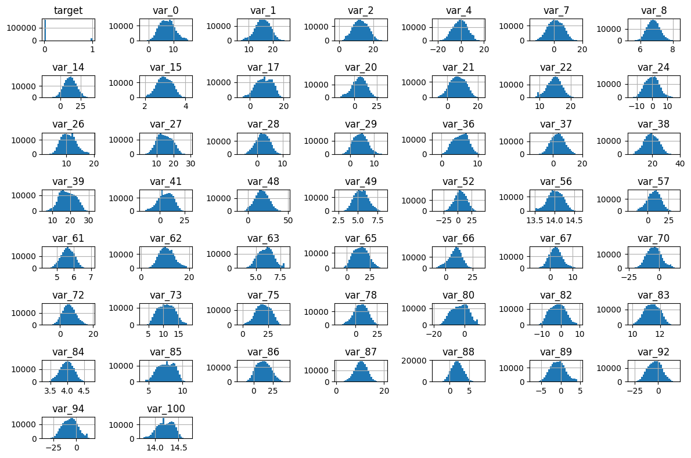
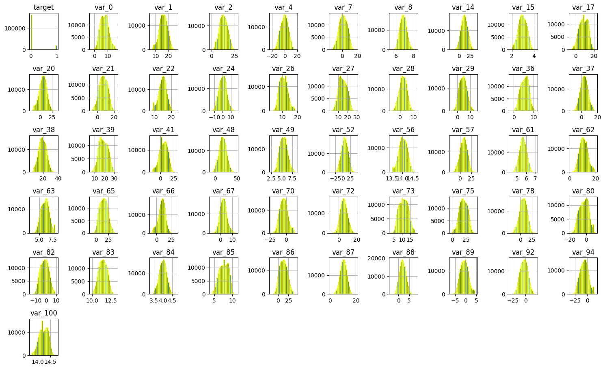
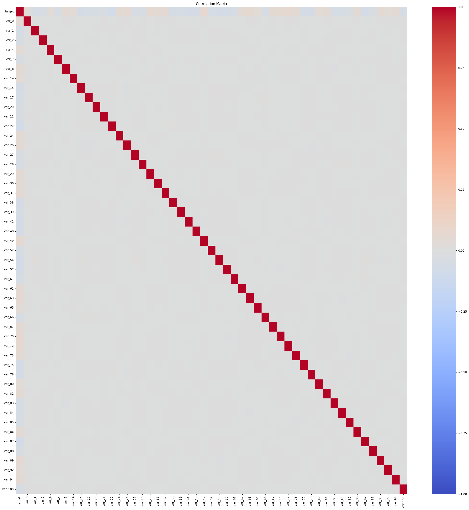
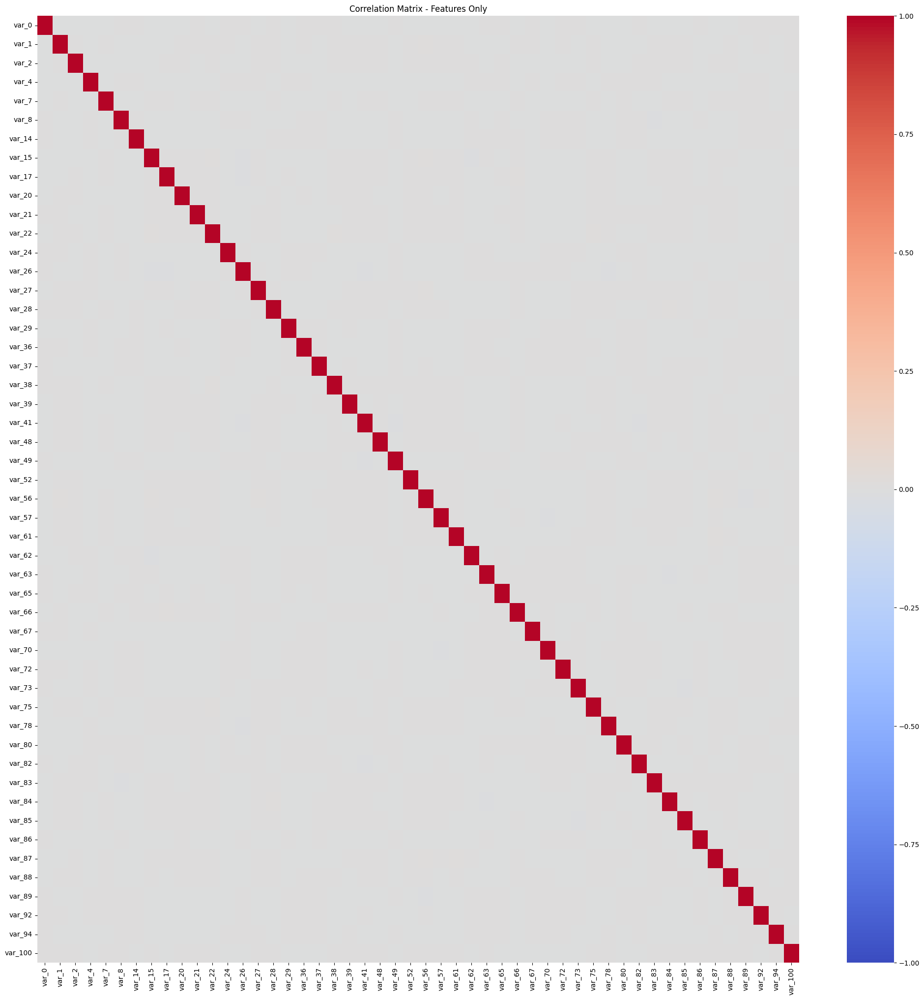
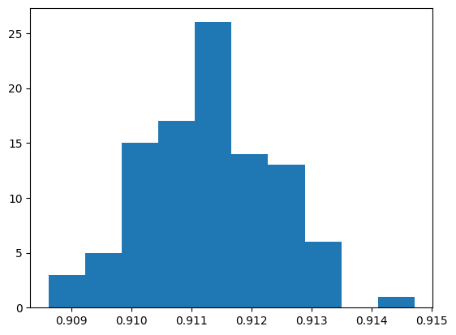
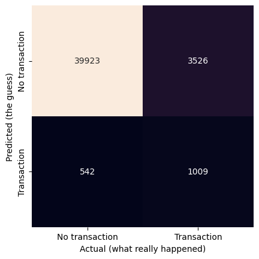

# Project 1 – Pass-10


## Problem Definition


Business problem: Predict whether a customer will make a successfull transaction,

Data Science problem: This is a supervised learning and classification problem. I will use the Gaussian Naive Bayes model


## Data Collection

### Imports


```python
import pandas as pd
import matplotlib.pyplot as plt
import numpy as np
import seaborn as sns

from sklearn.naive_bayes import GaussianNB
from sklearn.model_selection import train_test_split
from sklearn import datasets, metrics, model_selection
```

### File Paths


```python
url = 'https://ddc-datascience.s3.amazonaws.com/Projects/Project.1-Transactions/Data/Transaction.train.big.csv'
```

### Load data


```python
#load data
transaction_df= pd.read_csv(url)
```

### Head


```python
# first few rows
transaction_df.head()
```


  <div id="df-9a59764e-65b6-4c16-9ab7-98b2ee8a9808" class="colab-df-container">
    <div>
<style scoped>
    .dataframe tbody tr th:only-of-type {
        vertical-align: middle;
    }

    .dataframe tbody tr th {
        vertical-align: top;
    }

    .dataframe thead th {
        text-align: right;
    }
</style>
<table border="1" class="dataframe">
  <thead>
    <tr style="text-align: right;">
      <th></th>
      <th>Unnamed: 0</th>
      <th>ID_code</th>
      <th>target</th>
      <th>var_0</th>
      <th>var_1</th>
      <th>var_2</th>
      <th>var_3</th>
      <th>var_4</th>
      <th>var_5</th>
      <th>var_6</th>
      <th>...</th>
      <th>var_91</th>
      <th>var_92</th>
      <th>var_93</th>
      <th>var_94</th>
      <th>var_95</th>
      <th>var_96</th>
      <th>var_97</th>
      <th>var_98</th>
      <th>var_99</th>
      <th>var_100</th>
    </tr>
  </thead>
  <tbody>
    <tr>
      <th>0</th>
      <td>0</td>
      <td>train_0</td>
      <td>NaN</td>
      <td>NaN</td>
      <td>NaN</td>
      <td>NaN</td>
      <td>NaN</td>
      <td>NaN</td>
      <td>NaN</td>
      <td>NaN</td>
      <td>...</td>
      <td>NaN</td>
      <td>NaN</td>
      <td>NaN</td>
      <td>NaN</td>
      <td>NaN</td>
      <td>NaN</td>
      <td>NaN</td>
      <td>NaN</td>
      <td>NaN</td>
      <td>NaN</td>
    </tr>
    <tr>
      <th>1</th>
      <td>1</td>
      <td>train_1</td>
      <td>NaN</td>
      <td>NaN</td>
      <td>NaN</td>
      <td>NaN</td>
      <td>NaN</td>
      <td>NaN</td>
      <td>NaN</td>
      <td>NaN</td>
      <td>...</td>
      <td>NaN</td>
      <td>NaN</td>
      <td>NaN</td>
      <td>NaN</td>
      <td>NaN</td>
      <td>NaN</td>
      <td>NaN</td>
      <td>NaN</td>
      <td>NaN</td>
      <td>NaN</td>
    </tr>
    <tr>
      <th>2</th>
      <td>2</td>
      <td>train_2</td>
      <td>NaN</td>
      <td>NaN</td>
      <td>NaN</td>
      <td>NaN</td>
      <td>NaN</td>
      <td>NaN</td>
      <td>NaN</td>
      <td>NaN</td>
      <td>...</td>
      <td>NaN</td>
      <td>NaN</td>
      <td>NaN</td>
      <td>NaN</td>
      <td>NaN</td>
      <td>NaN</td>
      <td>NaN</td>
      <td>NaN</td>
      <td>NaN</td>
      <td>NaN</td>
    </tr>
    <tr>
      <th>3</th>
      <td>3</td>
      <td>train_3</td>
      <td>0.0</td>
      <td>4.6739</td>
      <td>22.3915</td>
      <td>15.6015</td>
      <td>NaN</td>
      <td>0.0464</td>
      <td>NaN</td>
      <td>NaN</td>
      <td>...</td>
      <td>NaN</td>
      <td>11.1077</td>
      <td>NaN</td>
      <td>-12.6465</td>
      <td>NaN</td>
      <td>NaN</td>
      <td>NaN</td>
      <td>NaN</td>
      <td>NaN</td>
      <td>14.0618</td>
    </tr>
    <tr>
      <th>4</th>
      <td>4</td>
      <td>train_4</td>
      <td>NaN</td>
      <td>NaN</td>
      <td>NaN</td>
      <td>NaN</td>
      <td>NaN</td>
      <td>NaN</td>
      <td>NaN</td>
      <td>NaN</td>
      <td>...</td>
      <td>NaN</td>
      <td>NaN</td>
      <td>NaN</td>
      <td>NaN</td>
      <td>NaN</td>
      <td>NaN</td>
      <td>NaN</td>
      <td>NaN</td>
      <td>NaN</td>
      <td>NaN</td>
    </tr>
  </tbody>
</table>
<p>5 rows × 104 columns</p>
</div>
    <div class="colab-df-buttons">

  <div class="colab-df-container">
    <button class="colab-df-convert" onclick="convertToInteractive('df-9a59764e-65b6-4c16-9ab7-98b2ee8a9808')"
            title="Convert this dataframe to an interactive table."
            style="display:none;">

  <svg xmlns="http://www.w3.org/2000/svg" height="24px" viewBox="0 -960 960 960">
    <path d="M120-120v-720h720v720H120Zm60-500h600v-160H180v160Zm220 220h160v-160H400v160Zm0 220h160v-160H400v160ZM180-400h160v-160H180v160Zm440 0h160v-160H620v160ZM180-180h160v-160H180v160Zm440 0h160v-160H620v160Z"/>
  </svg>
    </button>

  <style>
    .colab-df-container {
      display:flex;
      gap: 12px;
    }

    .colab-df-convert {
      background-color: #E8F0FE;
      border: none;
      border-radius: 50%;
      cursor: pointer;
      display: none;
      fill: #1967D2;
      height: 32px;
      padding: 0 0 0 0;
      width: 32px;
    }

    .colab-df-convert:hover {
      background-color: #E2EBFA;
      box-shadow: 0px 1px 2px rgba(60, 64, 67, 0.3), 0px 1px 3px 1px rgba(60, 64, 67, 0.15);
      fill: #174EA6;
    }

    .colab-df-buttons div {
      margin-bottom: 4px;
    }

    [theme=dark] .colab-df-convert {
      background-color: #3B4455;
      fill: #D2E3FC;
    }

    [theme=dark] .colab-df-convert:hover {
      background-color: #434B5C;
      box-shadow: 0px 1px 3px 1px rgba(0, 0, 0, 0.15);
      filter: drop-shadow(0px 1px 2px rgba(0, 0, 0, 0.3));
      fill: #FFFFFF;
    }
  </style>

    <script>
      const buttonEl =
        document.querySelector('#df-9a59764e-65b6-4c16-9ab7-98b2ee8a9808 button.colab-df-convert');
      buttonEl.style.display =
        google.colab.kernel.accessAllowed ? 'block' : 'none';

      async function convertToInteractive(key) {
        const element = document.querySelector('#df-9a59764e-65b6-4c16-9ab7-98b2ee8a9808');
        const dataTable =
          await google.colab.kernel.invokeFunction('convertToInteractive',
                                                    [key], {});
        if (!dataTable) return;

        const docLinkHtml = 'Like what you see? Visit the ' +
          '<a target="_blank" href=https://colab.research.google.com/notebooks/data_table.ipynb>data table notebook</a>'
          + ' to learn more about interactive tables.';
        element.innerHTML = '';
        dataTable['output_type'] = 'display_data';
        await google.colab.output.renderOutput(dataTable, element);
        const docLink = document.createElement('div');
        docLink.innerHTML = docLinkHtml;
        element.appendChild(docLink);
      }
    </script>
  </div>


    </div>
  </div>


### Tail


```python
# last few rows
transaction_df.tail()
```


  <div id="df-8e9f27d6-547b-441c-86c8-3e1ac9731345" class="colab-df-container">
    <div>
<style scoped>
    .dataframe tbody tr th:only-of-type {
        vertical-align: middle;
    }

    .dataframe tbody tr th {
        vertical-align: top;
    }

    .dataframe thead th {
        text-align: right;
    }
</style>
<table border="1" class="dataframe">
  <thead>
    <tr style="text-align: right;">
      <th></th>
      <th>Unnamed: 0</th>
      <th>ID_code</th>
      <th>target</th>
      <th>var_0</th>
      <th>var_1</th>
      <th>var_2</th>
      <th>var_3</th>
      <th>var_4</th>
      <th>var_5</th>
      <th>var_6</th>
      <th>...</th>
      <th>var_91</th>
      <th>var_92</th>
      <th>var_93</th>
      <th>var_94</th>
      <th>var_95</th>
      <th>var_96</th>
      <th>var_97</th>
      <th>var_98</th>
      <th>var_99</th>
      <th>var_100</th>
    </tr>
  </thead>
  <tbody>
    <tr>
      <th>1049995</th>
      <td>1049995</td>
      <td>train_1049995</td>
      <td>1.0</td>
      <td>11.3251</td>
      <td>16.4148</td>
      <td>20.5955</td>
      <td>NaN</td>
      <td>-6.3011</td>
      <td>NaN</td>
      <td>NaN</td>
      <td>...</td>
      <td>NaN</td>
      <td>1.3921</td>
      <td>NaN</td>
      <td>-16.4925</td>
      <td>NaN</td>
      <td>NaN</td>
      <td>NaN</td>
      <td>NaN</td>
      <td>NaN</td>
      <td>14.4421</td>
    </tr>
    <tr>
      <th>1049996</th>
      <td>1049996</td>
      <td>train_1049996</td>
      <td>NaN</td>
      <td>NaN</td>
      <td>NaN</td>
      <td>NaN</td>
      <td>NaN</td>
      <td>NaN</td>
      <td>NaN</td>
      <td>NaN</td>
      <td>...</td>
      <td>NaN</td>
      <td>NaN</td>
      <td>NaN</td>
      <td>NaN</td>
      <td>NaN</td>
      <td>NaN</td>
      <td>NaN</td>
      <td>NaN</td>
      <td>NaN</td>
      <td>NaN</td>
    </tr>
    <tr>
      <th>1049997</th>
      <td>1049997</td>
      <td>train_1049997</td>
      <td>0.0</td>
      <td>8.9941</td>
      <td>13.4127</td>
      <td>3.9567</td>
      <td>NaN</td>
      <td>3.5744</td>
      <td>NaN</td>
      <td>NaN</td>
      <td>...</td>
      <td>NaN</td>
      <td>2.0836</td>
      <td>NaN</td>
      <td>-18.6168</td>
      <td>NaN</td>
      <td>NaN</td>
      <td>NaN</td>
      <td>NaN</td>
      <td>NaN</td>
      <td>14.0689</td>
    </tr>
    <tr>
      <th>1049998</th>
      <td>1049998</td>
      <td>train_1049998</td>
      <td>NaN</td>
      <td>NaN</td>
      <td>NaN</td>
      <td>NaN</td>
      <td>NaN</td>
      <td>NaN</td>
      <td>NaN</td>
      <td>NaN</td>
      <td>...</td>
      <td>NaN</td>
      <td>NaN</td>
      <td>NaN</td>
      <td>NaN</td>
      <td>NaN</td>
      <td>NaN</td>
      <td>NaN</td>
      <td>NaN</td>
      <td>NaN</td>
      <td>NaN</td>
    </tr>
    <tr>
      <th>1049999</th>
      <td>1049999</td>
      <td>train_1049999</td>
      <td>0.0</td>
      <td>2.1828</td>
      <td>12.3805</td>
      <td>17.5654</td>
      <td>NaN</td>
      <td>8.1795</td>
      <td>NaN</td>
      <td>NaN</td>
      <td>...</td>
      <td>NaN</td>
      <td>-12.1108</td>
      <td>NaN</td>
      <td>10.7608</td>
      <td>NaN</td>
      <td>NaN</td>
      <td>NaN</td>
      <td>NaN</td>
      <td>NaN</td>
      <td>14.1690</td>
    </tr>
  </tbody>
</table>
<p>5 rows × 104 columns</p>
</div>
    <div class="colab-df-buttons">

  <div class="colab-df-container">
    <button class="colab-df-convert" onclick="convertToInteractive('df-8e9f27d6-547b-441c-86c8-3e1ac9731345')"
            title="Convert this dataframe to an interactive table."
            style="display:none;">

  <svg xmlns="http://www.w3.org/2000/svg" height="24px" viewBox="0 -960 960 960">
    <path d="M120-120v-720h720v720H120Zm60-500h600v-160H180v160Zm220 220h160v-160H400v160Zm0 220h160v-160H400v160ZM180-400h160v-160H180v160Zm440 0h160v-160H620v160ZM180-180h160v-160H180v160Zm440 0h160v-160H620v160Z"/>
  </svg>
    </button>

  <style>
    .colab-df-container {
      display:flex;
      gap: 12px;
    }

    .colab-df-convert {
      background-color: #E8F0FE;
      border: none;
      border-radius: 50%;
      cursor: pointer;
      display: none;
      fill: #1967D2;
      height: 32px;
      padding: 0 0 0 0;
      width: 32px;
    }

    .colab-df-convert:hover {
      background-color: #E2EBFA;
      box-shadow: 0px 1px 2px rgba(60, 64, 67, 0.3), 0px 1px 3px 1px rgba(60, 64, 67, 0.15);
      fill: #174EA6;
    }

    .colab-df-buttons div {
      margin-bottom: 4px;
    }

    [theme=dark] .colab-df-convert {
      background-color: #3B4455;
      fill: #D2E3FC;
    }

    [theme=dark] .colab-df-convert:hover {
      background-color: #434B5C;
      box-shadow: 0px 1px 3px 1px rgba(0, 0, 0, 0.15);
      filter: drop-shadow(0px 1px 2px rgba(0, 0, 0, 0.3));
      fill: #FFFFFF;
    }
  </style>

    <script>
      const buttonEl =
        document.querySelector('#df-8e9f27d6-547b-441c-86c8-3e1ac9731345 button.colab-df-convert');
      buttonEl.style.display =
        google.colab.kernel.accessAllowed ? 'block' : 'none';

      async function convertToInteractive(key) {
        const element = document.querySelector('#df-8e9f27d6-547b-441c-86c8-3e1ac9731345');
        const dataTable =
          await google.colab.kernel.invokeFunction('convertToInteractive',
                                                    [key], {});
        if (!dataTable) return;

        const docLinkHtml = 'Like what you see? Visit the ' +
          '<a target="_blank" href=https://colab.research.google.com/notebooks/data_table.ipynb>data table notebook</a>'
          + ' to learn more about interactive tables.';
        element.innerHTML = '';
        dataTable['output_type'] = 'display_data';
        await google.colab.output.renderOutput(dataTable, element);
        const docLink = document.createElement('div');
        docLink.innerHTML = docLinkHtml;
        element.appendChild(docLink);
      }
    </script>
  </div>


    </div>
  </div>


### Shape


```python
# shape of data frame
transaction_df.shape

#output (# of rows, # of columns)
```


    (1050000, 104)


### Size


```python
# size of data frame
transaction_df.size
```


    109200000


### Info


```python
# display meta-data
transaction_df.info()

```

    <class 'pandas.core.frame.DataFrame'>
    RangeIndex: 1050000 entries, 0 to 1049999
    Columns: 104 entries, Unnamed: 0 to var_100
    dtypes: float64(102), int64(1), object(1)
    memory usage: 833.1+ MB


## Summary statistics

### Describe


```python
# display summary statistics
transaction_df.describe()

```


  <div id="df-138dc3cc-f349-4d5f-b36e-66f945920372" class="colab-df-container">
    <div>
<style scoped>
    .dataframe tbody tr th:only-of-type {
        vertical-align: middle;
    }

    .dataframe tbody tr th {
        vertical-align: top;
    }

    .dataframe thead th {
        text-align: right;
    }
</style>
<table border="1" class="dataframe">
  <thead>
    <tr style="text-align: right;">
      <th></th>
      <th>Unnamed: 0</th>
      <th>target</th>
      <th>var_0</th>
      <th>var_1</th>
      <th>var_2</th>
      <th>var_3</th>
      <th>var_4</th>
      <th>var_5</th>
      <th>var_6</th>
      <th>var_7</th>
      <th>...</th>
      <th>var_91</th>
      <th>var_92</th>
      <th>var_93</th>
      <th>var_94</th>
      <th>var_95</th>
      <th>var_96</th>
      <th>var_97</th>
      <th>var_98</th>
      <th>var_99</th>
      <th>var_100</th>
    </tr>
  </thead>
  <tbody>
    <tr>
      <th>count</th>
      <td>1.050000e+06</td>
      <td>180000.000000</td>
      <td>180000.000000</td>
      <td>180000.000000</td>
      <td>180000.000000</td>
      <td>0.0</td>
      <td>180000.000000</td>
      <td>0.0</td>
      <td>0.0</td>
      <td>180000.000000</td>
      <td>...</td>
      <td>0.0</td>
      <td>180000.000000</td>
      <td>0.0</td>
      <td>180000.000000</td>
      <td>0.0</td>
      <td>0.0</td>
      <td>0.0</td>
      <td>0.0</td>
      <td>0.0</td>
      <td>180000.000000</td>
    </tr>
    <tr>
      <th>mean</th>
      <td>5.249995e+05</td>
      <td>0.100222</td>
      <td>7.440715</td>
      <td>15.870166</td>
      <td>12.735619</td>
      <td>NaN</td>
      <td>-0.668334</td>
      <td>NaN</td>
      <td>NaN</td>
      <td>1.190419</td>
      <td>...</td>
      <td>NaN</td>
      <td>-3.294620</td>
      <td>NaN</td>
      <td>-6.727860</td>
      <td>NaN</td>
      <td>NaN</td>
      <td>NaN</td>
      <td>NaN</td>
      <td>NaN</td>
      <td>14.224538</td>
    </tr>
    <tr>
      <th>std</th>
      <td>3.031090e+05</td>
      <td>0.300297</td>
      <td>3.021636</td>
      <td>3.010492</td>
      <td>4.185923</td>
      <td>NaN</td>
      <td>5.968300</td>
      <td>NaN</td>
      <td>NaN</td>
      <td>5.169343</td>
      <td>...</td>
      <td>NaN</td>
      <td>7.418545</td>
      <td>NaN</td>
      <td>8.278554</td>
      <td>NaN</td>
      <td>NaN</td>
      <td>NaN</td>
      <td>NaN</td>
      <td>NaN</td>
      <td>0.171058</td>
    </tr>
    <tr>
      <th>min</th>
      <td>0.000000e+00</td>
      <td>0.000000</td>
      <td>-2.691700</td>
      <td>6.299300</td>
      <td>-1.018500</td>
      <td>NaN</td>
      <td>-22.748700</td>
      <td>NaN</td>
      <td>NaN</td>
      <td>-15.194000</td>
      <td>...</td>
      <td>NaN</td>
      <td>-29.984000</td>
      <td>NaN</td>
      <td>-35.211700</td>
      <td>NaN</td>
      <td>NaN</td>
      <td>NaN</td>
      <td>NaN</td>
      <td>NaN</td>
      <td>13.729000</td>
    </tr>
    <tr>
      <th>25%</th>
      <td>2.624998e+05</td>
      <td>0.000000</td>
      <td>5.160325</td>
      <td>13.830400</td>
      <td>9.664675</td>
      <td>NaN</td>
      <td>-4.997500</td>
      <td>NaN</td>
      <td>NaN</td>
      <td>-2.571400</td>
      <td>...</td>
      <td>NaN</td>
      <td>-8.757925</td>
      <td>NaN</td>
      <td>-12.835875</td>
      <td>NaN</td>
      <td>NaN</td>
      <td>NaN</td>
      <td>NaN</td>
      <td>NaN</td>
      <td>14.098900</td>
    </tr>
    <tr>
      <th>50%</th>
      <td>5.249995e+05</td>
      <td>0.000000</td>
      <td>7.350950</td>
      <td>15.934600</td>
      <td>12.670700</td>
      <td>NaN</td>
      <td>-0.560300</td>
      <td>NaN</td>
      <td>NaN</td>
      <td>1.194600</td>
      <td>...</td>
      <td>NaN</td>
      <td>-3.170950</td>
      <td>NaN</td>
      <td>-6.615100</td>
      <td>NaN</td>
      <td>NaN</td>
      <td>NaN</td>
      <td>NaN</td>
      <td>NaN</td>
      <td>14.226800</td>
    </tr>
    <tr>
      <th>75%</th>
      <td>7.874992e+05</td>
      <td>0.000000</td>
      <td>9.511125</td>
      <td>18.061425</td>
      <td>15.837300</td>
      <td>NaN</td>
      <td>3.632525</td>
      <td>NaN</td>
      <td>NaN</td>
      <td>5.090450</td>
      <td>...</td>
      <td>NaN</td>
      <td>2.043350</td>
      <td>NaN</td>
      <td>-0.885250</td>
      <td>NaN</td>
      <td>NaN</td>
      <td>NaN</td>
      <td>NaN</td>
      <td>NaN</td>
      <td>14.361800</td>
    </tr>
    <tr>
      <th>max</th>
      <td>1.049999e+06</td>
      <td>1.000000</td>
      <td>16.716500</td>
      <td>26.079100</td>
      <td>26.997600</td>
      <td>NaN</td>
      <td>18.855400</td>
      <td>NaN</td>
      <td>NaN</td>
      <td>18.471400</td>
      <td>...</td>
      <td>NaN</td>
      <td>21.236400</td>
      <td>NaN</td>
      <td>18.105600</td>
      <td>NaN</td>
      <td>NaN</td>
      <td>NaN</td>
      <td>NaN</td>
      <td>NaN</td>
      <td>14.743000</td>
    </tr>
  </tbody>
</table>
<p>8 rows × 103 columns</p>
</div>
    <div class="colab-df-buttons">

  <div class="colab-df-container">
    <button class="colab-df-convert" onclick="convertToInteractive('df-138dc3cc-f349-4d5f-b36e-66f945920372')"
            title="Convert this dataframe to an interactive table."
            style="display:none;">

  <svg xmlns="http://www.w3.org/2000/svg" height="24px" viewBox="0 -960 960 960">
    <path d="M120-120v-720h720v720H120Zm60-500h600v-160H180v160Zm220 220h160v-160H400v160Zm0 220h160v-160H400v160ZM180-400h160v-160H180v160Zm440 0h160v-160H620v160ZM180-180h160v-160H180v160Zm440 0h160v-160H620v160Z"/>
  </svg>
    </button>

  <style>
    .colab-df-container {
      display:flex;
      gap: 12px;
    }

    .colab-df-convert {
      background-color: #E8F0FE;
      border: none;
      border-radius: 50%;
      cursor: pointer;
      display: none;
      fill: #1967D2;
      height: 32px;
      padding: 0 0 0 0;
      width: 32px;
    }

    .colab-df-convert:hover {
      background-color: #E2EBFA;
      box-shadow: 0px 1px 2px rgba(60, 64, 67, 0.3), 0px 1px 3px 1px rgba(60, 64, 67, 0.15);
      fill: #174EA6;
    }

    .colab-df-buttons div {
      margin-bottom: 4px;
    }

    [theme=dark] .colab-df-convert {
      background-color: #3B4455;
      fill: #D2E3FC;
    }

    [theme=dark] .colab-df-convert:hover {
      background-color: #434B5C;
      box-shadow: 0px 1px 3px 1px rgba(0, 0, 0, 0.15);
      filter: drop-shadow(0px 1px 2px rgba(0, 0, 0, 0.3));
      fill: #FFFFFF;
    }
  </style>

    <script>
      const buttonEl =
        document.querySelector('#df-138dc3cc-f349-4d5f-b36e-66f945920372 button.colab-df-convert');
      buttonEl.style.display =
        google.colab.kernel.accessAllowed ? 'block' : 'none';

      async function convertToInteractive(key) {
        const element = document.querySelector('#df-138dc3cc-f349-4d5f-b36e-66f945920372');
        const dataTable =
          await google.colab.kernel.invokeFunction('convertToInteractive',
                                                    [key], {});
        if (!dataTable) return;

        const docLinkHtml = 'Like what you see? Visit the ' +
          '<a target="_blank" href=https://colab.research.google.com/notebooks/data_table.ipynb>data table notebook</a>'
          + ' to learn more about interactive tables.';
        element.innerHTML = '';
        dataTable['output_type'] = 'display_data';
        await google.colab.output.renderOutput(dataTable, element);
        const docLink = document.createElement('div');
        docLink.innerHTML = docLinkHtml;
        element.appendChild(docLink);
      }
    </script>
  </div>


    </div>
  </div>


### Target value counts

NOTE: the ‘target’ column indicates a successful transaction (‘1’) or a no-transaction (‘0’). Verify these are the only values in that column, and that there are no nulls.


```python
# value_counts on target ; include nulls
transaction_df['target'].value_counts(dropna=False)
```


<div>
<style scoped>
    .dataframe tbody tr th:only-of-type {
        vertical-align: middle;
    }

    .dataframe tbody tr th {
        vertical-align: top;
    }

    .dataframe thead th {
        text-align: right;
    }
</style>
<table border="1" class="dataframe">
  <thead>
    <tr style="text-align: right;">
      <th></th>
      <th>count</th>
    </tr>
    <tr>
      <th>target</th>
      <th></th>
    </tr>
  </thead>
  <tbody>
    <tr>
      <th>NaN</th>
      <td>870000</td>
    </tr>
    <tr>
      <th>0.0</th>
      <td>161960</td>
    </tr>
    <tr>
      <th>1.0</th>
      <td>18040</td>
    </tr>
  </tbody>
</table>
</div><br><label><b>dtype:</b> int64</label>


```python
#normalize value counts on target ; include nulls
transaction_df['target'].value_counts(normalize=True, dropna=False)
```


<div>
<style scoped>
    .dataframe tbody tr th:only-of-type {
        vertical-align: middle;
    }

    .dataframe tbody tr th {
        vertical-align: top;
    }

    .dataframe thead th {
        text-align: right;
    }
</style>
<table border="1" class="dataframe">
  <thead>
    <tr style="text-align: right;">
      <th></th>
      <th>proportion</th>
    </tr>
    <tr>
      <th>target</th>
      <th></th>
    </tr>
  </thead>
  <tbody>
    <tr>
      <th>NaN</th>
      <td>0.828571</td>
    </tr>
    <tr>
      <th>0.0</th>
      <td>0.154248</td>
    </tr>
    <tr>
      <th>1.0</th>
      <td>0.017181</td>
    </tr>
  </tbody>
</table>
</div><br><label><b>dtype:</b> float64</label>


### Nulls


```python
# look for nulls
transaction_df.isnull().sum().sort_values(ascending=False)


```


<div>
<style scoped>
    .dataframe tbody tr th:only-of-type {
        vertical-align: middle;
    }

    .dataframe tbody tr th {
        vertical-align: top;
    }

    .dataframe thead th {
        text-align: right;
    }
</style>
<table border="1" class="dataframe">
  <thead>
    <tr style="text-align: right;">
      <th></th>
      <th>0</th>
    </tr>
  </thead>
  <tbody>
    <tr>
      <th>var_3</th>
      <td>1050000</td>
    </tr>
    <tr>
      <th>var_16</th>
      <td>1050000</td>
    </tr>
    <tr>
      <th>var_12</th>
      <td>1050000</td>
    </tr>
    <tr>
      <th>var_11</th>
      <td>1050000</td>
    </tr>
    <tr>
      <th>var_9</th>
      <td>1050000</td>
    </tr>
    <tr>
      <th>...</th>
      <td>...</td>
    </tr>
    <tr>
      <th>var_88</th>
      <td>870000</td>
    </tr>
    <tr>
      <th>var_94</th>
      <td>870000</td>
    </tr>
    <tr>
      <th>var_100</th>
      <td>870000</td>
    </tr>
    <tr>
      <th>Unnamed: 0</th>
      <td>0</td>
    </tr>
    <tr>
      <th>ID_code</th>
      <td>0</td>
    </tr>
  </tbody>
</table>
<p>104 rows × 1 columns</p>
</div><br><label><b>dtype:</b> int64</label>


```python
# look for nulls, display relative frequency
null_sum = transaction_df.isnull().sum()
null_freq = null_sum / transaction_df.shape[0] * 100
null_freq.sort_values()

#Output- target has 82% percent null values
```


<div>
<style scoped>
    .dataframe tbody tr th:only-of-type {
        vertical-align: middle;
    }

    .dataframe tbody tr th {
        vertical-align: top;
    }

    .dataframe thead th {
        text-align: right;
    }
</style>
<table border="1" class="dataframe">
  <thead>
    <tr style="text-align: right;">
      <th></th>
      <th>0</th>
    </tr>
  </thead>
  <tbody>
    <tr>
      <th>Unnamed: 0</th>
      <td>0.000000</td>
    </tr>
    <tr>
      <th>ID_code</th>
      <td>0.000000</td>
    </tr>
    <tr>
      <th>target</th>
      <td>82.857143</td>
    </tr>
    <tr>
      <th>var_0</th>
      <td>82.857143</td>
    </tr>
    <tr>
      <th>var_1</th>
      <td>82.857143</td>
    </tr>
    <tr>
      <th>...</th>
      <td>...</td>
    </tr>
    <tr>
      <th>var_93</th>
      <td>100.000000</td>
    </tr>
    <tr>
      <th>var_96</th>
      <td>100.000000</td>
    </tr>
    <tr>
      <th>var_97</th>
      <td>100.000000</td>
    </tr>
    <tr>
      <th>var_98</th>
      <td>100.000000</td>
    </tr>
    <tr>
      <th>var_99</th>
      <td>100.000000</td>
    </tr>
  </tbody>
</table>
<p>104 rows × 1 columns</p>
</div><br><label><b>dtype:</b> float64</label>


### Column data types


```python
# display data types
transaction_df.dtypes.sort_values()
```


<div>
<style scoped>
    .dataframe tbody tr th:only-of-type {
        vertical-align: middle;
    }

    .dataframe tbody tr th {
        vertical-align: top;
    }

    .dataframe thead th {
        text-align: right;
    }
</style>
<table border="1" class="dataframe">
  <thead>
    <tr style="text-align: right;">
      <th></th>
      <th>0</th>
    </tr>
  </thead>
  <tbody>
    <tr>
      <th>Unnamed: 0</th>
      <td>int64</td>
    </tr>
    <tr>
      <th>var_72</th>
      <td>float64</td>
    </tr>
    <tr>
      <th>var_71</th>
      <td>float64</td>
    </tr>
    <tr>
      <th>var_70</th>
      <td>float64</td>
    </tr>
    <tr>
      <th>var_69</th>
      <td>float64</td>
    </tr>
    <tr>
      <th>...</th>
      <td>...</td>
    </tr>
    <tr>
      <th>var_26</th>
      <td>float64</td>
    </tr>
    <tr>
      <th>var_25</th>
      <td>float64</td>
    </tr>
    <tr>
      <th>var_35</th>
      <td>float64</td>
    </tr>
    <tr>
      <th>var_100</th>
      <td>float64</td>
    </tr>
    <tr>
      <th>ID_code</th>
      <td>object</td>
    </tr>
  </tbody>
</table>
<p>104 rows × 1 columns</p>
</div><br><label><b>dtype:</b> object</label>


### Unique elements


```python
# number of unique elements in every column (works on the whole dataframe)
transaction_df.nunique().sort_values(ascending=False)
```


<div>
<style scoped>
    .dataframe tbody tr th:only-of-type {
        vertical-align: middle;
    }

    .dataframe tbody tr th {
        vertical-align: top;
    }

    .dataframe thead th {
        text-align: right;
    }
</style>
<table border="1" class="dataframe">
  <thead>
    <tr style="text-align: right;">
      <th></th>
      <th>0</th>
    </tr>
  </thead>
  <tbody>
    <tr>
      <th>Unnamed: 0</th>
      <td>1050000</td>
    </tr>
    <tr>
      <th>ID_code</th>
      <td>1050000</td>
    </tr>
    <tr>
      <th>var_52</th>
      <td>137280</td>
    </tr>
    <tr>
      <th>var_86</th>
      <td>134537</td>
    </tr>
    <tr>
      <th>var_94</th>
      <td>131746</td>
    </tr>
    <tr>
      <th>...</th>
      <td>...</td>
    </tr>
    <tr>
      <th>var_93</th>
      <td>0</td>
    </tr>
    <tr>
      <th>var_96</th>
      <td>0</td>
    </tr>
    <tr>
      <th>var_97</th>
      <td>0</td>
    </tr>
    <tr>
      <th>var_98</th>
      <td>0</td>
    </tr>
    <tr>
      <th>var_99</th>
      <td>0</td>
    </tr>
  </tbody>
</table>
<p>104 rows × 1 columns</p>
</div><br><label><b>dtype:</b> int64</label>


```python
# actual unique values in one column
transaction_df['target'].unique()
```


    array([nan,  0.,  1.])


```python

```

## Data Cleaning


Backup #1


```python
# backup copy of the original data
transaction_df_backup= transaction_df.copy()

```


```python
# restore from backup
transaction_df=transaction_df_backup.copy()
```

### Drop rows with no target
  - The target has 83% nulls. Model cant learn from rows with no answer, remove them first

Selected `target` for the target and drop the rows with null values


```python
# Keep only the rows where target is not missing
transaction_df_target=transaction_df.dropna(subset=['target']).copy()
transaction_df_target.head()
```


  <div id="df-176ba4f3-2e5b-4bac-8d78-cc140262f3e1" class="colab-df-container">
    <div>
<style scoped>
    .dataframe tbody tr th:only-of-type {
        vertical-align: middle;
    }

    .dataframe tbody tr th {
        vertical-align: top;
    }

    .dataframe thead th {
        text-align: right;
    }
</style>
<table border="1" class="dataframe">
  <thead>
    <tr style="text-align: right;">
      <th></th>
      <th>Unnamed: 0</th>
      <th>ID_code</th>
      <th>target</th>
      <th>var_0</th>
      <th>var_1</th>
      <th>var_2</th>
      <th>var_3</th>
      <th>var_4</th>
      <th>var_5</th>
      <th>var_6</th>
      <th>...</th>
      <th>var_91</th>
      <th>var_92</th>
      <th>var_93</th>
      <th>var_94</th>
      <th>var_95</th>
      <th>var_96</th>
      <th>var_97</th>
      <th>var_98</th>
      <th>var_99</th>
      <th>var_100</th>
    </tr>
  </thead>
  <tbody>
    <tr>
      <th>3</th>
      <td>3</td>
      <td>train_3</td>
      <td>0.0</td>
      <td>4.6739</td>
      <td>22.3915</td>
      <td>15.6015</td>
      <td>NaN</td>
      <td>0.0464</td>
      <td>NaN</td>
      <td>NaN</td>
      <td>...</td>
      <td>NaN</td>
      <td>11.1077</td>
      <td>NaN</td>
      <td>-12.6465</td>
      <td>NaN</td>
      <td>NaN</td>
      <td>NaN</td>
      <td>NaN</td>
      <td>NaN</td>
      <td>14.0618</td>
    </tr>
    <tr>
      <th>5</th>
      <td>5</td>
      <td>train_5</td>
      <td>0.0</td>
      <td>14.6962</td>
      <td>18.3383</td>
      <td>17.4788</td>
      <td>NaN</td>
      <td>-9.1355</td>
      <td>NaN</td>
      <td>NaN</td>
      <td>...</td>
      <td>NaN</td>
      <td>-2.0111</td>
      <td>NaN</td>
      <td>-3.6166</td>
      <td>NaN</td>
      <td>NaN</td>
      <td>NaN</td>
      <td>NaN</td>
      <td>NaN</td>
      <td>14.4520</td>
    </tr>
    <tr>
      <th>11</th>
      <td>11</td>
      <td>train_11</td>
      <td>0.0</td>
      <td>4.4949</td>
      <td>14.4142</td>
      <td>13.2219</td>
      <td>NaN</td>
      <td>4.9140</td>
      <td>NaN</td>
      <td>NaN</td>
      <td>...</td>
      <td>NaN</td>
      <td>13.9424</td>
      <td>NaN</td>
      <td>-15.5776</td>
      <td>NaN</td>
      <td>NaN</td>
      <td>NaN</td>
      <td>NaN</td>
      <td>NaN</td>
      <td>14.1222</td>
    </tr>
    <tr>
      <th>15</th>
      <td>15</td>
      <td>train_15</td>
      <td>0.0</td>
      <td>4.9657</td>
      <td>16.2867</td>
      <td>17.9579</td>
      <td>NaN</td>
      <td>0.6017</td>
      <td>NaN</td>
      <td>NaN</td>
      <td>...</td>
      <td>NaN</td>
      <td>3.7943</td>
      <td>NaN</td>
      <td>5.6184</td>
      <td>NaN</td>
      <td>NaN</td>
      <td>NaN</td>
      <td>NaN</td>
      <td>NaN</td>
      <td>14.0619</td>
    </tr>
    <tr>
      <th>19</th>
      <td>19</td>
      <td>train_19</td>
      <td>0.0</td>
      <td>9.4287</td>
      <td>18.7822</td>
      <td>10.7630</td>
      <td>NaN</td>
      <td>-0.7532</td>
      <td>NaN</td>
      <td>NaN</td>
      <td>...</td>
      <td>NaN</td>
      <td>-5.6677</td>
      <td>NaN</td>
      <td>-1.8961</td>
      <td>NaN</td>
      <td>NaN</td>
      <td>NaN</td>
      <td>NaN</td>
      <td>NaN</td>
      <td>14.0275</td>
    </tr>
  </tbody>
</table>
<p>5 rows × 104 columns</p>
</div>
    <div class="colab-df-buttons">

  <div class="colab-df-container">
    <button class="colab-df-convert" onclick="convertToInteractive('df-176ba4f3-2e5b-4bac-8d78-cc140262f3e1')"
            title="Convert this dataframe to an interactive table."
            style="display:none;">

  <svg xmlns="http://www.w3.org/2000/svg" height="24px" viewBox="0 -960 960 960">
    <path d="M120-120v-720h720v720H120Zm60-500h600v-160H180v160Zm220 220h160v-160H400v160Zm0 220h160v-160H400v160ZM180-400h160v-160H180v160Zm440 0h160v-160H620v160ZM180-180h160v-160H180v160Zm440 0h160v-160H620v160Z"/>
  </svg>
    </button>

  <style>
    .colab-df-container {
      display:flex;
      gap: 12px;
    }

    .colab-df-convert {
      background-color: #E8F0FE;
      border: none;
      border-radius: 50%;
      cursor: pointer;
      display: none;
      fill: #1967D2;
      height: 32px;
      padding: 0 0 0 0;
      width: 32px;
    }

    .colab-df-convert:hover {
      background-color: #E2EBFA;
      box-shadow: 0px 1px 2px rgba(60, 64, 67, 0.3), 0px 1px 3px 1px rgba(60, 64, 67, 0.15);
      fill: #174EA6;
    }

    .colab-df-buttons div {
      margin-bottom: 4px;
    }

    [theme=dark] .colab-df-convert {
      background-color: #3B4455;
      fill: #D2E3FC;
    }

    [theme=dark] .colab-df-convert:hover {
      background-color: #434B5C;
      box-shadow: 0px 1px 3px 1px rgba(0, 0, 0, 0.15);
      filter: drop-shadow(0px 1px 2px rgba(0, 0, 0, 0.3));
      fill: #FFFFFF;
    }
  </style>

    <script>
      const buttonEl =
        document.querySelector('#df-176ba4f3-2e5b-4bac-8d78-cc140262f3e1 button.colab-df-convert');
      buttonEl.style.display =
        google.colab.kernel.accessAllowed ? 'block' : 'none';

      async function convertToInteractive(key) {
        const element = document.querySelector('#df-176ba4f3-2e5b-4bac-8d78-cc140262f3e1');
        const dataTable =
          await google.colab.kernel.invokeFunction('convertToInteractive',
                                                    [key], {});
        if (!dataTable) return;

        const docLinkHtml = 'Like what you see? Visit the ' +
          '<a target="_blank" href=https://colab.research.google.com/notebooks/data_table.ipynb>data table notebook</a>'
          + ' to learn more about interactive tables.';
        element.innerHTML = '';
        dataTable['output_type'] = 'display_data';
        await google.colab.output.renderOutput(dataTable, element);
        const docLink = document.createElement('div');
        docLink.innerHTML = docLinkHtml;
        element.appendChild(docLink);
      }
    </script>
  </div>


    </div>
  </div>


```python
transaction_df_target.head(10) # this is to check
```


  <div id="df-b5270165-31ac-4109-8947-8af364e69ece" class="colab-df-container">
    <div>
<style scoped>
    .dataframe tbody tr th:only-of-type {
        vertical-align: middle;
    }

    .dataframe tbody tr th {
        vertical-align: top;
    }

    .dataframe thead th {
        text-align: right;
    }
</style>
<table border="1" class="dataframe">
  <thead>
    <tr style="text-align: right;">
      <th></th>
      <th>Unnamed: 0</th>
      <th>ID_code</th>
      <th>target</th>
      <th>var_0</th>
      <th>var_1</th>
      <th>var_2</th>
      <th>var_3</th>
      <th>var_4</th>
      <th>var_5</th>
      <th>var_6</th>
      <th>...</th>
      <th>var_91</th>
      <th>var_92</th>
      <th>var_93</th>
      <th>var_94</th>
      <th>var_95</th>
      <th>var_96</th>
      <th>var_97</th>
      <th>var_98</th>
      <th>var_99</th>
      <th>var_100</th>
    </tr>
  </thead>
  <tbody>
    <tr>
      <th>3</th>
      <td>3</td>
      <td>train_3</td>
      <td>0.0</td>
      <td>4.6739</td>
      <td>22.3915</td>
      <td>15.6015</td>
      <td>NaN</td>
      <td>0.0464</td>
      <td>NaN</td>
      <td>NaN</td>
      <td>...</td>
      <td>NaN</td>
      <td>11.1077</td>
      <td>NaN</td>
      <td>-12.6465</td>
      <td>NaN</td>
      <td>NaN</td>
      <td>NaN</td>
      <td>NaN</td>
      <td>NaN</td>
      <td>14.0618</td>
    </tr>
    <tr>
      <th>5</th>
      <td>5</td>
      <td>train_5</td>
      <td>0.0</td>
      <td>14.6962</td>
      <td>18.3383</td>
      <td>17.4788</td>
      <td>NaN</td>
      <td>-9.1355</td>
      <td>NaN</td>
      <td>NaN</td>
      <td>...</td>
      <td>NaN</td>
      <td>-2.0111</td>
      <td>NaN</td>
      <td>-3.6166</td>
      <td>NaN</td>
      <td>NaN</td>
      <td>NaN</td>
      <td>NaN</td>
      <td>NaN</td>
      <td>14.4520</td>
    </tr>
    <tr>
      <th>11</th>
      <td>11</td>
      <td>train_11</td>
      <td>0.0</td>
      <td>4.4949</td>
      <td>14.4142</td>
      <td>13.2219</td>
      <td>NaN</td>
      <td>4.9140</td>
      <td>NaN</td>
      <td>NaN</td>
      <td>...</td>
      <td>NaN</td>
      <td>13.9424</td>
      <td>NaN</td>
      <td>-15.5776</td>
      <td>NaN</td>
      <td>NaN</td>
      <td>NaN</td>
      <td>NaN</td>
      <td>NaN</td>
      <td>14.1222</td>
    </tr>
    <tr>
      <th>15</th>
      <td>15</td>
      <td>train_15</td>
      <td>0.0</td>
      <td>4.9657</td>
      <td>16.2867</td>
      <td>17.9579</td>
      <td>NaN</td>
      <td>0.6017</td>
      <td>NaN</td>
      <td>NaN</td>
      <td>...</td>
      <td>NaN</td>
      <td>3.7943</td>
      <td>NaN</td>
      <td>5.6184</td>
      <td>NaN</td>
      <td>NaN</td>
      <td>NaN</td>
      <td>NaN</td>
      <td>NaN</td>
      <td>14.0619</td>
    </tr>
    <tr>
      <th>19</th>
      <td>19</td>
      <td>train_19</td>
      <td>0.0</td>
      <td>9.4287</td>
      <td>18.7822</td>
      <td>10.7630</td>
      <td>NaN</td>
      <td>-0.7532</td>
      <td>NaN</td>
      <td>NaN</td>
      <td>...</td>
      <td>NaN</td>
      <td>-5.6677</td>
      <td>NaN</td>
      <td>-1.8961</td>
      <td>NaN</td>
      <td>NaN</td>
      <td>NaN</td>
      <td>NaN</td>
      <td>NaN</td>
      <td>14.0275</td>
    </tr>
    <tr>
      <th>22</th>
      <td>22</td>
      <td>train_22</td>
      <td>0.0</td>
      <td>6.7023</td>
      <td>18.0127</td>
      <td>18.4424</td>
      <td>NaN</td>
      <td>-5.1010</td>
      <td>NaN</td>
      <td>NaN</td>
      <td>...</td>
      <td>NaN</td>
      <td>-4.0632</td>
      <td>NaN</td>
      <td>-23.8292</td>
      <td>NaN</td>
      <td>NaN</td>
      <td>NaN</td>
      <td>NaN</td>
      <td>NaN</td>
      <td>14.2807</td>
    </tr>
    <tr>
      <th>29</th>
      <td>29</td>
      <td>train_29</td>
      <td>0.0</td>
      <td>11.2902</td>
      <td>7.7553</td>
      <td>6.6189</td>
      <td>NaN</td>
      <td>-7.0587</td>
      <td>NaN</td>
      <td>NaN</td>
      <td>...</td>
      <td>NaN</td>
      <td>-14.5796</td>
      <td>NaN</td>
      <td>-4.8106</td>
      <td>NaN</td>
      <td>NaN</td>
      <td>NaN</td>
      <td>NaN</td>
      <td>NaN</td>
      <td>14.5344</td>
    </tr>
    <tr>
      <th>33</th>
      <td>33</td>
      <td>train_33</td>
      <td>0.0</td>
      <td>4.6761</td>
      <td>14.6116</td>
      <td>12.4063</td>
      <td>NaN</td>
      <td>-9.6457</td>
      <td>NaN</td>
      <td>NaN</td>
      <td>...</td>
      <td>NaN</td>
      <td>-8.4133</td>
      <td>NaN</td>
      <td>-13.9157</td>
      <td>NaN</td>
      <td>NaN</td>
      <td>NaN</td>
      <td>NaN</td>
      <td>NaN</td>
      <td>14.5322</td>
    </tr>
    <tr>
      <th>35</th>
      <td>35</td>
      <td>train_35</td>
      <td>0.0</td>
      <td>10.5404</td>
      <td>10.9793</td>
      <td>11.0240</td>
      <td>NaN</td>
      <td>2.2579</td>
      <td>NaN</td>
      <td>NaN</td>
      <td>...</td>
      <td>NaN</td>
      <td>-2.6769</td>
      <td>NaN</td>
      <td>10.5682</td>
      <td>NaN</td>
      <td>NaN</td>
      <td>NaN</td>
      <td>NaN</td>
      <td>NaN</td>
      <td>14.3515</td>
    </tr>
    <tr>
      <th>46</th>
      <td>46</td>
      <td>train_46</td>
      <td>0.0</td>
      <td>5.6315</td>
      <td>13.2825</td>
      <td>20.9955</td>
      <td>NaN</td>
      <td>3.1402</td>
      <td>NaN</td>
      <td>NaN</td>
      <td>...</td>
      <td>NaN</td>
      <td>8.3377</td>
      <td>NaN</td>
      <td>-6.9172</td>
      <td>NaN</td>
      <td>NaN</td>
      <td>NaN</td>
      <td>NaN</td>
      <td>NaN</td>
      <td>14.1113</td>
    </tr>
  </tbody>
</table>
<p>10 rows × 104 columns</p>
</div>
    <div class="colab-df-buttons">

  <div class="colab-df-container">
    <button class="colab-df-convert" onclick="convertToInteractive('df-b5270165-31ac-4109-8947-8af364e69ece')"
            title="Convert this dataframe to an interactive table."
            style="display:none;">

  <svg xmlns="http://www.w3.org/2000/svg" height="24px" viewBox="0 -960 960 960">
    <path d="M120-120v-720h720v720H120Zm60-500h600v-160H180v160Zm220 220h160v-160H400v160Zm0 220h160v-160H400v160ZM180-400h160v-160H180v160Zm440 0h160v-160H620v160ZM180-180h160v-160H180v160Zm440 0h160v-160H620v160Z"/>
  </svg>
    </button>

  <style>
    .colab-df-container {
      display:flex;
      gap: 12px;
    }

    .colab-df-convert {
      background-color: #E8F0FE;
      border: none;
      border-radius: 50%;
      cursor: pointer;
      display: none;
      fill: #1967D2;
      height: 32px;
      padding: 0 0 0 0;
      width: 32px;
    }

    .colab-df-convert:hover {
      background-color: #E2EBFA;
      box-shadow: 0px 1px 2px rgba(60, 64, 67, 0.3), 0px 1px 3px 1px rgba(60, 64, 67, 0.15);
      fill: #174EA6;
    }

    .colab-df-buttons div {
      margin-bottom: 4px;
    }

    [theme=dark] .colab-df-convert {
      background-color: #3B4455;
      fill: #D2E3FC;
    }

    [theme=dark] .colab-df-convert:hover {
      background-color: #434B5C;
      box-shadow: 0px 1px 3px 1px rgba(0, 0, 0, 0.15);
      filter: drop-shadow(0px 1px 2px rgba(0, 0, 0, 0.3));
      fill: #FFFFFF;
    }
  </style>

    <script>
      const buttonEl =
        document.querySelector('#df-b5270165-31ac-4109-8947-8af364e69ece button.colab-df-convert');
      buttonEl.style.display =
        google.colab.kernel.accessAllowed ? 'block' : 'none';

      async function convertToInteractive(key) {
        const element = document.querySelector('#df-b5270165-31ac-4109-8947-8af364e69ece');
        const dataTable =
          await google.colab.kernel.invokeFunction('convertToInteractive',
                                                    [key], {});
        if (!dataTable) return;

        const docLinkHtml = 'Like what you see? Visit the ' +
          '<a target="_blank" href=https://colab.research.google.com/notebooks/data_table.ipynb>data table notebook</a>'
          + ' to learn more about interactive tables.';
        element.innerHTML = '';
        dataTable['output_type'] = 'display_data';
        await google.colab.output.renderOutput(dataTable, element);
        const docLink = document.createElement('div');
        docLink.innerHTML = docLinkHtml;
        element.appendChild(docLink);
      }
    </script>
  </div>


    </div>
  </div>


### Backup #2


```python
# make backup
transaction_df_target_backup = transaction_df_target.copy()
```


```python
# restore from back up
transaction_df_target = transaction_df_target_backup.copy()
```

### Address any rows with nulls

- If the number of nulls in a column is low, it would be easiest to drop the row.
- If the number of nulls in a column is high, it would be easiest to drop the column.
- If the number of nulls in a column is between the low and high, one should impute values for the nulls.


```python
transaction_df_target.isnull().sum().sort_values (ascending=False) # show me where the null value are
```


<div>
<style scoped>
    .dataframe tbody tr th:only-of-type {
        vertical-align: middle;
    }

    .dataframe tbody tr th {
        vertical-align: top;
    }

    .dataframe thead th {
        text-align: right;
    }
</style>
<table border="1" class="dataframe">
  <thead>
    <tr style="text-align: right;">
      <th></th>
      <th>0</th>
    </tr>
  </thead>
  <tbody>
    <tr>
      <th>var_3</th>
      <td>180000</td>
    </tr>
    <tr>
      <th>var_16</th>
      <td>180000</td>
    </tr>
    <tr>
      <th>var_12</th>
      <td>180000</td>
    </tr>
    <tr>
      <th>var_11</th>
      <td>180000</td>
    </tr>
    <tr>
      <th>var_9</th>
      <td>180000</td>
    </tr>
    <tr>
      <th>...</th>
      <td>...</td>
    </tr>
    <tr>
      <th>var_88</th>
      <td>0</td>
    </tr>
    <tr>
      <th>var_86</th>
      <td>0</td>
    </tr>
    <tr>
      <th>var_85</th>
      <td>0</td>
    </tr>
    <tr>
      <th>var_94</th>
      <td>0</td>
    </tr>
    <tr>
      <th>var_100</th>
      <td>0</td>
    </tr>
  </tbody>
</table>
<p>104 rows × 1 columns</p>
</div><br><label><b>dtype:</b> int64</label>


```python
# Remove all the null row under target
transaction_df_target_clean =transaction_df_target.dropna(axis ='columns')
transaction_df_target_clean.isnull().sum().sort_values(ascending=False)

transaction_df_target_clean.head()


```


  <div id="df-4fec74cf-8456-4555-862d-ed2732ad6f03" class="colab-df-container">
    <div>
<style scoped>
    .dataframe tbody tr th:only-of-type {
        vertical-align: middle;
    }

    .dataframe tbody tr th {
        vertical-align: top;
    }

    .dataframe thead th {
        text-align: right;
    }
</style>
<table border="1" class="dataframe">
  <thead>
    <tr style="text-align: right;">
      <th></th>
      <th>Unnamed: 0</th>
      <th>ID_code</th>
      <th>target</th>
      <th>var_0</th>
      <th>var_1</th>
      <th>var_2</th>
      <th>var_4</th>
      <th>var_7</th>
      <th>var_8</th>
      <th>var_14</th>
      <th>...</th>
      <th>var_83</th>
      <th>var_84</th>
      <th>var_85</th>
      <th>var_86</th>
      <th>var_87</th>
      <th>var_88</th>
      <th>var_89</th>
      <th>var_92</th>
      <th>var_94</th>
      <th>var_100</th>
    </tr>
  </thead>
  <tbody>
    <tr>
      <th>3</th>
      <td>3</td>
      <td>train_3</td>
      <td>0.0</td>
      <td>4.6739</td>
      <td>22.3915</td>
      <td>15.6015</td>
      <td>0.0464</td>
      <td>-1.9254</td>
      <td>6.4760</td>
      <td>21.6435</td>
      <td>...</td>
      <td>11.8011</td>
      <td>3.9677</td>
      <td>9.5382</td>
      <td>-8.4394</td>
      <td>5.5043</td>
      <td>2.2732</td>
      <td>1.6362</td>
      <td>11.1077</td>
      <td>-12.6465</td>
      <td>14.0618</td>
    </tr>
    <tr>
      <th>5</th>
      <td>5</td>
      <td>train_5</td>
      <td>0.0</td>
      <td>14.6962</td>
      <td>18.3383</td>
      <td>17.4788</td>
      <td>-9.1355</td>
      <td>-6.4882</td>
      <td>6.0821</td>
      <td>11.7476</td>
      <td>...</td>
      <td>11.8294</td>
      <td>3.8887</td>
      <td>8.8591</td>
      <td>6.1482</td>
      <td>8.5833</td>
      <td>2.8432</td>
      <td>1.8434</td>
      <td>-2.0111</td>
      <td>-3.6166</td>
      <td>14.4520</td>
    </tr>
    <tr>
      <th>11</th>
      <td>11</td>
      <td>train_11</td>
      <td>0.0</td>
      <td>4.4949</td>
      <td>14.4142</td>
      <td>13.2219</td>
      <td>4.9140</td>
      <td>4.0501</td>
      <td>5.8144</td>
      <td>18.7136</td>
      <td>...</td>
      <td>11.7464</td>
      <td>4.0017</td>
      <td>5.8179</td>
      <td>10.4951</td>
      <td>12.4494</td>
      <td>2.8009</td>
      <td>0.3394</td>
      <td>13.9424</td>
      <td>-15.5776</td>
      <td>14.1222</td>
    </tr>
    <tr>
      <th>15</th>
      <td>15</td>
      <td>train_15</td>
      <td>0.0</td>
      <td>4.9657</td>
      <td>16.2867</td>
      <td>17.9579</td>
      <td>0.6017</td>
      <td>-5.4904</td>
      <td>6.6670</td>
      <td>8.1019</td>
      <td>...</td>
      <td>11.5481</td>
      <td>3.9809</td>
      <td>8.2247</td>
      <td>21.2257</td>
      <td>6.9931</td>
      <td>3.3939</td>
      <td>-2.3905</td>
      <td>3.7943</td>
      <td>5.6184</td>
      <td>14.0619</td>
    </tr>
    <tr>
      <th>19</th>
      <td>19</td>
      <td>train_19</td>
      <td>0.0</td>
      <td>9.4287</td>
      <td>18.7822</td>
      <td>10.7630</td>
      <td>-0.7532</td>
      <td>8.8477</td>
      <td>6.8045</td>
      <td>19.0069</td>
      <td>...</td>
      <td>10.8981</td>
      <td>4.1808</td>
      <td>9.4220</td>
      <td>1.8563</td>
      <td>10.5738</td>
      <td>1.2409</td>
      <td>-1.3888</td>
      <td>-5.6677</td>
      <td>-1.8961</td>
      <td>14.0275</td>
    </tr>
  </tbody>
</table>
<p>5 rows × 53 columns</p>
</div>
    <div class="colab-df-buttons">

  <div class="colab-df-container">
    <button class="colab-df-convert" onclick="convertToInteractive('df-4fec74cf-8456-4555-862d-ed2732ad6f03')"
            title="Convert this dataframe to an interactive table."
            style="display:none;">

  <svg xmlns="http://www.w3.org/2000/svg" height="24px" viewBox="0 -960 960 960">
    <path d="M120-120v-720h720v720H120Zm60-500h600v-160H180v160Zm220 220h160v-160H400v160Zm0 220h160v-160H400v160ZM180-400h160v-160H180v160Zm440 0h160v-160H620v160ZM180-180h160v-160H180v160Zm440 0h160v-160H620v160Z"/>
  </svg>
    </button>

  <style>
    .colab-df-container {
      display:flex;
      gap: 12px;
    }

    .colab-df-convert {
      background-color: #E8F0FE;
      border: none;
      border-radius: 50%;
      cursor: pointer;
      display: none;
      fill: #1967D2;
      height: 32px;
      padding: 0 0 0 0;
      width: 32px;
    }

    .colab-df-convert:hover {
      background-color: #E2EBFA;
      box-shadow: 0px 1px 2px rgba(60, 64, 67, 0.3), 0px 1px 3px 1px rgba(60, 64, 67, 0.15);
      fill: #174EA6;
    }

    .colab-df-buttons div {
      margin-bottom: 4px;
    }

    [theme=dark] .colab-df-convert {
      background-color: #3B4455;
      fill: #D2E3FC;
    }

    [theme=dark] .colab-df-convert:hover {
      background-color: #434B5C;
      box-shadow: 0px 1px 3px 1px rgba(0, 0, 0, 0.15);
      filter: drop-shadow(0px 1px 2px rgba(0, 0, 0, 0.3));
      fill: #FFFFFF;
    }
  </style>

    <script>
      const buttonEl =
        document.querySelector('#df-4fec74cf-8456-4555-862d-ed2732ad6f03 button.colab-df-convert');
      buttonEl.style.display =
        google.colab.kernel.accessAllowed ? 'block' : 'none';

      async function convertToInteractive(key) {
        const element = document.querySelector('#df-4fec74cf-8456-4555-862d-ed2732ad6f03');
        const dataTable =
          await google.colab.kernel.invokeFunction('convertToInteractive',
                                                    [key], {});
        if (!dataTable) return;

        const docLinkHtml = 'Like what you see? Visit the ' +
          '<a target="_blank" href=https://colab.research.google.com/notebooks/data_table.ipynb>data table notebook</a>'
          + ' to learn more about interactive tables.';
        element.innerHTML = '';
        dataTable['output_type'] = 'display_data';
        await google.colab.output.renderOutput(dataTable, element);
        const docLink = document.createElement('div');
        docLink.innerHTML = docLinkHtml;
        element.appendChild(docLink);
      }
    </script>
  </div>


    </div>
  </div>


```python
#DROP THE 'UNMAMED:0 and id_code, colums)
transaction_df_target_clean = transaction_df_target_clean.drop (columns=['Unnamed: 0','ID_code'])
transaction_df_target_clean
```


  <div id="df-c2d3bd62-402c-44da-b366-d5cbb110f528" class="colab-df-container">
    <div>
<style scoped>
    .dataframe tbody tr th:only-of-type {
        vertical-align: middle;
    }

    .dataframe tbody tr th {
        vertical-align: top;
    }

    .dataframe thead th {
        text-align: right;
    }
</style>
<table border="1" class="dataframe">
  <thead>
    <tr style="text-align: right;">
      <th></th>
      <th>target</th>
      <th>var_0</th>
      <th>var_1</th>
      <th>var_2</th>
      <th>var_4</th>
      <th>var_7</th>
      <th>var_8</th>
      <th>var_14</th>
      <th>var_15</th>
      <th>var_17</th>
      <th>...</th>
      <th>var_83</th>
      <th>var_84</th>
      <th>var_85</th>
      <th>var_86</th>
      <th>var_87</th>
      <th>var_88</th>
      <th>var_89</th>
      <th>var_92</th>
      <th>var_94</th>
      <th>var_100</th>
    </tr>
  </thead>
  <tbody>
    <tr>
      <th>3</th>
      <td>0.0</td>
      <td>4.6739</td>
      <td>22.3915</td>
      <td>15.6015</td>
      <td>0.0464</td>
      <td>-1.9254</td>
      <td>6.4760</td>
      <td>21.6435</td>
      <td>2.8817</td>
      <td>11.6975</td>
      <td>...</td>
      <td>11.8011</td>
      <td>3.9677</td>
      <td>9.5382</td>
      <td>-8.4394</td>
      <td>5.5043</td>
      <td>2.2732</td>
      <td>1.6362</td>
      <td>11.1077</td>
      <td>-12.6465</td>
      <td>14.0618</td>
    </tr>
    <tr>
      <th>5</th>
      <td>0.0</td>
      <td>14.6962</td>
      <td>18.3383</td>
      <td>17.4788</td>
      <td>-9.1355</td>
      <td>-6.4882</td>
      <td>6.0821</td>
      <td>11.7476</td>
      <td>2.2225</td>
      <td>7.2218</td>
      <td>...</td>
      <td>11.8294</td>
      <td>3.8887</td>
      <td>8.8591</td>
      <td>6.1482</td>
      <td>8.5833</td>
      <td>2.8432</td>
      <td>1.8434</td>
      <td>-2.0111</td>
      <td>-3.6166</td>
      <td>14.4520</td>
    </tr>
    <tr>
      <th>11</th>
      <td>0.0</td>
      <td>4.4949</td>
      <td>14.4142</td>
      <td>13.2219</td>
      <td>4.9140</td>
      <td>4.0501</td>
      <td>5.8144</td>
      <td>18.7136</td>
      <td>3.4990</td>
      <td>4.2892</td>
      <td>...</td>
      <td>11.7464</td>
      <td>4.0017</td>
      <td>5.8179</td>
      <td>10.4951</td>
      <td>12.4494</td>
      <td>2.8009</td>
      <td>0.3394</td>
      <td>13.9424</td>
      <td>-15.5776</td>
      <td>14.1222</td>
    </tr>
    <tr>
      <th>15</th>
      <td>0.0</td>
      <td>4.9657</td>
      <td>16.2867</td>
      <td>17.9579</td>
      <td>0.6017</td>
      <td>-5.4904</td>
      <td>6.6670</td>
      <td>8.1019</td>
      <td>2.8910</td>
      <td>8.2374</td>
      <td>...</td>
      <td>11.5481</td>
      <td>3.9809</td>
      <td>8.2247</td>
      <td>21.2257</td>
      <td>6.9931</td>
      <td>3.3939</td>
      <td>-2.3905</td>
      <td>3.7943</td>
      <td>5.6184</td>
      <td>14.0619</td>
    </tr>
    <tr>
      <th>19</th>
      <td>0.0</td>
      <td>9.4287</td>
      <td>18.7822</td>
      <td>10.7630</td>
      <td>-0.7532</td>
      <td>8.8477</td>
      <td>6.8045</td>
      <td>19.0069</td>
      <td>3.2771</td>
      <td>12.6446</td>
      <td>...</td>
      <td>10.8981</td>
      <td>4.1808</td>
      <td>9.4220</td>
      <td>1.8563</td>
      <td>10.5738</td>
      <td>1.2409</td>
      <td>-1.3888</td>
      <td>-5.6677</td>
      <td>-1.8961</td>
      <td>14.0275</td>
    </tr>
    <tr>
      <th>...</th>
      <td>...</td>
      <td>...</td>
      <td>...</td>
      <td>...</td>
      <td>...</td>
      <td>...</td>
      <td>...</td>
      <td>...</td>
      <td>...</td>
      <td>...</td>
      <td>...</td>
      <td>...</td>
      <td>...</td>
      <td>...</td>
      <td>...</td>
      <td>...</td>
      <td>...</td>
      <td>...</td>
      <td>...</td>
      <td>...</td>
      <td>...</td>
    </tr>
    <tr>
      <th>1049990</th>
      <td>0.0</td>
      <td>7.9632</td>
      <td>20.4650</td>
      <td>10.7295</td>
      <td>2.9322</td>
      <td>5.0267</td>
      <td>7.1953</td>
      <td>10.0695</td>
      <td>3.0732</td>
      <td>11.0135</td>
      <td>...</td>
      <td>12.1000</td>
      <td>4.2019</td>
      <td>7.1249</td>
      <td>14.6591</td>
      <td>10.2705</td>
      <td>3.5833</td>
      <td>2.5588</td>
      <td>10.4219</td>
      <td>-19.7158</td>
      <td>14.0582</td>
    </tr>
    <tr>
      <th>1049993</th>
      <td>0.0</td>
      <td>5.0862</td>
      <td>14.4785</td>
      <td>17.3709</td>
      <td>-2.4732</td>
      <td>-2.5987</td>
      <td>6.6798</td>
      <td>3.0420</td>
      <td>2.4057</td>
      <td>18.2729</td>
      <td>...</td>
      <td>10.9960</td>
      <td>3.9637</td>
      <td>8.0217</td>
      <td>11.0449</td>
      <td>9.3100</td>
      <td>1.0545</td>
      <td>-2.8770</td>
      <td>-2.8052</td>
      <td>-13.7290</td>
      <td>14.3794</td>
    </tr>
    <tr>
      <th>1049995</th>
      <td>1.0</td>
      <td>11.3251</td>
      <td>16.4148</td>
      <td>20.5955</td>
      <td>-6.3011</td>
      <td>-6.8112</td>
      <td>7.3226</td>
      <td>14.9182</td>
      <td>2.4579</td>
      <td>14.7175</td>
      <td>...</td>
      <td>11.2265</td>
      <td>3.8431</td>
      <td>8.2748</td>
      <td>-7.8464</td>
      <td>9.9774</td>
      <td>1.7377</td>
      <td>-1.7942</td>
      <td>1.3921</td>
      <td>-16.4925</td>
      <td>14.4421</td>
    </tr>
    <tr>
      <th>1049997</th>
      <td>0.0</td>
      <td>8.9941</td>
      <td>13.4127</td>
      <td>3.9567</td>
      <td>3.5744</td>
      <td>1.6614</td>
      <td>6.1486</td>
      <td>12.0996</td>
      <td>2.5439</td>
      <td>10.2936</td>
      <td>...</td>
      <td>10.5067</td>
      <td>4.0642</td>
      <td>8.3381</td>
      <td>17.9081</td>
      <td>12.3357</td>
      <td>2.6530</td>
      <td>-1.2359</td>
      <td>2.0836</td>
      <td>-18.6168</td>
      <td>14.0689</td>
    </tr>
    <tr>
      <th>1049999</th>
      <td>0.0</td>
      <td>2.1828</td>
      <td>12.3805</td>
      <td>17.5654</td>
      <td>8.1795</td>
      <td>-5.5755</td>
      <td>6.3705</td>
      <td>5.1813</td>
      <td>2.5118</td>
      <td>10.0141</td>
      <td>...</td>
      <td>12.0632</td>
      <td>3.8415</td>
      <td>6.3466</td>
      <td>30.6304</td>
      <td>10.7439</td>
      <td>-0.1808</td>
      <td>0.2578</td>
      <td>-12.1108</td>
      <td>10.7608</td>
      <td>14.1690</td>
    </tr>
  </tbody>
</table>
<p>180000 rows × 51 columns</p>
</div>
    <div class="colab-df-buttons">

  <div class="colab-df-container">
    <button class="colab-df-convert" onclick="convertToInteractive('df-c2d3bd62-402c-44da-b366-d5cbb110f528')"
            title="Convert this dataframe to an interactive table."
            style="display:none;">

  <svg xmlns="http://www.w3.org/2000/svg" height="24px" viewBox="0 -960 960 960">
    <path d="M120-120v-720h720v720H120Zm60-500h600v-160H180v160Zm220 220h160v-160H400v160Zm0 220h160v-160H400v160ZM180-400h160v-160H180v160Zm440 0h160v-160H620v160ZM180-180h160v-160H180v160Zm440 0h160v-160H620v160Z"/>
  </svg>
    </button>

  <style>
    .colab-df-container {
      display:flex;
      gap: 12px;
    }

    .colab-df-convert {
      background-color: #E8F0FE;
      border: none;
      border-radius: 50%;
      cursor: pointer;
      display: none;
      fill: #1967D2;
      height: 32px;
      padding: 0 0 0 0;
      width: 32px;
    }

    .colab-df-convert:hover {
      background-color: #E2EBFA;
      box-shadow: 0px 1px 2px rgba(60, 64, 67, 0.3), 0px 1px 3px 1px rgba(60, 64, 67, 0.15);
      fill: #174EA6;
    }

    .colab-df-buttons div {
      margin-bottom: 4px;
    }

    [theme=dark] .colab-df-convert {
      background-color: #3B4455;
      fill: #D2E3FC;
    }

    [theme=dark] .colab-df-convert:hover {
      background-color: #434B5C;
      box-shadow: 0px 1px 3px 1px rgba(0, 0, 0, 0.15);
      filter: drop-shadow(0px 1px 2px rgba(0, 0, 0, 0.3));
      fill: #FFFFFF;
    }
  </style>

    <script>
      const buttonEl =
        document.querySelector('#df-c2d3bd62-402c-44da-b366-d5cbb110f528 button.colab-df-convert');
      buttonEl.style.display =
        google.colab.kernel.accessAllowed ? 'block' : 'none';

      async function convertToInteractive(key) {
        const element = document.querySelector('#df-c2d3bd62-402c-44da-b366-d5cbb110f528');
        const dataTable =
          await google.colab.kernel.invokeFunction('convertToInteractive',
                                                    [key], {});
        if (!dataTable) return;

        const docLinkHtml = 'Like what you see? Visit the ' +
          '<a target="_blank" href=https://colab.research.google.com/notebooks/data_table.ipynb>data table notebook</a>'
          + ' to learn more about interactive tables.';
        element.innerHTML = '';
        dataTable['output_type'] = 'display_data';
        await google.colab.output.renderOutput(dataTable, element);
        const docLink = document.createElement('div');
        docLink.innerHTML = docLinkHtml;
        element.appendChild(docLink);
      }
    </script>
  </div>


  <div id="id_f91de993-49fc-4ca5-a099-756fcd584da0">
    <style>
      .colab-df-generate {
        background-color: #E8F0FE;
        border: none;
        border-radius: 50%;
        cursor: pointer;
        display: none;
        fill: #1967D2;
        height: 32px;
        padding: 0 0 0 0;
        width: 32px;
      }

      .colab-df-generate:hover {
        background-color: #E2EBFA;
        box-shadow: 0px 1px 2px rgba(60, 64, 67, 0.3), 0px 1px 3px 1px rgba(60, 64, 67, 0.15);
        fill: #174EA6;
      }

      [theme=dark] .colab-df-generate {
        background-color: #3B4455;
        fill: #D2E3FC;
      }

      [theme=dark] .colab-df-generate:hover {
        background-color: #434B5C;
        box-shadow: 0px 1px 3px 1px rgba(0, 0, 0, 0.15);
        filter: drop-shadow(0px 1px 2px rgba(0, 0, 0, 0.3));
        fill: #FFFFFF;
      }
    </style>
    <button class="colab-df-generate" onclick="generateWithVariable('transaction_df_target_clean')"
            title="Generate code using this dataframe."
            style="display:none;">

  <svg xmlns="http://www.w3.org/2000/svg" height="24px"viewBox="0 0 24 24"
       width="24px">
    <path d="M7,19H8.4L18.45,9,17,7.55,7,17.6ZM5,21V16.75L18.45,3.32a2,2,0,0,1,2.83,0l1.4,1.43a1.91,1.91,0,0,1,.58,1.4,1.91,1.91,0,0,1-.58,1.4L9.25,21ZM18.45,9,17,7.55Zm-12,3A5.31,5.31,0,0,0,4.9,8.1,5.31,5.31,0,0,0,1,6.5,5.31,5.31,0,0,0,4.9,4.9,5.31,5.31,0,0,0,6.5,1,5.31,5.31,0,0,0,8.1,4.9,5.31,5.31,0,0,0,12,6.5,5.46,5.46,0,0,0,6.5,12Z"/>
  </svg>
    </button>
    <script>
      (() => {
      const buttonEl =
        document.querySelector('#id_f91de993-49fc-4ca5-a099-756fcd584da0 button.colab-df-generate');
      buttonEl.style.display =
        google.colab.kernel.accessAllowed ? 'block' : 'none';

      buttonEl.onclick = () => {
        google.colab.notebook.generateWithVariable('transaction_df_target_clean');
      }
      })();
    </script>
  </div>

    </div>
  </div>


```python

```

## Recommendations for Data Cleaning

**1. Identifier Columns**
- **Two columns:** `Unnamed: 0` is row numbers and `ID_code` is customer ID. cannot help predict anything
- **Recommendation:** Drop both columns. (I kept only `target` and `var_0` to `var_4`.)

**2. Null values:** No feature column have nulls. no action needed

**3. Target nulls:** 82% null values, rows with nulls are dropped

**4. Feature columns with high null counts:** None

**5. Medium null counts:** none

**6. Low null counts:** none

**7. Null rows:** none


## Exploratory Data Analysis ##

### Normal distribution of features:histogram


```python
# Display a histogram

transaction_df_target_clean.hist(figsize=(12, 8), bins=30)
plt.tight_layout()
plt.show()

```


    

    


```python
# Check the distributions of the 20 features (var_0 to var_19)

transaction_df_target_clean.hist(
  figsize=(15,15), # size of the whole picture in inches(width,height)
  layout=(10,10),    # 5 rows, 4 column= 20 boxes
  bins=30,         # more bars, so the shape is clear
  edgecolor= "yellow"
)
plt.tight_layout()
plt.show()
#output- each graph look like a bell-shaped (first GNB assumption)
```


    

    


### Independence of features: Correlation matrix


```python
# Calculate a correlation matrix (target & features)
transaction_df_target_clean.corr()
```


  <div id="df-e42ca18f-9fc3-41dd-8941-7f020a6b48ab" class="colab-df-container">
    <div>
<style scoped>
    .dataframe tbody tr th:only-of-type {
        vertical-align: middle;
    }

    .dataframe tbody tr th {
        vertical-align: top;
    }

    .dataframe thead th {
        text-align: right;
    }
</style>
<table border="1" class="dataframe">
  <thead>
    <tr style="text-align: right;">
      <th></th>
      <th>target</th>
      <th>var_0</th>
      <th>var_1</th>
      <th>var_2</th>
      <th>var_4</th>
      <th>var_7</th>
      <th>var_8</th>
      <th>var_14</th>
      <th>var_15</th>
      <th>var_17</th>
      <th>...</th>
      <th>var_83</th>
      <th>var_84</th>
      <th>var_85</th>
      <th>var_86</th>
      <th>var_87</th>
      <th>var_88</th>
      <th>var_89</th>
      <th>var_92</th>
      <th>var_94</th>
      <th>var_100</th>
    </tr>
  </thead>
  <tbody>
    <tr>
      <th>target</th>
      <td>1.000000</td>
      <td>0.045506</td>
      <td>-0.051718</td>
      <td>-0.046433</td>
      <td>0.041593</td>
      <td>-0.041987</td>
      <td>0.052457</td>
      <td>0.045281</td>
      <td>-0.057373</td>
      <td>-0.054375</td>
      <td>...</td>
      <td>-0.052324</td>
      <td>-0.053733</td>
      <td>-0.042073</td>
      <td>0.047543</td>
      <td>-0.063871</td>
      <td>-0.042765</td>
      <td>0.059306</td>
      <td>0.040520</td>
      <td>0.049072</td>
      <td>-0.047005</td>
    </tr>
    <tr>
      <th>var_0</th>
      <td>0.045506</td>
      <td>1.000000</td>
      <td>-0.000892</td>
      <td>-0.000225</td>
      <td>-0.000269</td>
      <td>-0.001320</td>
      <td>0.002949</td>
      <td>0.002901</td>
      <td>-0.007758</td>
      <td>-0.002799</td>
      <td>...</td>
      <td>-0.004960</td>
      <td>-0.005451</td>
      <td>-0.000716</td>
      <td>0.004577</td>
      <td>-0.004664</td>
      <td>-0.001088</td>
      <td>0.000236</td>
      <td>0.001668</td>
      <td>0.001837</td>
      <td>0.001475</td>
    </tr>
    <tr>
      <th>var_1</th>
      <td>-0.051718</td>
      <td>-0.000892</td>
      <td>1.000000</td>
      <td>0.006064</td>
      <td>-0.000821</td>
      <td>0.000783</td>
      <td>-0.007127</td>
      <td>-0.006180</td>
      <td>-0.002585</td>
      <td>-0.001663</td>
      <td>...</td>
      <td>0.004265</td>
      <td>0.002411</td>
      <td>0.001484</td>
      <td>-0.003859</td>
      <td>-0.000485</td>
      <td>0.003141</td>
      <td>-0.006188</td>
      <td>0.000071</td>
      <td>-0.003682</td>
      <td>0.003964</td>
    </tr>
    <tr>
      <th>var_2</th>
      <td>-0.046433</td>
      <td>-0.000225</td>
      <td>0.006064</td>
      <td>1.000000</td>
      <td>-0.003427</td>
      <td>-0.000108</td>
      <td>-0.001809</td>
      <td>-0.002786</td>
      <td>-0.001177</td>
      <td>0.006360</td>
      <td>...</td>
      <td>0.004890</td>
      <td>0.002240</td>
      <td>0.001980</td>
      <td>-0.001161</td>
      <td>0.003921</td>
      <td>0.002087</td>
      <td>-0.004422</td>
      <td>-0.003418</td>
      <td>-0.001565</td>
      <td>0.002418</td>
    </tr>
    <tr>
      <th>var_4</th>
      <td>0.041593</td>
      <td>-0.000269</td>
      <td>-0.000821</td>
      <td>-0.003427</td>
      <td>1.000000</td>
      <td>-0.002750</td>
      <td>0.003347</td>
      <td>0.001377</td>
      <td>-0.004732</td>
      <td>-0.001814</td>
      <td>...</td>
      <td>0.000657</td>
      <td>-0.005267</td>
      <td>-0.004266</td>
      <td>-0.004179</td>
      <td>-0.004211</td>
      <td>-0.002330</td>
      <td>0.000254</td>
      <td>0.001090</td>
      <td>-0.000468</td>
      <td>-0.002807</td>
    </tr>
    <tr>
      <th>var_7</th>
      <td>-0.041987</td>
      <td>-0.001320</td>
      <td>0.000783</td>
      <td>-0.000108</td>
      <td>-0.002750</td>
      <td>1.000000</td>
      <td>-0.003199</td>
      <td>-0.003588</td>
      <td>0.002329</td>
      <td>0.004282</td>
      <td>...</td>
      <td>-0.000412</td>
      <td>0.003262</td>
      <td>0.002574</td>
      <td>-0.001824</td>
      <td>0.001186</td>
      <td>0.002811</td>
      <td>0.001306</td>
      <td>0.000236</td>
      <td>-0.000568</td>
      <td>0.004575</td>
    </tr>
    <tr>
      <th>var_8</th>
      <td>0.052457</td>
      <td>0.002949</td>
      <td>-0.007127</td>
      <td>-0.001809</td>
      <td>0.003347</td>
      <td>-0.003199</td>
      <td>1.000000</td>
      <td>0.003472</td>
      <td>-0.003858</td>
      <td>-0.002727</td>
      <td>...</td>
      <td>-0.008394</td>
      <td>-0.004254</td>
      <td>-0.002446</td>
      <td>0.001117</td>
      <td>-0.003713</td>
      <td>-0.003929</td>
      <td>0.003837</td>
      <td>0.003422</td>
      <td>0.003204</td>
      <td>0.000821</td>
    </tr>
    <tr>
      <th>var_14</th>
      <td>0.045281</td>
      <td>0.002901</td>
      <td>-0.006180</td>
      <td>-0.002786</td>
      <td>0.001377</td>
      <td>-0.003588</td>
      <td>0.003472</td>
      <td>1.000000</td>
      <td>-0.007115</td>
      <td>-0.004249</td>
      <td>...</td>
      <td>-0.002214</td>
      <td>-0.002179</td>
      <td>-0.003054</td>
      <td>-0.000160</td>
      <td>-0.000504</td>
      <td>-0.004046</td>
      <td>0.003136</td>
      <td>0.005715</td>
      <td>0.001501</td>
      <td>-0.000106</td>
    </tr>
    <tr>
      <th>var_15</th>
      <td>-0.057373</td>
      <td>-0.007758</td>
      <td>-0.002585</td>
      <td>-0.001177</td>
      <td>-0.004732</td>
      <td>0.002329</td>
      <td>-0.003858</td>
      <td>-0.007115</td>
      <td>1.000000</td>
      <td>0.002467</td>
      <td>...</td>
      <td>0.000581</td>
      <td>0.006633</td>
      <td>0.004569</td>
      <td>-0.001573</td>
      <td>0.003251</td>
      <td>0.003066</td>
      <td>-0.001541</td>
      <td>-0.003719</td>
      <td>-0.002825</td>
      <td>0.004247</td>
    </tr>
    <tr>
      <th>var_17</th>
      <td>-0.054375</td>
      <td>-0.002799</td>
      <td>-0.001663</td>
      <td>0.006360</td>
      <td>-0.001814</td>
      <td>0.004282</td>
      <td>-0.002727</td>
      <td>-0.004249</td>
      <td>0.002467</td>
      <td>1.000000</td>
      <td>...</td>
      <td>0.005578</td>
      <td>0.001237</td>
      <td>0.000210</td>
      <td>-0.002714</td>
      <td>0.004149</td>
      <td>-0.002182</td>
      <td>-0.002642</td>
      <td>-0.001968</td>
      <td>-0.004100</td>
      <td>-0.000822</td>
    </tr>
    <tr>
      <th>var_20</th>
      <td>-0.040311</td>
      <td>-0.001353</td>
      <td>0.001590</td>
      <td>0.004796</td>
      <td>-0.000539</td>
      <td>-0.001971</td>
      <td>-0.003417</td>
      <td>-0.001595</td>
      <td>0.003584</td>
      <td>0.001476</td>
      <td>...</td>
      <td>-0.001476</td>
      <td>0.003107</td>
      <td>0.001610</td>
      <td>0.001186</td>
      <td>0.004265</td>
      <td>0.001449</td>
      <td>-0.004506</td>
      <td>-0.003241</td>
      <td>-0.000988</td>
      <td>0.001734</td>
    </tr>
    <tr>
      <th>var_21</th>
      <td>-0.045513</td>
      <td>0.000087</td>
      <td>0.007019</td>
      <td>-0.000311</td>
      <td>-0.001116</td>
      <td>0.000779</td>
      <td>-0.001896</td>
      <td>-0.001903</td>
      <td>0.005596</td>
      <td>0.007089</td>
      <td>...</td>
      <td>0.004739</td>
      <td>0.004191</td>
      <td>0.002981</td>
      <td>-0.005077</td>
      <td>0.005430</td>
      <td>0.001005</td>
      <td>-0.001356</td>
      <td>-0.000499</td>
      <td>-0.002179</td>
      <td>0.001162</td>
    </tr>
    <tr>
      <th>var_22</th>
      <td>-0.080689</td>
      <td>-0.000780</td>
      <td>0.004288</td>
      <td>0.000095</td>
      <td>-0.003469</td>
      <td>0.002544</td>
      <td>-0.005949</td>
      <td>-0.005164</td>
      <td>0.007813</td>
      <td>0.005505</td>
      <td>...</td>
      <td>0.001432</td>
      <td>0.001421</td>
      <td>0.000842</td>
      <td>-0.003804</td>
      <td>0.005394</td>
      <td>0.005639</td>
      <td>-0.007014</td>
      <td>-0.003708</td>
      <td>-0.003656</td>
      <td>0.000794</td>
    </tr>
    <tr>
      <th>var_24</th>
      <td>0.047948</td>
      <td>0.001009</td>
      <td>0.000379</td>
      <td>-0.004615</td>
      <td>0.002092</td>
      <td>-0.005960</td>
      <td>0.004496</td>
      <td>-0.000849</td>
      <td>-0.000018</td>
      <td>-0.001122</td>
      <td>...</td>
      <td>-0.004693</td>
      <td>-0.004184</td>
      <td>-0.000685</td>
      <td>-0.000843</td>
      <td>-0.002546</td>
      <td>-0.003694</td>
      <td>-0.000634</td>
      <td>-0.000380</td>
      <td>0.001784</td>
      <td>-0.005980</td>
    </tr>
    <tr>
      <th>var_26</th>
      <td>0.055450</td>
      <td>0.000968</td>
      <td>-0.000372</td>
      <td>-0.001183</td>
      <td>0.000459</td>
      <td>-0.003774</td>
      <td>0.000987</td>
      <td>-0.002321</td>
      <td>-0.008062</td>
      <td>-0.009171</td>
      <td>...</td>
      <td>-0.006361</td>
      <td>-0.000990</td>
      <td>-0.001293</td>
      <td>0.004021</td>
      <td>-0.003880</td>
      <td>-0.002388</td>
      <td>0.005903</td>
      <td>0.001614</td>
      <td>0.000502</td>
      <td>-0.000660</td>
    </tr>
    <tr>
      <th>var_27</th>
      <td>-0.045516</td>
      <td>-0.001531</td>
      <td>0.001471</td>
      <td>0.001726</td>
      <td>0.003816</td>
      <td>-0.001559</td>
      <td>-0.000400</td>
      <td>-0.001540</td>
      <td>0.004417</td>
      <td>0.002331</td>
      <td>...</td>
      <td>0.000021</td>
      <td>0.002568</td>
      <td>0.003206</td>
      <td>-0.003121</td>
      <td>0.003747</td>
      <td>0.002908</td>
      <td>-0.003104</td>
      <td>-0.001378</td>
      <td>0.001917</td>
      <td>0.000305</td>
    </tr>
    <tr>
      <th>var_28</th>
      <td>-0.049551</td>
      <td>0.000636</td>
      <td>0.002573</td>
      <td>0.001410</td>
      <td>-0.001616</td>
      <td>0.003138</td>
      <td>-0.000669</td>
      <td>0.000278</td>
      <td>-0.001507</td>
      <td>-0.000732</td>
      <td>...</td>
      <td>0.002739</td>
      <td>0.009238</td>
      <td>0.001646</td>
      <td>-0.002877</td>
      <td>0.001500</td>
      <td>0.003358</td>
      <td>-0.005368</td>
      <td>-0.002225</td>
      <td>-0.003906</td>
      <td>0.002023</td>
    </tr>
    <tr>
      <th>var_29</th>
      <td>0.059227</td>
      <td>-0.001395</td>
      <td>-0.005218</td>
      <td>-0.004308</td>
      <td>0.001234</td>
      <td>-0.000855</td>
      <td>-0.000696</td>
      <td>0.004762</td>
      <td>-0.003145</td>
      <td>0.000293</td>
      <td>...</td>
      <td>-0.002981</td>
      <td>-0.007497</td>
      <td>-0.005332</td>
      <td>0.001718</td>
      <td>-0.001899</td>
      <td>-0.001118</td>
      <td>0.003656</td>
      <td>0.005123</td>
      <td>0.002835</td>
      <td>-0.006518</td>
    </tr>
    <tr>
      <th>var_36</th>
      <td>0.048392</td>
      <td>0.001374</td>
      <td>0.000974</td>
      <td>-0.004409</td>
      <td>0.004985</td>
      <td>-0.003699</td>
      <td>0.004532</td>
      <td>0.003461</td>
      <td>-0.007717</td>
      <td>-0.003728</td>
      <td>...</td>
      <td>-0.002213</td>
      <td>-0.003194</td>
      <td>-0.002726</td>
      <td>-0.000511</td>
      <td>-0.002893</td>
      <td>0.000999</td>
      <td>0.003404</td>
      <td>0.005872</td>
      <td>0.000806</td>
      <td>-0.001608</td>
    </tr>
    <tr>
      <th>var_37</th>
      <td>0.056902</td>
      <td>0.002885</td>
      <td>-0.001607</td>
      <td>-0.003808</td>
      <td>-0.001474</td>
      <td>-0.004441</td>
      <td>0.001007</td>
      <td>0.001755</td>
      <td>-0.000609</td>
      <td>-0.001001</td>
      <td>...</td>
      <td>-0.003375</td>
      <td>0.002361</td>
      <td>0.000043</td>
      <td>0.004576</td>
      <td>-0.005490</td>
      <td>0.001399</td>
      <td>0.005298</td>
      <td>0.003803</td>
      <td>0.003868</td>
      <td>-0.007496</td>
    </tr>
    <tr>
      <th>var_38</th>
      <td>-0.055704</td>
      <td>0.000383</td>
      <td>0.003957</td>
      <td>0.003147</td>
      <td>-0.002000</td>
      <td>0.001852</td>
      <td>-0.000320</td>
      <td>-0.001427</td>
      <td>0.004921</td>
      <td>0.005744</td>
      <td>...</td>
      <td>0.003617</td>
      <td>0.003601</td>
      <td>0.004357</td>
      <td>-0.005268</td>
      <td>-0.000032</td>
      <td>0.002691</td>
      <td>-0.005402</td>
      <td>-0.001516</td>
      <td>-0.003260</td>
      <td>0.004432</td>
    </tr>
    <tr>
      <th>var_39</th>
      <td>-0.050278</td>
      <td>-0.003738</td>
      <td>0.004289</td>
      <td>0.007290</td>
      <td>-0.003807</td>
      <td>-0.001919</td>
      <td>-0.005726</td>
      <td>-0.000344</td>
      <td>0.003033</td>
      <td>0.000993</td>
      <td>...</td>
      <td>0.000614</td>
      <td>0.001990</td>
      <td>0.002389</td>
      <td>-0.000124</td>
      <td>0.003857</td>
      <td>-0.000693</td>
      <td>-0.003939</td>
      <td>-0.002884</td>
      <td>0.000529</td>
      <td>0.000866</td>
    </tr>
    <tr>
      <th>var_41</th>
      <td>-0.057320</td>
      <td>-0.001149</td>
      <td>0.003272</td>
      <td>0.005564</td>
      <td>-0.002271</td>
      <td>0.003435</td>
      <td>-0.004458</td>
      <td>-0.007079</td>
      <td>0.003447</td>
      <td>0.003756</td>
      <td>...</td>
      <td>0.003885</td>
      <td>0.005903</td>
      <td>0.002086</td>
      <td>-0.001920</td>
      <td>0.004280</td>
      <td>0.003110</td>
      <td>-0.006784</td>
      <td>0.002173</td>
      <td>-0.000295</td>
      <td>0.002574</td>
    </tr>
    <tr>
      <th>var_48</th>
      <td>-0.057378</td>
      <td>-0.001933</td>
      <td>0.000810</td>
      <td>0.004102</td>
      <td>-0.004523</td>
      <td>0.000514</td>
      <td>-0.003145</td>
      <td>-0.003999</td>
      <td>0.001496</td>
      <td>0.001879</td>
      <td>...</td>
      <td>0.002605</td>
      <td>-0.001145</td>
      <td>0.000962</td>
      <td>-0.001034</td>
      <td>0.002166</td>
      <td>0.000192</td>
      <td>-0.003458</td>
      <td>-0.000502</td>
      <td>-0.002722</td>
      <td>0.002765</td>
    </tr>
    <tr>
      <th>var_49</th>
      <td>0.066924</td>
      <td>0.005311</td>
      <td>-0.002987</td>
      <td>-0.004269</td>
      <td>-0.000344</td>
      <td>-0.000245</td>
      <td>0.002256</td>
      <td>0.001771</td>
      <td>-0.003894</td>
      <td>-0.005282</td>
      <td>...</td>
      <td>-0.003659</td>
      <td>-0.006517</td>
      <td>-0.006768</td>
      <td>0.003463</td>
      <td>-0.001359</td>
      <td>-0.001109</td>
      <td>0.005080</td>
      <td>-0.004274</td>
      <td>0.000999</td>
      <td>-0.002887</td>
    </tr>
    <tr>
      <th>var_52</th>
      <td>-0.048198</td>
      <td>-0.001241</td>
      <td>0.004302</td>
      <td>0.002107</td>
      <td>-0.004803</td>
      <td>-0.000969</td>
      <td>-0.004247</td>
      <td>-0.001983</td>
      <td>0.006883</td>
      <td>0.004320</td>
      <td>...</td>
      <td>0.000601</td>
      <td>0.003351</td>
      <td>0.002901</td>
      <td>-0.003571</td>
      <td>0.003007</td>
      <td>0.001802</td>
      <td>-0.002124</td>
      <td>-0.003495</td>
      <td>-0.004599</td>
      <td>0.002898</td>
    </tr>
    <tr>
      <th>var_56</th>
      <td>-0.070015</td>
      <td>-0.004525</td>
      <td>0.008009</td>
      <td>0.006521</td>
      <td>-0.006139</td>
      <td>0.002366</td>
      <td>-0.003349</td>
      <td>-0.000761</td>
      <td>0.007981</td>
      <td>0.004778</td>
      <td>...</td>
      <td>0.003767</td>
      <td>0.006401</td>
      <td>0.000845</td>
      <td>-0.002999</td>
      <td>0.008401</td>
      <td>0.003204</td>
      <td>-0.009386</td>
      <td>0.000237</td>
      <td>-0.004156</td>
      <td>0.003363</td>
    </tr>
    <tr>
      <th>var_57</th>
      <td>-0.073296</td>
      <td>-0.004745</td>
      <td>0.004164</td>
      <td>0.003450</td>
      <td>-0.001621</td>
      <td>0.002365</td>
      <td>-0.005743</td>
      <td>-0.003548</td>
      <td>0.007243</td>
      <td>0.005050</td>
      <td>...</td>
      <td>0.006588</td>
      <td>0.002551</td>
      <td>0.000657</td>
      <td>-0.005207</td>
      <td>0.004053</td>
      <td>-0.001672</td>
      <td>-0.003332</td>
      <td>-0.000323</td>
      <td>-0.001690</td>
      <td>0.000963</td>
    </tr>
    <tr>
      <th>var_61</th>
      <td>-0.050049</td>
      <td>-0.006360</td>
      <td>0.002123</td>
      <td>0.004728</td>
      <td>-0.003330</td>
      <td>0.001570</td>
      <td>-0.004834</td>
      <td>-0.007425</td>
      <td>0.005273</td>
      <td>0.001306</td>
      <td>...</td>
      <td>0.002819</td>
      <td>0.005144</td>
      <td>-0.000824</td>
      <td>-0.003808</td>
      <td>0.009601</td>
      <td>0.000607</td>
      <td>-0.002736</td>
      <td>-0.003602</td>
      <td>-0.004848</td>
      <td>0.001780</td>
    </tr>
    <tr>
      <th>var_62</th>
      <td>0.052904</td>
      <td>-0.000037</td>
      <td>-0.005945</td>
      <td>0.000999</td>
      <td>0.001072</td>
      <td>-0.000785</td>
      <td>0.002141</td>
      <td>0.002762</td>
      <td>-0.008580</td>
      <td>-0.001717</td>
      <td>...</td>
      <td>-0.003419</td>
      <td>-0.001549</td>
      <td>-0.002247</td>
      <td>-0.000227</td>
      <td>0.000216</td>
      <td>-0.005759</td>
      <td>0.004061</td>
      <td>0.001071</td>
      <td>0.006984</td>
      <td>-0.003717</td>
    </tr>
    <tr>
      <th>var_63</th>
      <td>0.062887</td>
      <td>0.002503</td>
      <td>-0.003435</td>
      <td>-0.001629</td>
      <td>0.004893</td>
      <td>-0.003233</td>
      <td>-0.000483</td>
      <td>0.003071</td>
      <td>0.000553</td>
      <td>-0.000941</td>
      <td>...</td>
      <td>-0.002858</td>
      <td>-0.009786</td>
      <td>-0.001129</td>
      <td>0.005322</td>
      <td>-0.002256</td>
      <td>-0.003845</td>
      <td>0.000119</td>
      <td>0.006973</td>
      <td>0.000594</td>
      <td>0.000057</td>
    </tr>
    <tr>
      <th>var_65</th>
      <td>0.044769</td>
      <td>0.004656</td>
      <td>-0.004983</td>
      <td>0.001788</td>
      <td>0.002339</td>
      <td>-0.001980</td>
      <td>0.005089</td>
      <td>0.004549</td>
      <td>-0.002751</td>
      <td>0.001922</td>
      <td>...</td>
      <td>-0.005472</td>
      <td>-0.000707</td>
      <td>-0.001267</td>
      <td>-0.000275</td>
      <td>-0.000616</td>
      <td>-0.006991</td>
      <td>0.000857</td>
      <td>0.005070</td>
      <td>0.000639</td>
      <td>-0.005090</td>
    </tr>
    <tr>
      <th>var_66</th>
      <td>-0.048623</td>
      <td>-0.004908</td>
      <td>0.003660</td>
      <td>-0.000419</td>
      <td>-0.002119</td>
      <td>0.004670</td>
      <td>-0.000068</td>
      <td>0.000549</td>
      <td>0.004525</td>
      <td>0.007995</td>
      <td>...</td>
      <td>-0.000290</td>
      <td>-0.001310</td>
      <td>0.001561</td>
      <td>-0.001590</td>
      <td>0.000559</td>
      <td>0.001897</td>
      <td>-0.005039</td>
      <td>-0.000942</td>
      <td>-0.000592</td>
      <td>-0.001026</td>
    </tr>
    <tr>
      <th>var_67</th>
      <td>0.051110</td>
      <td>0.006413</td>
      <td>0.000081</td>
      <td>-0.005454</td>
      <td>0.001463</td>
      <td>-0.003721</td>
      <td>-0.000577</td>
      <td>-0.001727</td>
      <td>-0.003692</td>
      <td>-0.005164</td>
      <td>...</td>
      <td>-0.003245</td>
      <td>-0.004755</td>
      <td>-0.003563</td>
      <td>-0.000230</td>
      <td>-0.004382</td>
      <td>0.000092</td>
      <td>0.001817</td>
      <td>0.001407</td>
      <td>0.005755</td>
      <td>-0.002234</td>
    </tr>
    <tr>
      <th>var_70</th>
      <td>0.063565</td>
      <td>-0.000582</td>
      <td>-0.005822</td>
      <td>-0.005056</td>
      <td>-0.000539</td>
      <td>-0.004605</td>
      <td>0.002969</td>
      <td>0.001152</td>
      <td>-0.007409</td>
      <td>-0.007201</td>
      <td>...</td>
      <td>0.000804</td>
      <td>-0.003788</td>
      <td>-0.003446</td>
      <td>0.004700</td>
      <td>-0.005673</td>
      <td>0.000946</td>
      <td>0.002790</td>
      <td>0.004508</td>
      <td>0.001282</td>
      <td>-0.004026</td>
    </tr>
    <tr>
      <th>var_72</th>
      <td>0.064868</td>
      <td>0.006135</td>
      <td>0.001540</td>
      <td>-0.002231</td>
      <td>0.006782</td>
      <td>-0.002688</td>
      <td>0.007005</td>
      <td>0.007064</td>
      <td>-0.001968</td>
      <td>-0.001736</td>
      <td>...</td>
      <td>0.000423</td>
      <td>-0.003872</td>
      <td>-0.002513</td>
      <td>0.002833</td>
      <td>-0.001291</td>
      <td>-0.000717</td>
      <td>0.005784</td>
      <td>0.006607</td>
      <td>0.001981</td>
      <td>-0.004776</td>
    </tr>
    <tr>
      <th>var_73</th>
      <td>0.047569</td>
      <td>0.003831</td>
      <td>-0.003101</td>
      <td>-0.000969</td>
      <td>0.001406</td>
      <td>-0.003392</td>
      <td>0.001596</td>
      <td>0.004043</td>
      <td>-0.004325</td>
      <td>-0.003612</td>
      <td>...</td>
      <td>-0.003395</td>
      <td>-0.004203</td>
      <td>-0.007927</td>
      <td>0.006113</td>
      <td>-0.001936</td>
      <td>-0.002168</td>
      <td>0.000028</td>
      <td>0.004871</td>
      <td>-0.002043</td>
      <td>-0.004052</td>
    </tr>
    <tr>
      <th>var_75</th>
      <td>-0.061291</td>
      <td>-0.004553</td>
      <td>0.002975</td>
      <td>0.004096</td>
      <td>-0.002379</td>
      <td>0.004144</td>
      <td>-0.002294</td>
      <td>-0.002490</td>
      <td>0.004092</td>
      <td>0.000897</td>
      <td>...</td>
      <td>0.003434</td>
      <td>0.004082</td>
      <td>0.000483</td>
      <td>-0.000705</td>
      <td>0.003646</td>
      <td>0.002030</td>
      <td>-0.002020</td>
      <td>-0.003304</td>
      <td>-0.003950</td>
      <td>0.002351</td>
    </tr>
    <tr>
      <th>var_78</th>
      <td>-0.059906</td>
      <td>-0.002737</td>
      <td>-0.001818</td>
      <td>-0.001089</td>
      <td>0.002917</td>
      <td>-0.000712</td>
      <td>-0.003073</td>
      <td>-0.004463</td>
      <td>0.007736</td>
      <td>0.001999</td>
      <td>...</td>
      <td>0.004091</td>
      <td>0.002332</td>
      <td>-0.000039</td>
      <td>-0.002355</td>
      <td>0.000183</td>
      <td>0.004096</td>
      <td>-0.006857</td>
      <td>-0.000722</td>
      <td>0.000154</td>
      <td>0.002163</td>
    </tr>
    <tr>
      <th>var_80</th>
      <td>0.040147</td>
      <td>-0.000477</td>
      <td>-0.004615</td>
      <td>-0.006437</td>
      <td>0.005514</td>
      <td>0.000981</td>
      <td>0.003494</td>
      <td>0.003263</td>
      <td>-0.002552</td>
      <td>-0.005349</td>
      <td>...</td>
      <td>0.001518</td>
      <td>-0.003447</td>
      <td>0.001161</td>
      <td>-0.000635</td>
      <td>0.000186</td>
      <td>-0.005028</td>
      <td>0.002691</td>
      <td>0.005024</td>
      <td>-0.001218</td>
      <td>-0.000985</td>
    </tr>
    <tr>
      <th>var_82</th>
      <td>0.049916</td>
      <td>0.003845</td>
      <td>-0.005352</td>
      <td>0.000353</td>
      <td>0.003331</td>
      <td>-0.003454</td>
      <td>0.002295</td>
      <td>0.002061</td>
      <td>-0.007379</td>
      <td>-0.001234</td>
      <td>...</td>
      <td>-0.003251</td>
      <td>-0.001535</td>
      <td>-0.000408</td>
      <td>0.000387</td>
      <td>-0.004563</td>
      <td>-0.003810</td>
      <td>0.004988</td>
      <td>0.002160</td>
      <td>0.001400</td>
      <td>-0.001364</td>
    </tr>
    <tr>
      <th>var_83</th>
      <td>-0.052324</td>
      <td>-0.004960</td>
      <td>0.004265</td>
      <td>0.004890</td>
      <td>0.000657</td>
      <td>-0.000412</td>
      <td>-0.008394</td>
      <td>-0.002214</td>
      <td>0.000581</td>
      <td>0.005578</td>
      <td>...</td>
      <td>1.000000</td>
      <td>0.003881</td>
      <td>0.003278</td>
      <td>0.000097</td>
      <td>0.003458</td>
      <td>0.000980</td>
      <td>0.000677</td>
      <td>-0.003856</td>
      <td>-0.001861</td>
      <td>0.005469</td>
    </tr>
    <tr>
      <th>var_84</th>
      <td>-0.053733</td>
      <td>-0.005451</td>
      <td>0.002411</td>
      <td>0.002240</td>
      <td>-0.005267</td>
      <td>0.003262</td>
      <td>-0.004254</td>
      <td>-0.002179</td>
      <td>0.006633</td>
      <td>0.001237</td>
      <td>...</td>
      <td>0.003881</td>
      <td>1.000000</td>
      <td>0.004187</td>
      <td>-0.003125</td>
      <td>0.002860</td>
      <td>0.001290</td>
      <td>-0.001505</td>
      <td>-0.005081</td>
      <td>-0.005009</td>
      <td>0.002916</td>
    </tr>
    <tr>
      <th>var_85</th>
      <td>-0.042073</td>
      <td>-0.000716</td>
      <td>0.001484</td>
      <td>0.001980</td>
      <td>-0.004266</td>
      <td>0.002574</td>
      <td>-0.002446</td>
      <td>-0.003054</td>
      <td>0.004569</td>
      <td>0.000210</td>
      <td>...</td>
      <td>0.003278</td>
      <td>0.004187</td>
      <td>1.000000</td>
      <td>-0.004458</td>
      <td>-0.000499</td>
      <td>0.000190</td>
      <td>-0.003609</td>
      <td>-0.002492</td>
      <td>-0.000803</td>
      <td>0.004553</td>
    </tr>
    <tr>
      <th>var_86</th>
      <td>0.047543</td>
      <td>0.004577</td>
      <td>-0.003859</td>
      <td>-0.001161</td>
      <td>-0.004179</td>
      <td>-0.001824</td>
      <td>0.001117</td>
      <td>-0.000160</td>
      <td>-0.001573</td>
      <td>-0.002714</td>
      <td>...</td>
      <td>0.000097</td>
      <td>-0.003125</td>
      <td>-0.004458</td>
      <td>1.000000</td>
      <td>-0.005613</td>
      <td>-0.000009</td>
      <td>0.003375</td>
      <td>0.004643</td>
      <td>-0.000328</td>
      <td>0.000085</td>
    </tr>
    <tr>
      <th>var_87</th>
      <td>-0.063871</td>
      <td>-0.004664</td>
      <td>-0.000485</td>
      <td>0.003921</td>
      <td>-0.004211</td>
      <td>0.001186</td>
      <td>-0.003713</td>
      <td>-0.000504</td>
      <td>0.003251</td>
      <td>0.004149</td>
      <td>...</td>
      <td>0.003458</td>
      <td>0.002860</td>
      <td>-0.000499</td>
      <td>-0.005613</td>
      <td>1.000000</td>
      <td>0.007556</td>
      <td>-0.002909</td>
      <td>-0.005825</td>
      <td>0.000767</td>
      <td>0.002963</td>
    </tr>
    <tr>
      <th>var_88</th>
      <td>-0.042765</td>
      <td>-0.001088</td>
      <td>0.003141</td>
      <td>0.002087</td>
      <td>-0.002330</td>
      <td>0.002811</td>
      <td>-0.003929</td>
      <td>-0.004046</td>
      <td>0.003066</td>
      <td>-0.002182</td>
      <td>...</td>
      <td>0.000980</td>
      <td>0.001290</td>
      <td>0.000190</td>
      <td>-0.000009</td>
      <td>0.007556</td>
      <td>1.000000</td>
      <td>0.001352</td>
      <td>0.002127</td>
      <td>-0.003036</td>
      <td>0.001439</td>
    </tr>
    <tr>
      <th>var_89</th>
      <td>0.059306</td>
      <td>0.000236</td>
      <td>-0.006188</td>
      <td>-0.004422</td>
      <td>0.000254</td>
      <td>0.001306</td>
      <td>0.003837</td>
      <td>0.003136</td>
      <td>-0.001541</td>
      <td>-0.002642</td>
      <td>...</td>
      <td>0.000677</td>
      <td>-0.001505</td>
      <td>-0.003609</td>
      <td>0.003375</td>
      <td>-0.002909</td>
      <td>0.001352</td>
      <td>1.000000</td>
      <td>0.002857</td>
      <td>0.003646</td>
      <td>0.000851</td>
    </tr>
    <tr>
      <th>var_92</th>
      <td>0.040520</td>
      <td>0.001668</td>
      <td>0.000071</td>
      <td>-0.003418</td>
      <td>0.001090</td>
      <td>0.000236</td>
      <td>0.003422</td>
      <td>0.005715</td>
      <td>-0.003719</td>
      <td>-0.001968</td>
      <td>...</td>
      <td>-0.003856</td>
      <td>-0.005081</td>
      <td>-0.002492</td>
      <td>0.004643</td>
      <td>-0.005825</td>
      <td>0.002127</td>
      <td>0.002857</td>
      <td>1.000000</td>
      <td>0.003444</td>
      <td>-0.001871</td>
    </tr>
    <tr>
      <th>var_94</th>
      <td>0.049072</td>
      <td>0.001837</td>
      <td>-0.003682</td>
      <td>-0.001565</td>
      <td>-0.000468</td>
      <td>-0.000568</td>
      <td>0.003204</td>
      <td>0.001501</td>
      <td>-0.002825</td>
      <td>-0.004100</td>
      <td>...</td>
      <td>-0.001861</td>
      <td>-0.005009</td>
      <td>-0.000803</td>
      <td>-0.000328</td>
      <td>0.000767</td>
      <td>-0.003036</td>
      <td>0.003646</td>
      <td>0.003444</td>
      <td>1.000000</td>
      <td>0.002841</td>
    </tr>
    <tr>
      <th>var_100</th>
      <td>-0.047005</td>
      <td>0.001475</td>
      <td>0.003964</td>
      <td>0.002418</td>
      <td>-0.002807</td>
      <td>0.004575</td>
      <td>0.000821</td>
      <td>-0.000106</td>
      <td>0.004247</td>
      <td>-0.000822</td>
      <td>...</td>
      <td>0.005469</td>
      <td>0.002916</td>
      <td>0.004553</td>
      <td>0.000085</td>
      <td>0.002963</td>
      <td>0.001439</td>
      <td>0.000851</td>
      <td>-0.001871</td>
      <td>0.002841</td>
      <td>1.000000</td>
    </tr>
  </tbody>
</table>
<p>51 rows × 51 columns</p>
</div>
    <div class="colab-df-buttons">

  <div class="colab-df-container">
    <button class="colab-df-convert" onclick="convertToInteractive('df-e42ca18f-9fc3-41dd-8941-7f020a6b48ab')"
            title="Convert this dataframe to an interactive table."
            style="display:none;">

  <svg xmlns="http://www.w3.org/2000/svg" height="24px" viewBox="0 -960 960 960">
    <path d="M120-120v-720h720v720H120Zm60-500h600v-160H180v160Zm220 220h160v-160H400v160Zm0 220h160v-160H400v160ZM180-400h160v-160H180v160Zm440 0h160v-160H620v160ZM180-180h160v-160H180v160Zm440 0h160v-160H620v160Z"/>
  </svg>
    </button>

  <style>
    .colab-df-container {
      display:flex;
      gap: 12px;
    }

    .colab-df-convert {
      background-color: #E8F0FE;
      border: none;
      border-radius: 50%;
      cursor: pointer;
      display: none;
      fill: #1967D2;
      height: 32px;
      padding: 0 0 0 0;
      width: 32px;
    }

    .colab-df-convert:hover {
      background-color: #E2EBFA;
      box-shadow: 0px 1px 2px rgba(60, 64, 67, 0.3), 0px 1px 3px 1px rgba(60, 64, 67, 0.15);
      fill: #174EA6;
    }

    .colab-df-buttons div {
      margin-bottom: 4px;
    }

    [theme=dark] .colab-df-convert {
      background-color: #3B4455;
      fill: #D2E3FC;
    }

    [theme=dark] .colab-df-convert:hover {
      background-color: #434B5C;
      box-shadow: 0px 1px 3px 1px rgba(0, 0, 0, 0.15);
      filter: drop-shadow(0px 1px 2px rgba(0, 0, 0, 0.3));
      fill: #FFFFFF;
    }
  </style>

    <script>
      const buttonEl =
        document.querySelector('#df-e42ca18f-9fc3-41dd-8941-7f020a6b48ab button.colab-df-convert');
      buttonEl.style.display =
        google.colab.kernel.accessAllowed ? 'block' : 'none';

      async function convertToInteractive(key) {
        const element = document.querySelector('#df-e42ca18f-9fc3-41dd-8941-7f020a6b48ab');
        const dataTable =
          await google.colab.kernel.invokeFunction('convertToInteractive',
                                                    [key], {});
        if (!dataTable) return;

        const docLinkHtml = 'Like what you see? Visit the ' +
          '<a target="_blank" href=https://colab.research.google.com/notebooks/data_table.ipynb>data table notebook</a>'
          + ' to learn more about interactive tables.';
        element.innerHTML = '';
        dataTable['output_type'] = 'display_data';
        await google.colab.output.renderOutput(dataTable, element);
        const docLink = document.createElement('div');
        docLink.innerHTML = docLinkHtml;
        element.appendChild(docLink);
      }
    </script>
  </div>


    </div>
  </div>


```python
# Display the correlation matrix

plt.figure(figsize=(30, 30))
sns.heatmap(transaction_df_target_clean.corr(),
            annot=False,
            cmap='coolwarm',  # blue = negative, red = positive
            center=0,         # white = no correlation
            vmin=-1, vmax=1)  # full correlation range
plt.title('Correlation Matrix')
plt.show()

```


    

    


```python
# select the features
feature_cols =[] #start with an empty list to hold the features
for col in transaction_df_target_clean.columns: #look at each column name
  if col.startswith ('var_'): #if the name start with 'var_, it's a feature
    feature_cols.append(col)

print(feature_cols)
print(len(feature_cols))
```

    ['var_0', 'var_1', 'var_2', 'var_4', 'var_7', 'var_8', 'var_14', 'var_15', 'var_17', 'var_20', 'var_21', 'var_22', 'var_24', 'var_26', 'var_27', 'var_28', 'var_29', 'var_36', 'var_37', 'var_38', 'var_39', 'var_41', 'var_48', 'var_49', 'var_52', 'var_56', 'var_57', 'var_61', 'var_62', 'var_63', 'var_65', 'var_66', 'var_67', 'var_70', 'var_72', 'var_73', 'var_75', 'var_78', 'var_80', 'var_82', 'var_83', 'var_84', 'var_85', 'var_86', 'var_87', 'var_88', 'var_89', 'var_92', 'var_94', 'var_100']
    50


```python
# Calculate a correlation matrix (features only)
transaction_df_features_only = transaction_df_target_clean[feature_cols]
feature_corr = transaction_df_features_only.corr()

plt.figure(figsize=(25, 25))
sns.heatmap(feature_corr,
            annot=False,
            cmap='coolwarm',  # blue = negative, red = positive
            center=0,         # white/gray = no correlation
            vmin=-1, vmax=1)  # full correlation range
plt.title('Correlation Matrix - Features Only')
plt.show()

#output- correlation between features are near 0
#look independent, 2nd GNB assumption

```


    

    


```python
# Create two data frames

# no transaction (target= 0)
transaction_df_no_success= transaction_df_target_clean[transaction_df_target_clean['target'] == 0].copy()

# successful transaction (target= 1)
transaction_df_successful= transaction_df_target_clean[transaction_df_target_clean['target'] == 1].copy()


print(type(transaction_df_successful))
print(type(transaction_df_no_success))

print(transaction_df_successful.shape)
print(transaction_df_no_success.shape)

```

    <class 'pandas.core.frame.DataFrame'>
    <class 'pandas.core.frame.DataFrame'>
    (18040, 51)
    (161960, 51)


## Data Processing

### Single Cross-validation


```python
# Split data from into target and features
target =transaction_df_target_clean['target'].copy()
features= transaction_df_target_clean [feature_cols].copy()


```


```python
# Train test split
x_train, x_test, y_train, y_test = train_test_split( features, target, test_size=0.25, random_state=42)
```


```python
# verify shape of each data set from Train test split
for i in (x_train, x_test,y_train,y_test):
  print(i.shape)
  print(type(i))
```

    (135000, 50)
    <class 'pandas.core.frame.DataFrame'>
    (45000, 50)
    <class 'pandas.core.frame.DataFrame'>
    (135000,)
    <class 'pandas.core.series.Series'>
    (45000,)
    <class 'pandas.core.series.Series'>


### Model


```python
# Create an empty GNB model
modelGNB= GaussianNB()
```

### Fit


```python
# Train ( fit ) the model
modelGNB.fit(x_train,y_train)
```


<style>#sk-container-id-1 {
  /* Definition of color scheme common for light and dark mode */
  --sklearn-color-text: #000;
  --sklearn-color-text-muted: #666;
  --sklearn-color-line: gray;
  /* Definition of color scheme for unfitted estimators */
  --sklearn-color-unfitted-level-0: #fff5e6;
  --sklearn-color-unfitted-level-1: #f6e4d2;
  --sklearn-color-unfitted-level-2: #ffe0b3;
  --sklearn-color-unfitted-level-3: chocolate;
  /* Definition of color scheme for fitted estimators */
  --sklearn-color-fitted-level-0: #f0f8ff;
  --sklearn-color-fitted-level-1: #d4ebff;
  --sklearn-color-fitted-level-2: #b3dbfd;
  --sklearn-color-fitted-level-3: cornflowerblue;

  /* Specific color for light theme */
  --sklearn-color-text-on-default-background: var(--sg-text-color, var(--theme-code-foreground, var(--jp-content-font-color1, black)));
  --sklearn-color-background: var(--sg-background-color, var(--theme-background, var(--jp-layout-color0, white)));
  --sklearn-color-border-box: var(--sg-text-color, var(--theme-code-foreground, var(--jp-content-font-color1, black)));
  --sklearn-color-icon: #696969;

  @media (prefers-color-scheme: dark) {
    /* Redefinition of color scheme for dark theme */
    --sklearn-color-text-on-default-background: var(--sg-text-color, var(--theme-code-foreground, var(--jp-content-font-color1, white)));
    --sklearn-color-background: var(--sg-background-color, var(--theme-background, var(--jp-layout-color0, #111)));
    --sklearn-color-border-box: var(--sg-text-color, var(--theme-code-foreground, var(--jp-content-font-color1, white)));
    --sklearn-color-icon: #878787;
  }
}

#sk-container-id-1 {
  color: var(--sklearn-color-text);
}

#sk-container-id-1 pre {
  padding: 0;
}

#sk-container-id-1 input.sk-hidden--visually {
  border: 0;
  clip: rect(1px 1px 1px 1px);
  clip: rect(1px, 1px, 1px, 1px);
  height: 1px;
  margin: -1px;
  overflow: hidden;
  padding: 0;
  position: absolute;
  width: 1px;
}

#sk-container-id-1 div.sk-dashed-wrapped {
  border: 1px dashed var(--sklearn-color-line);
  margin: 0 0.4em 0.5em 0.4em;
  box-sizing: border-box;
  padding-bottom: 0.4em;
  background-color: var(--sklearn-color-background);
}

#sk-container-id-1 div.sk-container {
  /* jupyter's `normalize.less` sets `[hidden] { display: none; }`
     but bootstrap.min.css set `[hidden] { display: none !important; }`
     so we also need the `!important` here to be able to override the
     default hidden behavior on the sphinx rendered scikit-learn.org.
     See: https://github.com/scikit-learn/scikit-learn/issues/21755 */
  display: inline-block !important;
  position: relative;
}

#sk-container-id-1 div.sk-text-repr-fallback {
  display: none;
}

div.sk-parallel-item,
div.sk-serial,
div.sk-item {
  /* draw centered vertical line to link estimators */
  background-image: linear-gradient(var(--sklearn-color-text-on-default-background), var(--sklearn-color-text-on-default-background));
  background-size: 2px 100%;
  background-repeat: no-repeat;
  background-position: center center;
}

/* Parallel-specific style estimator block */

#sk-container-id-1 div.sk-parallel-item::after {
  content: "";
  width: 100%;
  border-bottom: 2px solid var(--sklearn-color-text-on-default-background);
  flex-grow: 1;
}

#sk-container-id-1 div.sk-parallel {
  display: flex;
  align-items: stretch;
  justify-content: center;
  background-color: var(--sklearn-color-background);
  position: relative;
}

#sk-container-id-1 div.sk-parallel-item {
  display: flex;
  flex-direction: column;
}

#sk-container-id-1 div.sk-parallel-item:first-child::after {
  align-self: flex-end;
  width: 50%;
}

#sk-container-id-1 div.sk-parallel-item:last-child::after {
  align-self: flex-start;
  width: 50%;
}

#sk-container-id-1 div.sk-parallel-item:only-child::after {
  width: 0;
}

/* Serial-specific style estimator block */

#sk-container-id-1 div.sk-serial {
  display: flex;
  flex-direction: column;
  align-items: center;
  background-color: var(--sklearn-color-background);
  padding-right: 1em;
  padding-left: 1em;
}


/* Toggleable style: style used for estimator/Pipeline/ColumnTransformer box that is
clickable and can be expanded/collapsed.
- Pipeline and ColumnTransformer use this feature and define the default style
- Estimators will overwrite some part of the style using the `sk-estimator` class
*/

/* Pipeline and ColumnTransformer style (default) */

#sk-container-id-1 div.sk-toggleable {
  /* Default theme specific background. It is overwritten whether we have a
  specific estimator or a Pipeline/ColumnTransformer */
  background-color: var(--sklearn-color-background);
}

/* Toggleable label */
#sk-container-id-1 label.sk-toggleable__label {
  cursor: pointer;
  display: flex;
  width: 100%;
  margin-bottom: 0;
  padding: 0.5em;
  box-sizing: border-box;
  text-align: center;
  align-items: start;
  justify-content: space-between;
  gap: 0.5em;
}

#sk-container-id-1 label.sk-toggleable__label .caption {
  font-size: 0.6rem;
  font-weight: lighter;
  color: var(--sklearn-color-text-muted);
}

#sk-container-id-1 label.sk-toggleable__label-arrow:before {
  /* Arrow on the left of the label */
  content: "▸";
  float: left;
  margin-right: 0.25em;
  color: var(--sklearn-color-icon);
}

#sk-container-id-1 label.sk-toggleable__label-arrow:hover:before {
  color: var(--sklearn-color-text);
}

/* Toggleable content - dropdown */

#sk-container-id-1 div.sk-toggleable__content {
  max-height: 0;
  max-width: 0;
  overflow: hidden;
  text-align: left;
  /* unfitted */
  background-color: var(--sklearn-color-unfitted-level-0);
}

#sk-container-id-1 div.sk-toggleable__content.fitted {
  /* fitted */
  background-color: var(--sklearn-color-fitted-level-0);
}

#sk-container-id-1 div.sk-toggleable__content pre {
  margin: 0.2em;
  border-radius: 0.25em;
  color: var(--sklearn-color-text);
  /* unfitted */
  background-color: var(--sklearn-color-unfitted-level-0);
}

#sk-container-id-1 div.sk-toggleable__content.fitted pre {
  /* unfitted */
  background-color: var(--sklearn-color-fitted-level-0);
}

#sk-container-id-1 input.sk-toggleable__control:checked~div.sk-toggleable__content {
  /* Expand drop-down */
  max-height: 200px;
  max-width: 100%;
  overflow: auto;
}

#sk-container-id-1 input.sk-toggleable__control:checked~label.sk-toggleable__label-arrow:before {
  content: "▾";
}

/* Pipeline/ColumnTransformer-specific style */

#sk-container-id-1 div.sk-label input.sk-toggleable__control:checked~label.sk-toggleable__label {
  color: var(--sklearn-color-text);
  background-color: var(--sklearn-color-unfitted-level-2);
}

#sk-container-id-1 div.sk-label.fitted input.sk-toggleable__control:checked~label.sk-toggleable__label {
  background-color: var(--sklearn-color-fitted-level-2);
}

/* Estimator-specific style */

/* Colorize estimator box */
#sk-container-id-1 div.sk-estimator input.sk-toggleable__control:checked~label.sk-toggleable__label {
  /* unfitted */
  background-color: var(--sklearn-color-unfitted-level-2);
}

#sk-container-id-1 div.sk-estimator.fitted input.sk-toggleable__control:checked~label.sk-toggleable__label {
  /* fitted */
  background-color: var(--sklearn-color-fitted-level-2);
}

#sk-container-id-1 div.sk-label label.sk-toggleable__label,
#sk-container-id-1 div.sk-label label {
  /* The background is the default theme color */
  color: var(--sklearn-color-text-on-default-background);
}

/* On hover, darken the color of the background */
#sk-container-id-1 div.sk-label:hover label.sk-toggleable__label {
  color: var(--sklearn-color-text);
  background-color: var(--sklearn-color-unfitted-level-2);
}

/* Label box, darken color on hover, fitted */
#sk-container-id-1 div.sk-label.fitted:hover label.sk-toggleable__label.fitted {
  color: var(--sklearn-color-text);
  background-color: var(--sklearn-color-fitted-level-2);
}

/* Estimator label */

#sk-container-id-1 div.sk-label label {
  font-family: monospace;
  font-weight: bold;
  display: inline-block;
  line-height: 1.2em;
}

#sk-container-id-1 div.sk-label-container {
  text-align: center;
}

/* Estimator-specific */
#sk-container-id-1 div.sk-estimator {
  font-family: monospace;
  border: 1px dotted var(--sklearn-color-border-box);
  border-radius: 0.25em;
  box-sizing: border-box;
  margin-bottom: 0.5em;
  /* unfitted */
  background-color: var(--sklearn-color-unfitted-level-0);
}

#sk-container-id-1 div.sk-estimator.fitted {
  /* fitted */
  background-color: var(--sklearn-color-fitted-level-0);
}

/* on hover */
#sk-container-id-1 div.sk-estimator:hover {
  /* unfitted */
  background-color: var(--sklearn-color-unfitted-level-2);
}

#sk-container-id-1 div.sk-estimator.fitted:hover {
  /* fitted */
  background-color: var(--sklearn-color-fitted-level-2);
}

/* Specification for estimator info (e.g. "i" and "?") */

/* Common style for "i" and "?" */

.sk-estimator-doc-link,
a:link.sk-estimator-doc-link,
a:visited.sk-estimator-doc-link {
  float: right;
  font-size: smaller;
  line-height: 1em;
  font-family: monospace;
  background-color: var(--sklearn-color-background);
  border-radius: 1em;
  height: 1em;
  width: 1em;
  text-decoration: none !important;
  margin-left: 0.5em;
  text-align: center;
  /* unfitted */
  border: var(--sklearn-color-unfitted-level-1) 1pt solid;
  color: var(--sklearn-color-unfitted-level-1);
}

.sk-estimator-doc-link.fitted,
a:link.sk-estimator-doc-link.fitted,
a:visited.sk-estimator-doc-link.fitted {
  /* fitted */
  border: var(--sklearn-color-fitted-level-1) 1pt solid;
  color: var(--sklearn-color-fitted-level-1);
}

/* On hover */
div.sk-estimator:hover .sk-estimator-doc-link:hover,
.sk-estimator-doc-link:hover,
div.sk-label-container:hover .sk-estimator-doc-link:hover,
.sk-estimator-doc-link:hover {
  /* unfitted */
  background-color: var(--sklearn-color-unfitted-level-3);
  color: var(--sklearn-color-background);
  text-decoration: none;
}

div.sk-estimator.fitted:hover .sk-estimator-doc-link.fitted:hover,
.sk-estimator-doc-link.fitted:hover,
div.sk-label-container:hover .sk-estimator-doc-link.fitted:hover,
.sk-estimator-doc-link.fitted:hover {
  /* fitted */
  background-color: var(--sklearn-color-fitted-level-3);
  color: var(--sklearn-color-background);
  text-decoration: none;
}

/* Span, style for the box shown on hovering the info icon */
.sk-estimator-doc-link span {
  display: none;
  z-index: 9999;
  position: relative;
  font-weight: normal;
  right: .2ex;
  padding: .5ex;
  margin: .5ex;
  width: min-content;
  min-width: 20ex;
  max-width: 50ex;
  color: var(--sklearn-color-text);
  box-shadow: 2pt 2pt 4pt #999;
  /* unfitted */
  background: var(--sklearn-color-unfitted-level-0);
  border: .5pt solid var(--sklearn-color-unfitted-level-3);
}

.sk-estimator-doc-link.fitted span {
  /* fitted */
  background: var(--sklearn-color-fitted-level-0);
  border: var(--sklearn-color-fitted-level-3);
}

.sk-estimator-doc-link:hover span {
  display: block;
}

/* "?"-specific style due to the `<a>` HTML tag */

#sk-container-id-1 a.estimator_doc_link {
  float: right;
  font-size: 1rem;
  line-height: 1em;
  font-family: monospace;
  background-color: var(--sklearn-color-background);
  border-radius: 1rem;
  height: 1rem;
  width: 1rem;
  text-decoration: none;
  /* unfitted */
  color: var(--sklearn-color-unfitted-level-1);
  border: var(--sklearn-color-unfitted-level-1) 1pt solid;
}

#sk-container-id-1 a.estimator_doc_link.fitted {
  /* fitted */
  border: var(--sklearn-color-fitted-level-1) 1pt solid;
  color: var(--sklearn-color-fitted-level-1);
}

/* On hover */
#sk-container-id-1 a.estimator_doc_link:hover {
  /* unfitted */
  background-color: var(--sklearn-color-unfitted-level-3);
  color: var(--sklearn-color-background);
  text-decoration: none;
}

#sk-container-id-1 a.estimator_doc_link.fitted:hover {
  /* fitted */
  background-color: var(--sklearn-color-fitted-level-3);
}
</style><div id="sk-container-id-1" class="sk-top-container"><div class="sk-text-repr-fallback"><pre>GaussianNB()</pre><b>In a Jupyter environment, please rerun this cell to show the HTML representation or trust the notebook. <br />On GitHub, the HTML representation is unable to render, please try loading this page with nbviewer.org.</b></div><div class="sk-container" hidden><div class="sk-item"><div class="sk-estimator fitted sk-toggleable"><input class="sk-toggleable__control sk-hidden--visually" id="sk-estimator-id-1" type="checkbox" checked><label for="sk-estimator-id-1" class="sk-toggleable__label fitted sk-toggleable__label-arrow"><div><div>GaussianNB</div></div><div><a class="sk-estimator-doc-link fitted" rel="noreferrer" target="_blank" href="https://scikit-learn.org/1.6/modules/generated/sklearn.naive_bayes.GaussianNB.html">?<span>Documentation for GaussianNB</span></a><span class="sk-estimator-doc-link fitted">i<span>Fitted</span></span></div></label><div class="sk-toggleable__content fitted"><pre>GaussianNB()</pre></div> </div></div></div></div>


### Prediction


```python
# Make prediction using the model
pred_result= modelGNB.predict(x_test)
```

### Performance


```python
# Calculate the accuracy
accuracy=metrics.accuracy_score(y_test,pred_result)
accuracy*100
```


    91.03999999999999


```python
# Display a confusion matrix
mat = metrics.confusion_matrix(y_test,pred_result)
names = ['No transaction', 'Transaction']
sns.heatmap(mat.T,
    square=True,
    annot=True,
    fmt='d',
    cbar=False,
    xticklabels=names,  #names start left to right
    yticklabels=names,  #names start from top to bottom
)

plt.xlabel('Actual (what really happened)')
plt.ylabel('Predicted (the guess)') ;
```


    

    


```python
#Classification report
print(metrics.classification_report(y_test, pred_result,zero_division=0 ))

#output show a warning message because model did not guess successful transactio
# zero_division=0 to remove the warning message

```

                  precision    recall  f1-score   support
    
             0.0       0.92      0.99      0.95     40462
             1.0       0.66      0.23      0.34      4538
    
        accuracy                           0.91     45000
       macro avg       0.79      0.61      0.64     45000
    weighted avg       0.89      0.91      0.89     45000
    


### Communication of Results

The target show no transaction (‘0’) or  successful transaction (‘1’).

**Accuracy:** 90%


**Confusion matrix:**

 - 224: guessed no transaction, actually no transaction → right
  
 - 23: guessed no transaction, actually successfull transaction → wrong

 - 2: guessed sucessful transaction, actually no transaction -> wrong

 - 1: guess sucessful transaction, actually transaction ->right
  
**Classification report:**
  
  - Recall for successfull transaction: 0.04
    - The model found 1 out 24 successfull transaction.

  - Precision for successfull transaction: 0.33
    - The model said successfull transaction 3 times, right once  

  - 90% is just for the no transaction customer.

**Takeaway:** The model guessed "no transaction" for most customer transaction.


### Multiple Cross Validation


```python
# Multiple cross-validation loop
n= 100
results= np.zeros(n)

for i in range(n):
  x_train, x_test, y_train, y_test= train_test_split(features,target,test_size=0.25, random_state=i)
  modelGNB = GaussianNB()
  modelGNB.fit(x_train,y_train)
  y_pred = modelGNB.predict(x_test)
  results[i]=metrics.accuracy_score(y_test,y_pred)

results

```


    array([0.9114    , 0.91293333, 0.91084444, 0.91148889, 0.91213333,
           0.91157778, 0.91262222, 0.90911111, 0.91177778, 0.91082222,
           0.91166667, 0.91251111, 0.91111111, 0.91255556, 0.91122222,
           0.91095556, 0.91313333, 0.91093333, 0.91071111, 0.91      ,
           0.91088889, 0.91102222, 0.91284444, 0.91142222, 0.91133333,
           0.91011111, 0.91471111, 0.91206667, 0.91066667, 0.91144444,
           0.91242222, 0.90971111, 0.91331111, 0.91126667, 0.91215556,
           0.91024444, 0.91191111, 0.91215556, 0.91273333, 0.91035556,
           0.91311111, 0.91002222, 0.9104    , 0.91262222, 0.91091111,
           0.91237778, 0.91002222, 0.9102    , 0.91155556, 0.91164444,
           0.91026667, 0.91242222, 0.9126    , 0.911     , 0.91153333,
           0.91166667, 0.90993333, 0.91133333, 0.91146667, 0.91095556,
           0.91333333, 0.91126667, 0.91117778, 0.91146667, 0.91128889,
           0.91268889, 0.9114    , 0.91071111, 0.91257778, 0.91104444,
           0.91122222, 0.91311111, 0.91026667, 0.911     , 0.91046667,
           0.91204444, 0.91011111, 0.91173333, 0.91226667, 0.91095556,
           0.91224444, 0.91171111, 0.91124444, 0.91051111, 0.9092    ,
           0.91142222, 0.91037778, 0.91106667, 0.90862222, 0.91137778,
           0.91242222, 0.91124444, 0.90951111, 0.91004444, 0.9112    ,
           0.90928889, 0.91022222, 0.9122    , 0.90926667, 0.9096    ])


```python
# Calculate mean of results
results.mean()
```


    np.float64(0.9113124444444444)


```python
# Display a histogram of the results
plt.hist(results) ;
```


    

    


```python
# display a confusion matrix

mat= metrics.confusion_matrix(y_test,y_pred,)
sns.heatmap( mat.T,
    square=True,
    annot=True,
    fmt = "d",
    cbar = False,
    xticklabels=names,  #names start left to right
    yticklabels=names,  #names start from top to bottom
)
plt.xlabel('Actual (what really happened)')
plt.ylabel('Predicted (the guess)') ;
```


    

    


```python
# Classification report
print(metrics.classification_report(y_test, y_pred))
```

                  precision    recall  f1-score   support
    
             0.0       0.92      0.99      0.95     40465
             1.0       0.65      0.22      0.33      4535
    
        accuracy                           0.91     45000
       macro avg       0.78      0.60      0.64     45000
    weighted avg       0.89      0.91      0.89     45000
    


### Communication of Multiple Cross Classification report

**Classification report:**
  
  - Recall for successfull transaction: 0.23
    - The model found 1038 out 4518 successfull transaction.

  - Precision for successfull transaction: 0.69
    - The model said successfull transaction 1509 times, right 1038 times   

  - 91% is just for the no transaction customer.

**Takeaway:** The model guessed "no transaction" for most customer transaction.
